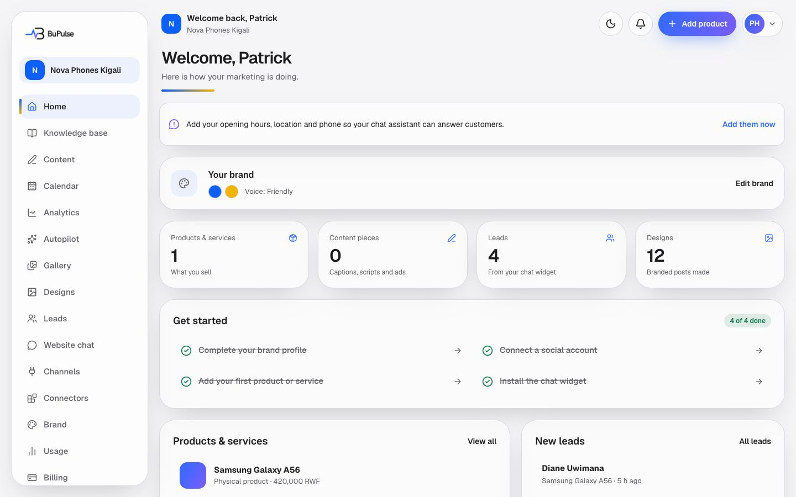
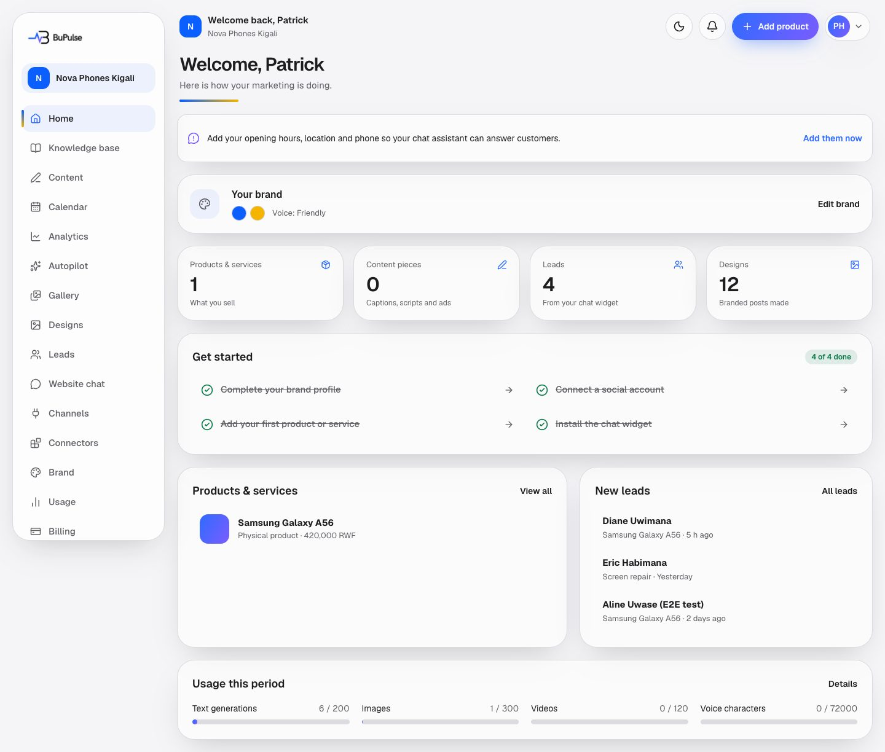
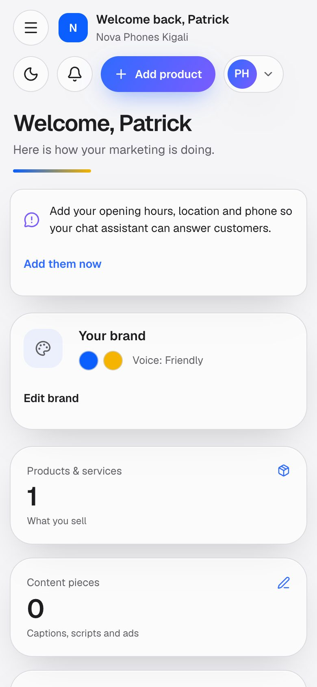

# Dashboard home

The first page a client sees after signing in. It greets them by name, shows their brand at a glance, counts what they
have made so far (products, content, leads, designs), lists the next set-up steps, shows the latest products and leads,
and shows how much of this month's plan they have used. Around every dashboard page sits the same frame: the menu on
the left, the bell for notices, the trial or plan banner and any message the BuPulse team has sent.

**Page:** `/dashboard`  **Plans:** every plan. Parts of the page follow the plan: the "Install the chat widget" step
only shows on plans with the website chat (feature key `websiteChat`, in Business), and menu items for features the
plan does not have move to an "Add to your plan" group.

## What you see

- **Welcome, (first name).** The name saved in Settings, or the Google name for Google sign-ups.
- **Reminder to add opening hours, location and phone.** Only for older accounts that are missing them. It links to
  step 4 on the Brand page so the website chat can answer customers. It never blocks anything.
- **Your brand.** The logo, up to five brand colours and the chosen voice, with **Edit brand** (owners and admins only).
- **Four counters.** Products and services, content pieces, leads and designs.
- **Get started.** A checklist: complete your brand profile, connect a social account, add your first product or
  service and, on plans with website chat, install the chat widget. Done steps are ticked and crossed out. A step the
  person is not allowed to do (a Member cannot connect channels) is shown without a link and says who to ask.
- **Products & services.** The three most recently changed products, with **View all**.
- **New leads.** The three newest leads from the website chat, with **All leads**.
- **Usage this period.** Bars for text generations, images, videos and voice characters, with **Details** (the Usage
  page). A metric the plan does not include says "Not in plan". When a paid plan has ended, the bars are greyed out
  and a line says nothing new can be made until a plan is chosen.

Around the page (on every dashboard page):

- **Menu.** On the left on a computer; on a phone it opens from **Menu** in the bottom bar. At the top a **+ Create**
  button (New post, New video, New design, Add photo) and **Home**, then the groups **Create** (Posts, Videos, Designs,
  Photos, Autopilot), **Publish** (Calendar, Channels, Link in bio), **Customers** (Inbox, Leads, Contacts,
  Automations, Website chat), **Results** (Analytics), **My business** (Business info, Brand) and **Account &
  settings** (Billing, Team, Usage, Settings, Connectors; folded until opened). Items the person's role cannot use are
  hidden; items the plan does not include are listed under **Add to your plan**. **Find a page** (also ⌘K / Ctrl+K),
  the plan name and the text-generation meter sit at the bottom. See [Finding your way](35-finding-your-way.md).
- **Phone bar.** On a phone: Home, Calendar, the big **+**, Inbox and Menu, always at the bottom.
- **Bell.** Notices that need attention, for example "Connect your apps so we can post for you" when posts are made
  for apps that are not connected yet.
- **Banners.** Messages (announcements) from the BuPulse team, a custom plan offer waiting to be accepted or paid, and
  the trial or plan banner: days left in the trial, "Payment failed", "Your plan ends on …", "You are close to a plan
  limit" or "Your plan has ended".
- **Light/dark switch** and the account menu with **Sign out**.

## Video

<video src="../videos/tour-dashboard.webm" controls muted width="100%"></video>

[Watch the clip](../videos/tour-dashboard.webm)

## How to use it

1. Sign in. You land on the home page.
2. Work down the **Get started** list: click a step to open the page where it is done.
3. Check **Usage this period** to see how much of the month's AI allowance is left. Click **Details** for the full
   picture.
4. Click a product or **View all** to go to Business info; click **All leads** to answer new customers.
5. Open the bell when it shows a dot, and follow its button (for example **Connect apps**).

## Limits and settings

- Nothing on this page uses up the plan. The usage bars only show what other pages used.
- Which menu items and checklist steps appear depends on the plan (Admin → Plans, `PlanDefinition.featureKeys`) and on
  the person's role (Owner, Admin, Member: see [Team, settings and brand](18-team-settings-and-brand.md)).
- Announcements are sent from **Admin → Announcements** and can target a plan.
- While a new company is waiting for its demo, every dashboard page shows only the demo screen; see
  [Sign-up, onboarding and account states](02-sign-up-onboarding-and-account-states.md).

## For developers

### Where it lives

| Part | Where |
|---|---|
| Page | `app/dashboard/page.tsx` (`DashboardPage`) |
| Frame for every dashboard page | `app/dashboard/layout.tsx` (`DashboardLayout`), `app/dashboard/loading.tsx`, `app/dashboard/error.tsx` |
| Server actions | none on this page (it only reads) |
| Components | `components/app/app-shell.tsx` (`AppShell`, `NoticesBell`), `components/app/nav.ts` (`NAV_ITEMS`, `FEATURE_ICONS`), `components/app/trial-banner.tsx` (`TrialBanner`), `components/app/announcement-banner.tsx`, `components/app/offer-banner.tsx`, `components/app/demo-lock.tsx`, `components/app/invoice-lock.tsx`, `components/business-info/essentials-banner.tsx` (`EssentialsBanner`), `components/publishing/auto-timezone.tsx` |
| Logic | `components/app/context.ts` (`getAppContext`), `lib/home-checklist.ts` (`homeChecklist`), `lib/widget/seen.ts` (`widgetInstalled`), `lib/usage.ts` (`getUsageSummary`), `lib/entitlements.ts` (`companyEntitlements`), `lib/team/roles.ts` (`can`, `askMessage`), `lib/team/company.ts` (`resolveCompany`), `lib/billing/period.ts` (`manualGrace`), `lib/content-board/queries.ts` (`missingApps`), `lib/admin/service.ts` (`getActiveAnnouncements`), `lib/offers/service.ts` (`clientOffer`), `lib/business-info/facts.ts` (`hasEssentials`) |
| Database | `Business`, `Subscription`, `UsageRecord`, `Membership`, `Product`, `GeneratedContent`, `Lead`, `Connection`, `Design`, `ChatWidget`, `CloudflareInstall`, `Announcement` |
| API routes | none |
| Cron jobs | none |
| Tests | `tests/team/home-checklist.test.ts`, `tests/business-info/essentials.test.ts`, `tests/widget/install.test.ts`, `tests/team/require-user.test.ts`, `e2e/app.spec.ts` (signed-out redirects) |
| Docs | [docs/PLANS.md](../../PLANS.md) (features and entitlements), [docs/REGIONS.md](../../REGIONS.md) (demo first) |

### Key functions

- `getAppContext` (components/app/context.ts) — loads the signed-in user, their company (through `Membership`), plan
  usage and entitlements once per request; also sends people to `/login`, `/suspended`, `/account/deletion`,
  `/account/waiting`, `/welcome`, `/onboarding` or `/book-demo` when they are not ready for the dashboard.
- `DashboardLayout` (app/dashboard/layout.tsx) — shows `DemoLock` or `InvoiceLock` while the status is `PENDING_DEMO`;
  otherwise builds the shell, the bell notices, the banners and the trial label.
- `DashboardPage` (app/dashboard/page.tsx) — counts products, content, leads, connections and designs, and builds the
  stats, checklist and usage meters.
- `homeChecklist` (lib/home-checklist.ts) — the "Get started" steps; pure, tested for plan and role rules.
- `widgetInstalled` (lib/widget/seen.ts) — the widget step is done once the widget loaded on an allowed site or was
  installed through Cloudflare.
- `getUsageSummary` (lib/usage.ts) — used and allowed amounts for text, image, videos, voice characters and chat.
- `companyEntitlements` (lib/entitlements.ts) — `inPlan` (plan features), `usable` (plan features whose services are
  on) and `block` (pending demo, trial ended, past due, inactive).
- `featureForRoute` (lib/features.ts) — maps a menu link to its feature, so the sidebar can hide or move it.
- `navFor`, `createActions`, `bottomBarItems` (components/app/nav.ts) — the grouped menu, + Create and the phone bar
  for a role and plan ([35-finding-your-way.md](35-finding-your-way.md)).
- `missingApps` (lib/content-board/queries.ts) — the apps posts are made for that are not connected (the bell notice).
- `manualGrace` (lib/billing/period.ts) — for Mobile Money and custom plans, the grace days after the period ended.
- `getActiveAnnouncements` (lib/admin/service.ts) — the admin's live announcements for this user and plan.
- `hasEssentials` (lib/business-info/facts.ts) — whether hours, location and phone are set (the reminder banner).

### How it works

1. The browser opens `/dashboard`. `DashboardLayout` and `DashboardPage` both call `getAppContext` (deduplicated by
   React `cache`).
2. `getAppContext` reads the Supabase session (`getCurrentUser`), finds the company with `resolveCompany`, loads
   `Business` and `getUsageSummary`, and redirects if the account is suspended, being deleted, not set up or waiting
   for a demo.
3. The layout reads `companyEntitlements(business.id)`; `AppShell` uses `inPlan` to hide or move menu items.
4. The page runs a set of `prisma.*.count` and `findMany` queries in parallel and renders the cards.
5. `homeChecklist` turns the counts, the plan and the role into the step list.

## If something goes wrong

| Symptom | First place to look | Usual fix |
|---|---|---|
| Client is sent to `/welcome` or `/onboarding` every time | Admin → Companies (the company's set-up dates); `getAppContext` in `components/app/context.ts` (`detailsCompletedAt`, `onboardedAt`) | Let the owner finish the organisation details and brand steps. |
| Dashboard only shows the demo screen | Admin → Demos; `DashboardLayout` (`pendingDemo`) | Start the trial or activate a plan for the company in the admin console. |
| A menu item is missing | Admin → Plans (the plan's features); `featureForRoute` in `lib/features.ts`, `NAV_ITEMS` in `components/app/nav.ts`; the role in `lib/team/roles.ts` | Add the feature to the plan, or give the person the right role. |
| "Install the chat widget" never gets ticked | Website chat page check; `widgetInstalled` in `lib/widget/seen.ts` | Check the website is in the allowed domains and the widget code is on the page. |
| Usage bars look wrong | Admin → Usage; `getUsageSummary` in `lib/usage.ts` | Check the period dates on the subscription; limits come from the plan in Admin → Plans. |
| Page shows "Something went wrong" | Admin → Errors; `app/dashboard/error.tsx` | Look at the logged error; most often the database could not be reached. |
