# Knowledge base

Everything BuPulse knows about a business, in one place: the company profile, what it sells (products and
services), its campaigns (events, offers, launches), where and when it is open, its customers, its competitors, its
FAQs and policies, its customer reviews, and its "digital marketing profile" (a short AI interview about how the
brand should sound). The AI writers, Autopilot, designs and the website chat all read from here, so the better this
is filled in, the better every post and chat answer is.

**Page:** `/dashboard/knowledge` (and its sections below)  **Plans:** the landing page, company profile, locations,
FAQs and policies are on every plan. Products, campaigns, customers, competitors, reviews and the interview need the
AI content feature (feature key `content`), which Starter and Business both include.

## What you see

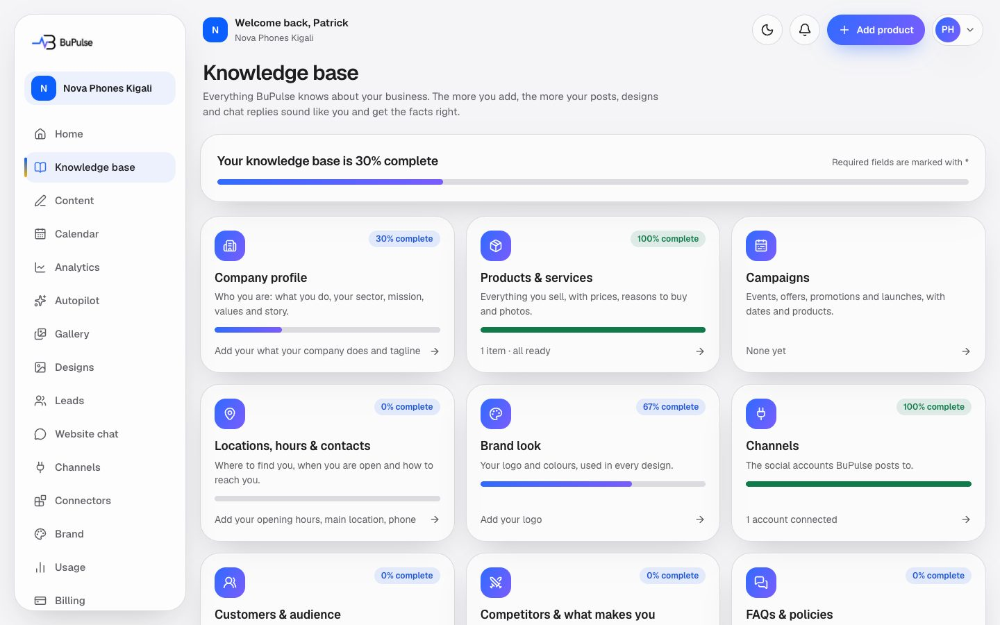

The landing page has one card per section, each with how complete it is and a one-line summary, and an overall
percentage at the top. A card says "Add to your plan" when the plan does not include it, and "Admins edit" when the
person's role may only look.

| Section | Page | What it holds |
|---|---|---|
| Company profile | `/dashboard/knowledge/profile` | Name, tagline, what you do, sector, mission, vision, values, achievements, year founded, size, legal name, TIN, website, area served, languages. |
| Products & services | `/dashboard/knowledge/products` | Everything you sell: physical, digital or a service, with price, selling points, photos. |
| Campaigns | `/dashboard/knowledge/campaigns` | Events, offers, promotions and launches, with dates and linked products. |
| Locations, hours & contacts | `/dashboard/knowledge/locations` | Opening hours, head office and branches, phone and WhatsApp. |
| Brand look | `/dashboard/brand` | Logo, colours, voice (see [Team, settings and brand](18-team-settings-and-brand.md)). |
| Channels | `/dashboard/connections` | Connected social accounts (see [Social connections](13-social-connections.md)). |
| Customers & audience | `/dashboard/knowledge/audience` | Customer types ("personas"): age, place, needs, pains, where they are online. |
| Competitors & what makes you different | `/dashboard/knowledge/competitors` | Competitors, what makes you different, a positioning sentence. |
| FAQs & policies | `/dashboard/knowledge/faqs` | Questions and answers; payment methods; delivery, returns, warranty and booking policies. |
| Reviews & testimonials | `/dashboard/knowledge/reviews` | Customer quotes, with a switch "The customer agreed to be quoted". |
| Digital marketing profile | `/dashboard/knowledge/interview` | A short AI interview that ends in an approved brand-voice guide. |

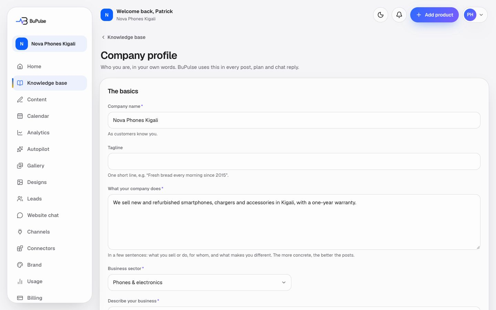

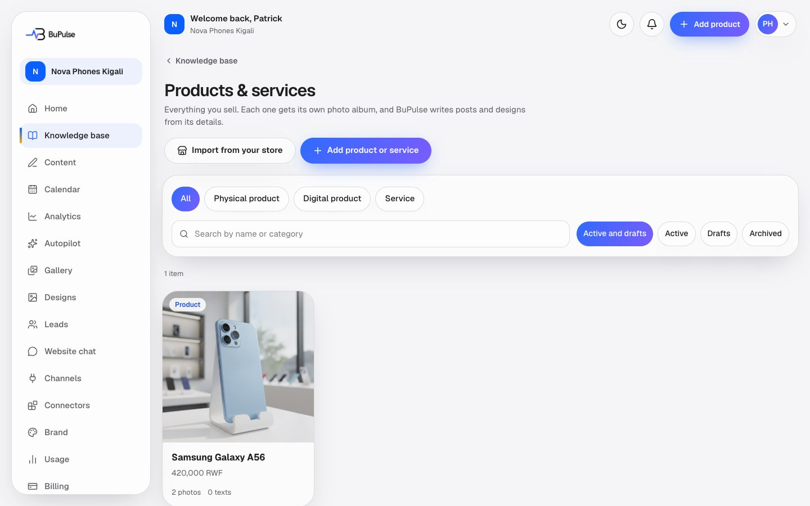

The products list filters by kind, status and a search, and shows "Needs details" with what is missing (a reason to
choose it, a price, a photo).

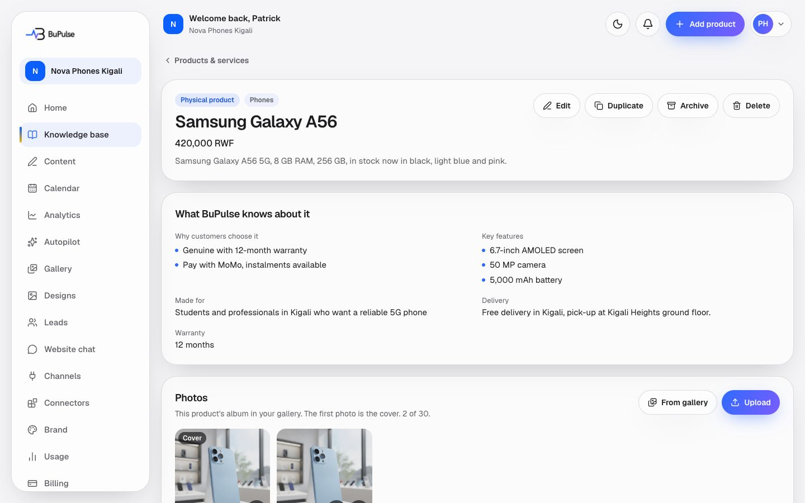

A product's page shows its facts, its photo album (upload, add from the gallery, choose the cover, remove) and a link
**See this product's content**. Buttons: Edit, Duplicate, Archive / Restore, Delete.

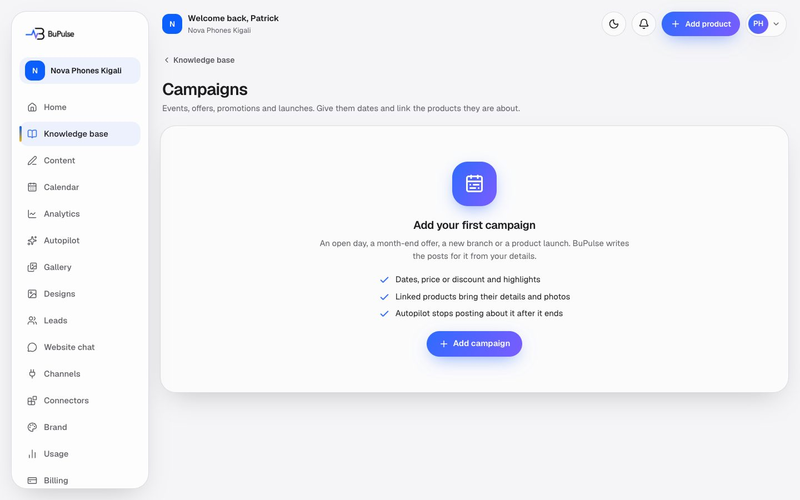

Campaigns show whether they are upcoming, on now or ended.

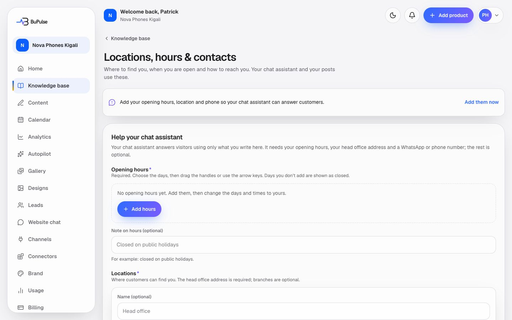

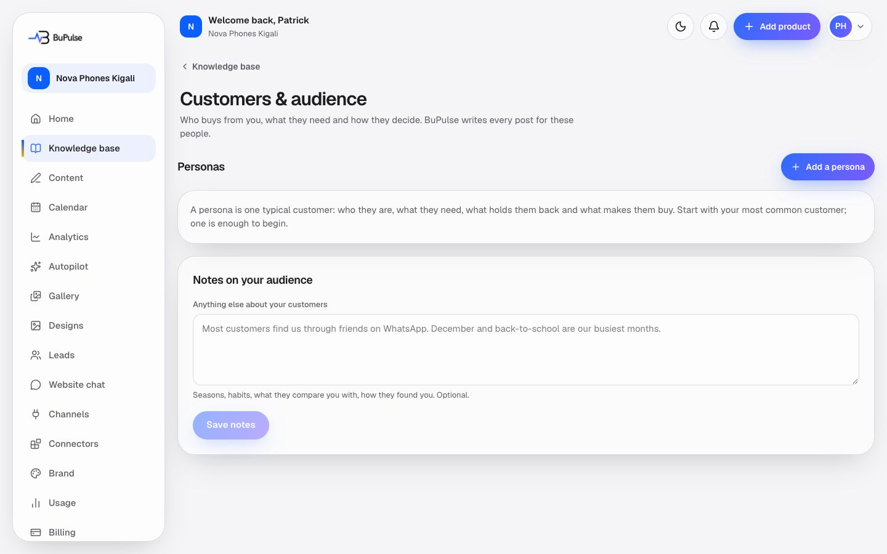

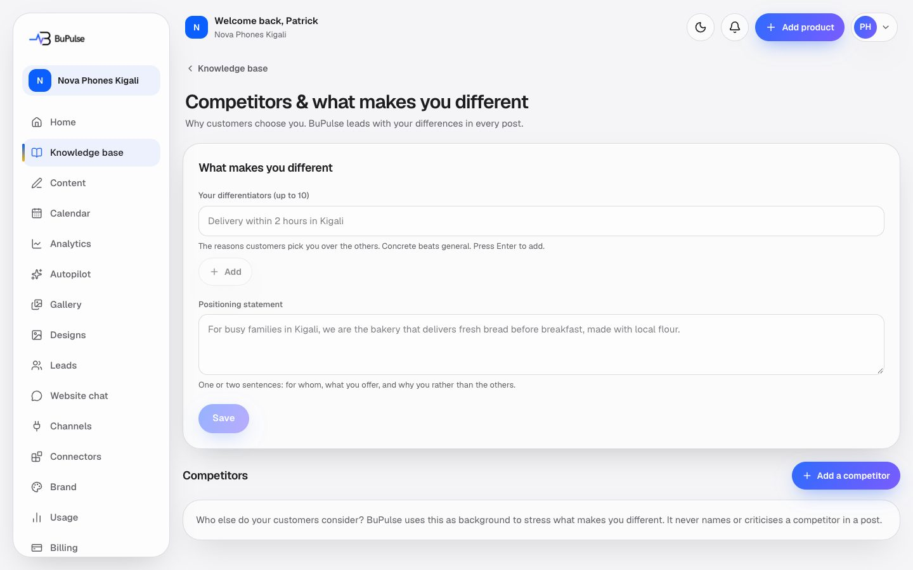

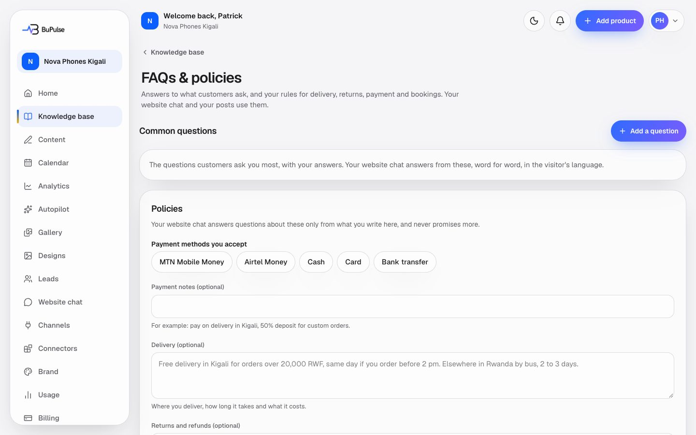

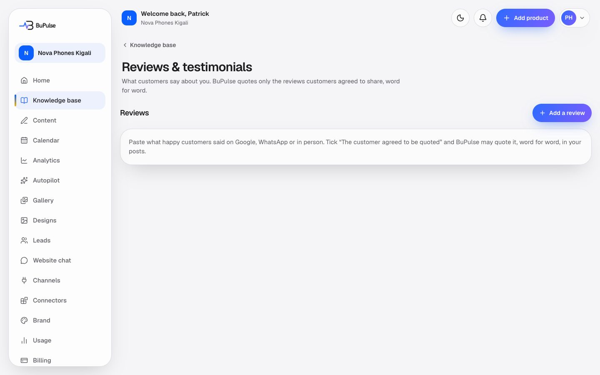

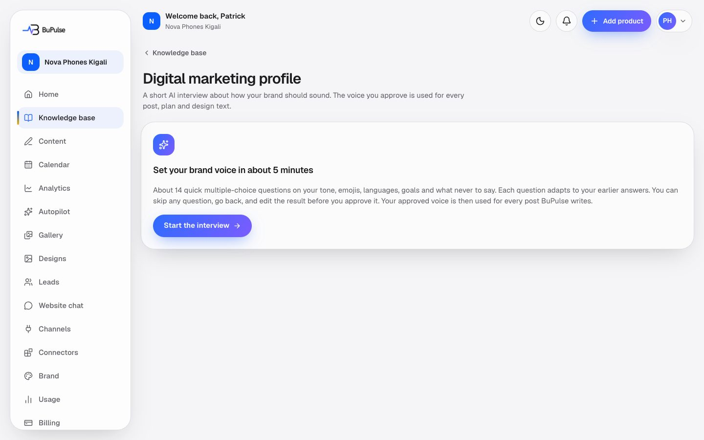

The interview shows one question at a time with answer chips and an "Other" box, plus **Skip** and **Back**. At the
end it shows a draft brand-voice guide (voice, do, don't, three sample captions) to edit and approve.

## Video

<video src="../videos/knowledge.webm" controls muted width="100%"></video>

[Watch the clip](../videos/knowledge.webm)

## How to use it

1. Open **Business info** in the menu (it used to be called Knowledge base). Start with the cards that show the lowest percentage.
2. **Company profile:** fill in at least the name, what the company does and the sector, then **Save**.
3. **Products & services:** click **Add**, pick physical, digital or service, enter the name, a short description,
   the price (or "on request") and at least one reason customers choose it. Add photos to its album.
4. **Campaigns:** add an event or offer with its dates and the products it is about.
5. **Locations, hours & contacts:** set the opening hours, the head office (search the address) and a phone or
   WhatsApp number. The website chat needs these to answer customers.
6. **FAQs & policies:** add the questions customers ask most, and the payment, delivery and returns rules. The chat
   gives these to visitors as the business's answers.
7. **Reviews:** paste customer quotes. Tick "The customer agreed to be quoted" only when they did: only those are
   used in posts.
8. **Digital marketing profile:** answer about 14 short questions, then edit and **Approve** the brand-voice guide.
   From then on every writer uses it instead of the voice chosen on the Brand page.
9. To make posts for a product or campaign, use **See this product's content** (see
   [Projects and content](04-projects-and-content.md)).

## Limits and settings

- Saving the knowledge base does not use the plan's AI allowance. The interview does use AI, counted in the
  company's monthly AI allowance, at most 60 AI questions an hour and 40 a day per company; when the AI is not
  available it falls back to a fixed set of questions. "Start over" is limited to 3 times a day.
- Caps per company: 500 products, 300 campaigns, 30 photos per album, 12 personas, 20 competitors, 200 FAQs, 300
  reviews. Saves are rate-limited per hour.
- Roles: products, campaigns, customers, competitors and reviews can be edited by Members too. The company profile,
  locations, FAQs, policies, the interview and the "agreed to be quoted" switch are for Owners and Admins only.
- Archived products stay with their content but are left out of Autopilot, the website chat and pickers. Deleting a
  product removes its texts; its photos stay in the gallery; designs and posts keep existing.
- Imported store products (Shopify, WooCommerce) appear here as physical products; see
  [Online stores](15-online-stores.md).

## For developers

### Where it lives

| Part | Where |
|---|---|
| Pages | `app/dashboard/knowledge/page.tsx` (landing), `profile/page.tsx`, `products/page.tsx`, `products/new/page.tsx`, `products/[id]/page.tsx`, `products/[id]/edit/page.tsx`, `campaigns/page.tsx`, `campaigns/new/page.tsx`, `campaigns/[id]/page.tsx`, `campaigns/[id]/edit/page.tsx`, `locations/page.tsx`, `audience/page.tsx`, `competitors/page.tsx`, `faqs/page.tsx`, `reviews/page.tsx`, `interview/page.tsx` (all under `app/dashboard/knowledge/`) |
| Server actions | `app/dashboard/knowledge/actions.ts` (`generateContent`, `saveEditedContent`, `addToAlbum`, `removeFromAlbum`, `setAlbumCover`, `getPhotoAlbums`, `setPhotoProductsAction`), `products/actions.ts`, `campaigns/actions.ts`, `profile/actions.ts` (`saveProfile`), `audience/actions.ts`, `competitors/actions.ts`, `faqs/actions.ts`, `reviews/actions.ts`, `interview/actions.ts` (`startInterview`, `answerQuestion`, `previousQuestion`, `approveVoice`) |
| Components | `components/knowledge/*` (`product-form.tsx`, `product-grid.tsx`, `campaign-form.tsx`, `album-card.tsx`, `profile-form.tsx`, `persona-editor.tsx`, `competitor-editor.tsx`, `faq-editor.tsx`, `review-editor.tsx`, `interview.tsx`, `item-actions.tsx`, `subject-content-link.tsx`, `section-icons.ts`, `progress.tsx`, `back-link.tsx`), `components/business-info/*` (hours, locations, contacts editors, `place-search.tsx`), `components/brand-profile/brand-section.tsx` |
| Logic | `lib/knowledge/sections.ts` (`KNOWLEDGE_SECTIONS`, `overallPercent`), `lib/knowledge/overview.ts` (`knowledgeProgress`), `lib/knowledge/guard.ts` (`knowledgeAction`), `lib/knowledge/service.ts`, `lib/knowledge/products.ts`, `lib/knowledge/campaigns.ts`, `lib/knowledge/profile.ts`, `lib/knowledge/policies.ts`, `lib/knowledge/audience.ts`, `lib/knowledge/competitors.ts`, `lib/knowledge/reviews.ts`, `lib/knowledge/records.ts`, `lib/knowledge/interview.ts`, `lib/knowledge/interview-service.ts`, `lib/knowledge/context.ts`, `lib/knowledge/writer-context.ts`, `lib/knowledge/legacy.ts`, `lib/business-info/*`, `lib/media/albums.ts`, `lib/media/destinations.ts` |
| Database | `Business` (`profile`, `knowledge`, `policies`, `positioning`, `audienceNotes`, `marketingProfile`), `Product`, `ProductPhoto`, `Campaign`, `CampaignProduct`, `CampaignPhoto`, `Persona`, `Competitor`, `KnowledgeFaq`, `Testimonial`, `MarketingInterview`, `MediaAsset` |
| API routes | `app/api/v1/products/route.ts`, `app/api/v1/products/[id]/route.ts`, `app/api/v1/campaigns/route.ts`, `app/api/v1/campaigns/[id]/route.ts` (read-only, see [Connectors, API and webhooks](14-connectors-api-and-webhooks.md)); `app/api/places/autocomplete/route.ts`, `app/api/places/details/route.ts` (address search) |
| Cron jobs | none (store products are re-synced by `/api/cron/store-sync`, see [Online stores](15-online-stores.md)) |
| Tests | `tests/knowledge/*.test.ts` (`products`, `campaigns`, `profile`, `context`, `legacy`, `records`, `actions`, `part2`, `part2-actions`, `interview`, `destinations`, `generate-route`), `tests/business-info/*.test.ts` |
| Docs | [docs/KNOWLEDGE_BASE.md](../../KNOWLEDGE_BASE.md), [docs/BUSINESS_INFO.md](../../BUSINESS_INFO.md) |

### Key functions

- `KNOWLEDGE_SECTIONS` (lib/knowledge/sections.ts) — the list of sections (title, href, ready or coming soon, plan
  feature, role permission) that the landing page draws.
- `knowledgeProgress` (lib/knowledge/overview.ts) — each section's completeness and summary line.
- `knowledgeAction` (lib/knowledge/guard.ts) — wraps every save: role, plan feature, rate limit, readable errors.
- `createProduct` / `updateProduct` / `duplicateProduct` / `deleteProduct` (lib/knowledge/service.ts) — product
  writes; `productInputSchema` (lib/knowledge/products.ts) validates the form and the action.
- `productReadiness` (lib/knowledge/products.ts) — what a product still needs ("Needs details").
- `toMinor` / `formatPrice` / `parsePriceText` (lib/knowledge/products.ts) — prices stored in the smallest unit.
- `createCampaign` / `updateCampaign` (lib/knowledge/service.ts) and `campaignPhase` (lib/knowledge/campaigns.ts) —
  campaigns and their upcoming / on now / ended state.
- `writingSubject` (lib/knowledge/service.ts) — everything a writer needs about one product or campaign.
- `productContext` / `campaignContext` / `profileContext` / `faqContext` / `voiceProfileContext`
  (lib/knowledge/context.ts) — the fenced, size-limited text blocks given to the AI.
- `writerKnowledge` (lib/knowledge/writer-context.ts) — customers, positioning, quotable reviews and policies in one
  load for the writers.
- `startInterview` / `answerStep` / `approveProfile` (lib/knowledge/interview-service.ts) — the AI interview and the
  approved `Business.marketingProfile`.
- `mapLegacyProject` (lib/knowledge/legacy.ts) — how old Projects became products and campaigns.

### How it works

1. The owner saves a form → the page's server action → `knowledgeAction` checks role, feature and rate limit → the
   `lib/knowledge/service.ts` function writes the Prisma row (`Product`, `Campaign`, …) or the `Business` JSON column.
2. Photos go to the gallery (`MediaAsset`) and are linked to the album (`ProductPhoto` / `CampaignPhoto`) through
   `lib/media/albums.ts`.
3. When content is written (Content page, Autopilot), `writingSubject` and `writerKnowledge` build the context
   blocks, which are passed to the AI writer (`lib/studio/service.ts`, `lib/autopilot/writer.ts`).
4. The website chat reads FAQs, policies, products and campaigns for its answers (`lib/widget/config.ts`,
   `lib/widget/prompt.ts`).
5. The interview: `answerQuestion` → `answerStep` saves the answer, then asks the cheap AI model for the next question
   (`getCheapTextProvider` in `lib/ai/index.ts`, through the AI ledger) or uses the fixed one.

## If something goes wrong

| Symptom | First place to look | Usual fix |
|---|---|---|
| A section says "Add to your plan" | Admin → Plans (feature `content`); `KNOWLEDGE_SECTIONS` in `lib/knowledge/sections.ts` | Add the feature to the company's plan. |
| Member cannot edit the profile or FAQs | `lib/team/roles.ts` (`settings` permission) | Expected: an Owner or Admin edits these. |
| "You're doing that a lot. Please try again in N minutes." | `knowledgeAction` in `lib/knowledge/guard.ts`; `RATE_LIMITS` in `lib/rate-limit.ts` | Wait the minutes shown, or check for a script hammering the page. |
| Product keeps showing "Needs details" | `productReadiness` in `lib/knowledge/products.ts` | Add a selling point, a price (or "on request") and a photo. |
| Price saved wrong (RWF with decimals refused) | `toMinor` in `lib/knowledge/products.ts` | Type whole francs for RWF. |
| Address search does not find anything | `app/api/places/autocomplete/route.ts`; Admin → Services (Google Places key) | Set the Places key, or type the address by hand. |
| Interview says "standard questions" | Admin → AI (AI usage and budget); `answerStep` in `lib/knowledge/interview-service.ts` | The AI was off, over budget or over the daily cap; the fixed questions still work. |
| A review is never used in posts | `Testimonial.canPublish`; `reviewsContext` in `lib/knowledge/context.ts` | An Owner or Admin ticks "The customer agreed to be quoted". |
| Old `/dashboard/projects/...` link | `app/dashboard/projects/[id]/page.tsx` | It redirects to the product or campaign; see [Projects and content](04-projects-and-content.md). |
