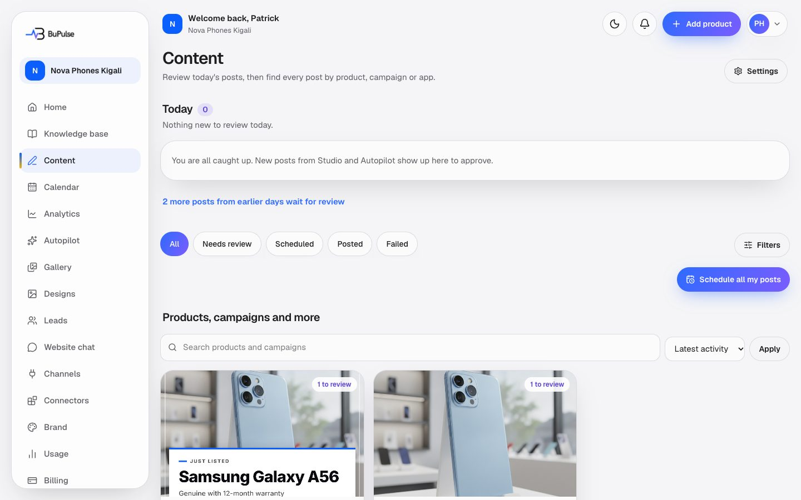
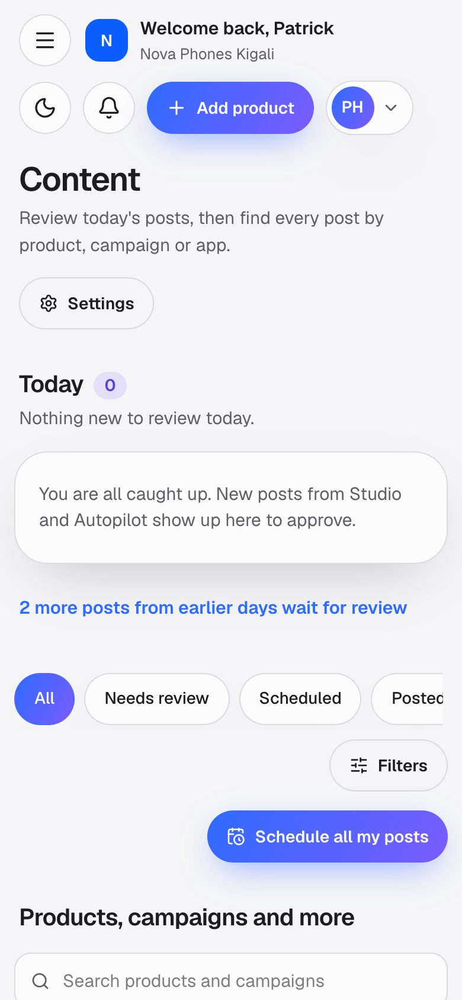
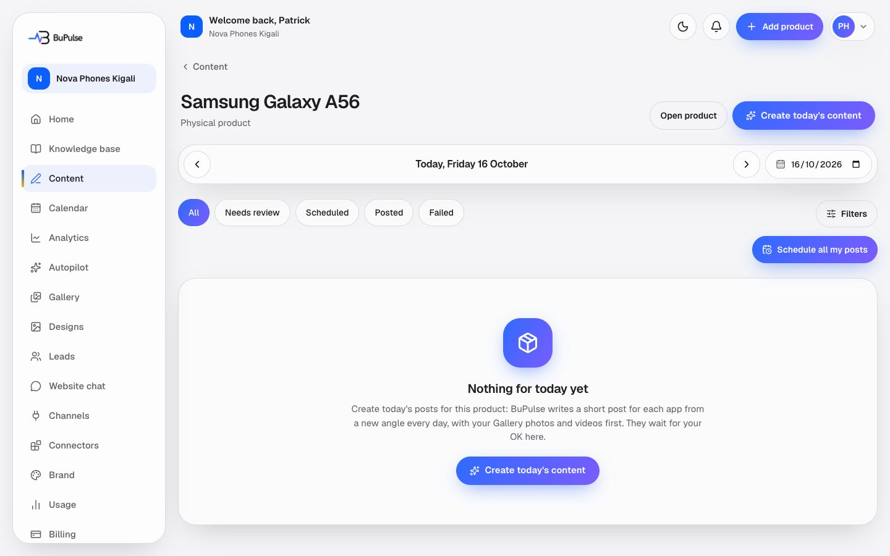
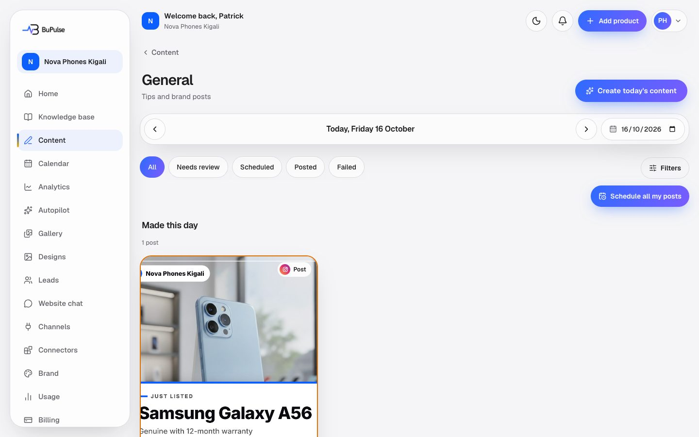
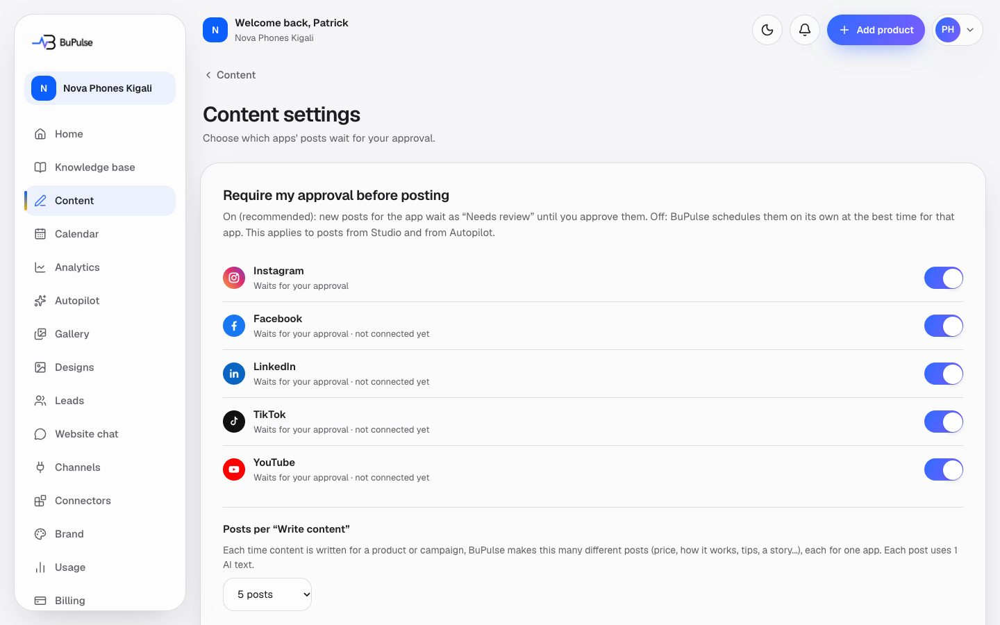
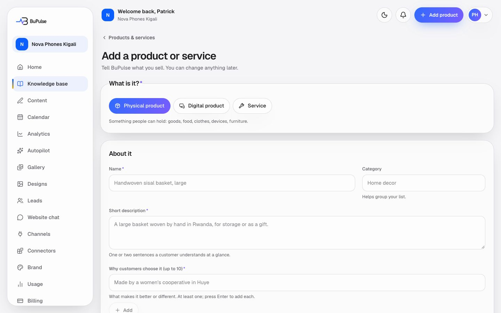

# Projects and content

The Posts page (**Posts** in the menu, once called Content) is where posts are made, reviewed and found. Every post belongs to a product, a campaign or
"General". BuPulse writes the caption and hashtags, a 30-second video script and three ad headlines for each post,
in the business's language and voice, picks a picture or video for it, and lets the owner approve it, change the
words, generate it again or go back to an earlier version. "Projects" is the old name: products and campaigns used to
be "projects", and old project links now open the product or campaign in the Knowledge base.

**Page:** `/dashboard/content` (and `/dashboard/content/products/[id]`, `/dashboard/content/campaigns/[id]`,
`/dashboard/content/general`, `/dashboard/content/settings`); old `/dashboard/projects*` links redirect
**Plans:** AI content (feature key `content`) on Starter and Business; the day view, "Create today's content" and every
post action also need Calendar and scheduling (feature key `calendar`), also in both plans. AI photos (`aiPhotos`) and
videos (`video`, `voice`) are in Business only.

## What you see

- **Today.** Posts made today that wait for review, each with **Approve** (scheduled at the best time for its app),
  **Edit** and **Reject**, plus **Approve all**.
- **Auto-scheduled notice.** How many posts were scheduled on their own in the last 24 hours, with a link to them.
- **Connect your apps** banner when posts are made for apps that are not connected yet.
- **Filters.** Status chips (All, Needs review, Scheduled, Posted, Failed) and a **Filters** sheet (app, post type,
  status, auto-scheduled, date).
- **Grid.** One card per product, one per campaign and a **General** card (posts tied to neither), each with a
  cover and counts: needs review, scheduled, posted, failed. Search and sort at the top.

A product, campaign or General page opens on **today**: "Needs your OK", "Goes out this day" and "Made this day",
with a date bar to go back (what was made or posted) or forward (what is scheduled). Each card shows the picture,
carousel or video, the app, the post type, the first lines of the caption, a status, and an amber "Not posted yet"
border with the reason. **Create today's content** and **Schedule all my posts** are on this page. Below the posts,
**Pictures and videos** shows the day's visuals, drawn in the browser while they are pending.

Opening a post shows its preview and buttons (Approve, Move, Back to review, Edit, Duplicate, Delete), the video
script and the three headlines with **Copy**, **Generate again** (whole post, caption, script or headlines) and
**Versions** (every earlier wording, with **Restore**).

**Content settings** has one switch per app: "Require my approval before posting". All are on by default.

Old project pages (`/dashboard/projects`, `/dashboard/projects/new`, `/dashboard/projects/<id>`) now open the Knowledge
base: Products & services, "Add a product or service" and the product's page.

## Video

<video src="../videos/content-post.webm" controls muted width="100%"></video>

[Watch the clip](../videos/content-post.webm)

## How to use it

Make today's posts for a product:

1. Open **Posts** and click the product's card (or **See this product's content** on its Business info page).
2. Click **Create today's content**.
3. Choose how:
   - **AI makes it for me:** BuPulse picks the ideas, writes one post per app and finds pictures.
   - **I'll create it → Describe today's content:** type what you want ("Promote the new phone for students this
     week") and, if you like, pick photos.
   - **I'll create it → Bring my own:** pick your photos or video and write one caption; BuPulse adapts it per app.
4. Choose the apps, how many posts per app, the price choice (AI decides, with price, no price), the format (let
   BuPulse decide, mostly video, mostly pictures) and the pictures (AI designs with people, or free templates).
5. Read the line that says what the run uses ("Uses 3 text generations, up to 1 AI image…") and confirm.
6. The posts appear under "Needs your OK". Pictures and videos finish drawing below.

Review and change a post:

1. Click a post. Read the caption, script and headlines.
2. To change the words, click **Edit** and type; or click **Generate again** and choose what to rewrite.
3. If you prefer an earlier wording, open **Versions** and click **Restore**.
4. Click **Approve**. BuPulse puts it at the best free time for that app (see
   [Calendar and publishing](07-calendar-and-publishing.md)).
5. Or click **Schedule all my posts** to place every waiting post at once ("Schedule for me" or "I'll choose times").

A contest post ("make the best video about us") cannot go out until an Owner or Admin fills in the prize, the end
date and how the winner is chosen, and ticks "I will give this prize to the winner".

To let some apps post without asking, open **Posts → Settings** and switch off "Require my approval" for them.

## Limits and settings

- **Text generations:** one per post written, one per Generate again. Reserved when a run starts; the ones not used
  are given back. A run that needs more than is left is refused before anything is charged. Starter 60 a month,
  Business 200 (Admin → Plans can change this).
- **AI images:** at most one per designed post, only on plans with AI photos (Business: 100 a month).
- **Videos:** BuPulse-made videos count one of the plan's videos each (up to 30 seconds, 4 a day), plus up to 600
  voice characters each with voiceover; at most 5 videos per run. See [Videos and voiceover](09-videos-and-voiceover.md).
- **Posts per app per day:** the plan's "posts per app per day" (1 to 10; set in Admin → Plans or a custom plan).
- **One run at a time** per company; 30 runs an hour; 60 Generate again an hour.
- **Versions:** the newest 50 per post are kept.
- **Roles:** Members can make, edit, approve and reject posts. Only Owners and Admins change Content settings and
  confirm contests.
- **Daily email:** from 08:00 business time, the Owner and Admins who chose alerts get "N posts were scheduled for
  you" when auto-approval scheduled posts.
- The company's monthly AI allowance (in dollars, set per plan) also applies to every AI call.

## For developers

### Where it lives

| Part | Where |
|---|---|
| Pages | `app/dashboard/content/page.tsx`, `app/dashboard/content/products/[id]/page.tsx`, `app/dashboard/content/campaigns/[id]/page.tsx`, `app/dashboard/content/general/page.tsx`, `app/dashboard/content/settings/page.tsx`; redirects in `app/dashboard/projects/page.tsx`, `app/dashboard/projects/new/page.tsx`, `app/dashboard/projects/[id]/page.tsx`, `app/dashboard/projects/[id]/[...rest]/page.tsx` |
| Server actions | `app/dashboard/content/actions.ts` (`saveContentSettingsAction`, `createPostsFromContentAction`, `previewScheduleAction`, `scheduleAllAction`, `previewVoiceAction`), `app/dashboard/content/day-actions.ts` (`createDayContentAction`, `confirmContestAction`), `app/dashboard/content/post-actions.ts` (`loadPostWritingAction`, `regeneratePostAction`, `restorePostVersionAction`, `editPostWordsAction`), `app/dashboard/calendar/actions.ts` (`approvePostsAction`, `updatePostAction`, `unschedulePostAction`, `deletePostAction`, `connectByHandPostsAction`, …), `app/dashboard/knowledge/actions.ts` (`generateContent`, `saveEditedContent`) |
| Components | `components/content-board/*` (`today-review.tsx`, `filter-bar.tsx`, `subject-grid.tsx`, `subject-page.tsx`, `post-board.tsx`, `post-card.tsx`, `schedule-all.tsx`, `settings-form.tsx`, `connect-apps-banner.tsx`, `content-actions.tsx`), `components/content-flow/*` (`create-day-dialog.tsx`, `day-bar.tsx`, `day-visuals.tsx`, `post-writing.tsx`, `contest-confirm.tsx`), `components/publishing/post-detail.tsx`, `components/publishing/composer.tsx` |
| Logic | `lib/content-flow/` (`service.ts` `runDayContent`, `format.ts`, `media.ts`, `networks.ts`, `price.ts`, `contest.ts`, `cost.ts`, `slots.ts`, `variety.ts`, `day.ts`, `queries.ts`, `writer.ts`, `post-writing.ts`, `post-versions.ts`, `versions.ts`, `autopilot.ts`), `lib/content-board/` (`queries.ts`, `filters.ts`, `grouping.ts`, `drafts.ts`, `auto.ts`, `rules.ts`, `schedule-all.ts`, `connect.ts`, `by-hand.ts`, `settings.ts`, `settings-service.ts`, `summary.ts`), `lib/studio/` (`angles.ts`, `pack.ts`, `headlines.ts`, `service.ts`, `variants.ts`), `lib/ai/pack.ts` (`writePack`), `lib/ai/marketing.ts` (`generateMarketingContent`), `lib/publishing/service.ts` (`approvePosts`, `claimSlot`), `lib/publishing/best-time.ts` (`bestTime`), `lib/visuals/service.ts` (`attachToContent`) |
| Database | `GeneratedContent` (`angle`, `network`, `format`, `forDate`, `mode`, `brief`, `postsDraftedAt`), `Post` (`status`, `source`, `reviewNote`, `autoScheduledAt`, `ownerEditedAt`, `remindOnly`, `contest`, `mediaKind`), `PostVersion`, `Business` (`contentSettings`, `contentLanguage`, `contentRunUntil`, `contentSummarySentAt`), `UsageRecord`, `AiCall` |
| API routes | `app/api/generate/route.ts` (write content for a product or campaign), `app/api/v1/content/route.ts`, `app/api/v1/content/[id]/route.ts`, `app/api/v1/projects/route.ts` (old shape, deprecated) |
| Cron jobs | `app/api/cron/content-summary/route.ts` (hourly at :07, `CONTENT_SUMMARY_CRON` in `worker-crons.ts`, `netlify/functions/cron-content-summary.mts`) |
| Tests | `tests/content-flow/*.test.ts`, `tests/content-board/*.test.ts`, `tests/studio/angles.test.ts`, `tests/studio/pack.test.ts`, `tests/studio-service.test.ts`, `tests/publishing/best-time.test.ts`, `tests/knowledge/generate-route.test.ts` |
| Docs | [docs/CONTENT.md](../../CONTENT.md), [docs/CONTENT_PACKS.md](../../CONTENT_PACKS.md), [docs/CONTENT_VISUALS.md](../../CONTENT_VISUALS.md) |

### Key functions

- `runDayContent` (lib/content-flow/service.ts) — "Create today's content": claims the company
  (`claimDayRun`), reserves credits, picks angles, formats and media, writes the pack and saves one
  `GeneratedContent` and one `Post` per post.
- `chooseAngles` / `spreadNetworks` (lib/studio/angles.ts) — which ideas, on which apps, rotating so posts differ.
- `decideFormats` (lib/content-flow/format.ts) — picture, carousel or video per app, within the plan's videos.
- `writePack` (lib/ai/pack.ts) — one AI call that writes every post of the run.
- `fitToNetwork` (lib/content-flow/networks.ts) — holds each caption to its app's length, hashtags and emoji rules.
- `adaptOwnPost` (lib/content-flow/writer.ts) — "Bring my own": adapts the owner's caption per app.
- `runCost` (lib/content-flow/cost.ts) — the "Uses N text generations…" line shown before confirming.
- `rewritePost` / `restorePostVersion` / `editPostWords` (lib/content-flow/post-writing.ts) — Generate again,
  Restore and editing the words, each keeping a `PostVersion` (`addVersion` in lib/content-flow/post-versions.ts).
- `exactlyThreeHeadlines` (lib/studio/headlines.ts) — the three ad headlines rule.
- `confirmContest` (lib/content-flow/service.ts) and `contestBlocked` (lib/content-flow/contest.ts) — contest posts
  wait until prize and rules are confirmed.
- `approvePosts` / `claimSlot` (lib/publishing/service.ts) — schedule at the best free time, 2.5 hours apart per
  account.
- `autoSchedule` (lib/content-board/auto.ts) and `autoDecision` (lib/content-board/rules.ts) — auto-approval for
  apps that skip approval, with the safety rules.
- `scheduleAll` (lib/content-board/schedule-all.ts) — "Schedule all my posts".
- `parseContentFilters` / `contentWhere` (lib/content-board/filters.ts) — URL filters to one Prisma `where`.
- `draftPostsFromContent` (lib/content-board/drafts.ts) — drafts posts per app when content is written through
  `/api/generate`.

### How it works

1. Owner clicks **Create today's content** → `createDayContentAction` (app/dashboard/content/day-actions.ts) →
   `runDayContent`.
2. `runDayContent` claims `Business.contentRunUntil`, reserves text credits (`consumeUsage` in lib/usage.ts), reads
   the Knowledge base (`writingSubject`, `writerKnowledge`), chooses angles and formats, and calls `writePack`
   (Gemini or Claude through the AI ledger).
3. It saves `GeneratedContent` rows and `Post` rows (`PENDING_APPROVAL`), then plans the pictures and videos
   (`lib/visuals/`), which are drawn in the browser and attached with `attachToContent`.
4. `autoSchedule` schedules posts for apps that skip approval; others wait for **Approve** (`approvePostsAction` →
   `approvePosts` → `claimSlot`).
5. The publish cron sends scheduled posts at their time ([Calendar and publishing](07-calendar-and-publishing.md)).
6. Every word change goes through `lib/content-flow/post-writing.ts`, which writes a `PostVersion`.

## If something goes wrong

| Symptom | First place to look | Usual fix |
|---|---|---|
| "Already making today's content…" | `claimDayRun` in `lib/content-flow/service.ts` (`Business.contentRunUntil`) | Wait a moment; a run that died is released after 5 minutes. |
| Run refused: not enough text generations | Usage page; `runCost` in `lib/content-flow/cost.ts` | Fewer posts per run, or more texts (upgrade or add features). |
| "Your monthly AI allowance is reached" | Admin → Companies (client view, Usage tab); `lib/ai/budget.ts` | It renews on the 1st; the plan's AI allowance is in Admin → Plans. |
| AI writing fails for everyone | Admin → Services (Gemini, Claude switches and keys); Admin → AI; Admin → Errors | Switch the provider back on or fix its key. |
| Post stays in review with "Video needs to be made" | The post's product/campaign day view (Pictures and videos); `autoDecision` in `lib/content-board/rules.ts` | Open the day view so the browser renders the video. |
| Post stays in review with "Connect this app in Channels first" | Channels page; `missingApps` in `lib/content-board/queries.ts` | Connect the app, or post it yourself from the reminder. |
| Contest post cannot be approved | `contestBlocked` in `lib/content-flow/contest.ts` | An Owner or Admin confirms the prize and rules on the day view. |
| All posts look alike | Knowledge base completeness; `chooseAngles` in `lib/studio/angles.ts` | Add selling points, reviews, competitors and photos so more angles qualify. |
| Old project link gives "not found" | `resolveSubject` in `lib/knowledge/service.ts` | The product or campaign was deleted. |
