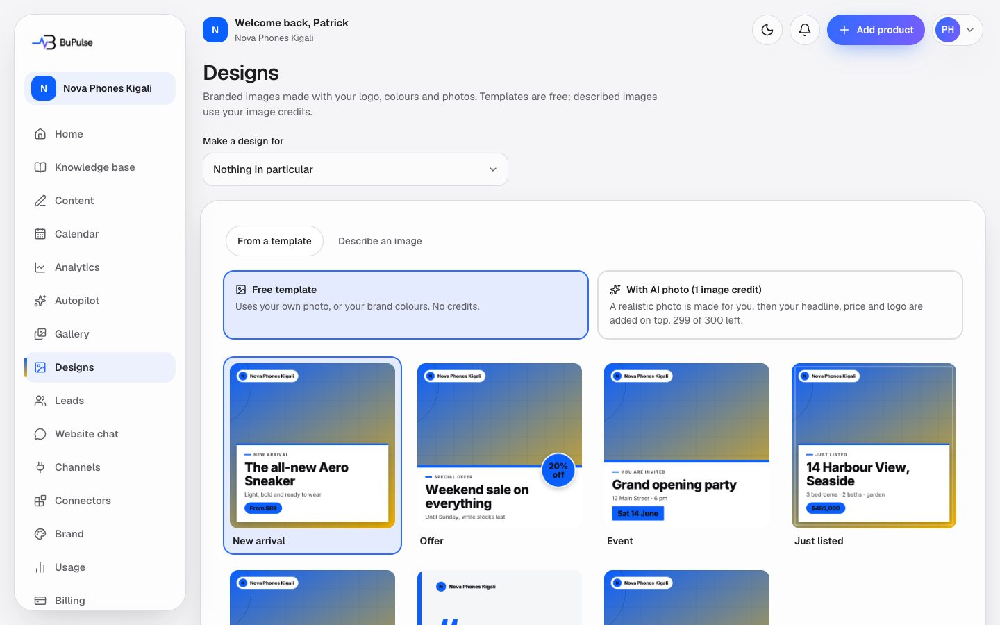

# Designs

Branded pictures for posts, made with the business's logo, colours and photos, in every size the social networks
need (square, portrait, story and landscape). There are three ways to make one: a free template, a template over an
AI photo, or "describe an image" for a fully AI-made picture. A design can also be opened in Canva, edited there and
brought back as a new design. Most of the time owners do not visit this page: "Create today's content" and Autopilot
choose and draw designs on their own (see [Projects and content](04-projects-and-content.md)).

**Page:** `/dashboard/designs`  **Plans:** branded designs (feature key `designs`) on Starter and Business; AI photos
and "describe an image" (feature key `aiPhotos`) on Business (100 AI images a month); Canva editing (feature key
`canva`) is in neither plan today: it can be added (Billing → Add features, when priced) or put in a custom plan, and
only shows once BuPulse's Canva app keys are set.

## What you see

- **Make a design for.** Pick a product or campaign (or "Nothing in particular"). The design then starts with its
  name, price, first feature and album photos, and is saved with it.
- **Design studio.** Choose a template (new arrival, offer, event, announcement, just listed, project done, quote),
  a style (the one that "Matches your brand" is chosen first), the size, the headline, subline and small label
  ("chip"), and a photo from the gallery. A live preview shows the result.
- **AI options** (Business): put the template over an AI photo, or describe an image in words. Both show how many AI
  images are left this month and when they refill.
- **Your designs.** Every design made, newest first, 30 a page, with a date filter. Each one can be downloaded,
  deleted or (with Canva) opened with **Edit in Canva**.

## How to use it

1. Open **Designs** in the menu.
2. Under **Make a design for**, choose the product or campaign the picture is about.
3. Pick a template and a style. Change the headline and subline if you want.
4. Pick a photo from the gallery (or upload one into the product's album).
5. Click to create the design. It appears under **Your designs**.
6. To use it, download it, or attach it to a post in the composer (see
   [Calendar and publishing](07-calendar-and-publishing.md)).
7. With Canva connected (Settings → Canva), click **Edit in Canva** on a design, edit it, then press **Return to
   BuPulse** in Canva. The edited picture is saved as a new design next to the original.

From the Gallery, a photo's "make a design" link opens this page with that photo already chosen.

## Limits and settings

- **Templates are free and unlimited** (they do not use any credit). Template designs are limited per hour against
  abuse.
- **AI photos and described images** use one AI image credit each (Business: 100 a month). They are limited to 10 an
  hour per user. If the AI fails, the credit is given back.
- Photos for templates must be JPG or PNG (not WebP), at most 12 MB.
- Languages: the small default labels ("New arrival", "Special offer") follow the content language (Kinyarwanda
  included). Latin, Cyrillic and Greek letters are supported; Arabic partly; Chinese, Japanese, Korean, Thai and Indic
  scripts are not.
- Canva needs the Canva app keys (`CANVA_CLIENT_ID`, `CANVA_CLIENT_SECRET`) and each client connects their own Canva
  account. Until Canva approves BuPulse's app, only the app owner's Canva team can connect (see
  [docs/CANVA.md](../../CANVA.md)).
- Design library: 12 styles, 1,260 image designs and 144 video looks. The admin can browse them at **Admin → Designs**.

## For developers

### Where it lives

| Part | Where |
|---|---|
| Page | `app/dashboard/designs/page.tsx` (`DesignsPage`) |
| Server actions | `app/dashboard/designs/actions.ts` (`createTemplateDesign`, `createAiDesign`, `createAiPhotoDesign`, `deleteDesign`, `getDesignDownloadUrl`), `app/dashboard/settings/canva-actions.ts` (`disconnectCanvaAction`) |
| Components | `components/designs/design-studio.tsx` (`DesignStudio`), `components/designs/designs-paging.tsx`, `components/designs/edit-in-canva.tsx`, `components/designs/canva-return-toast.tsx`, `components/knowledge/subject-picker.tsx`, `components/settings/canva-card.tsx` |
| Logic | `lib/designs/service.ts`, `lib/designs/templates/` (`index.ts` `renderTemplate`, `registry.ts` `TEMPLATES`, `packs/`, `fonts.ts`), `lib/designs/library/` (`catalog.ts` `chooseDesign`, `render.tsx` `renderDesign`, `styles.ts`, `motifs.ts`, `kit.tsx`), `lib/designs/packs.ts` (`recommendPack`), `lib/designs/layout.ts`, `lib/designs/labels.ts`, `lib/designs/prompt.ts` (`buildImagePrompt`), `lib/designs/photo-scene.ts` (`buildSceneBrief`), `lib/designs/list.ts`, `lib/designs/edge-cache.ts`, `lib/visuals/designs.ts` (`assignDesigns`), `lib/ai/gemini-image.ts`, `lib/ai/image.ts`, `lib/canva/` (`service.ts`, `client.ts`, `config.ts` `isCanvaEnabled`, `tokens.ts`, `pkce.ts`, `return-jwt.ts`) |
| Database | `Design` (kind `TEMPLATE` or `AI`, `template`, `productId`, `campaignId`), `ContentVisual`, `CanvaConnection`, `CanvaEdit`, `UsageRecord`, `AiCall`; Storage bucket `designs` |
| API routes | `app/api/designs/preview/route.ts` (template thumbnails), `app/api/canva/connect/route.ts`, `app/api/canva/callback/route.ts`, `app/api/canva/open/route.ts`, `app/api/canva/return/route.ts` |
| Cron jobs | none |
| Tests | `tests/designs/library.test.ts`, `tests/unit/designs-templates.test.ts`, `tests/designs-service.test.ts`, `tests/designs-list.test.ts`, `tests/visuals/designs.test.ts`, `tests/canva.test.ts`, `tests/canva-routes.test.ts` |
| Docs | [docs/DESIGNS.md](../../DESIGNS.md), [docs/CANVA.md](../../CANVA.md), [docs/CONTENT_VISUALS.md](../../CONTENT_VISUALS.md) |

### Key functions

- `createTemplateDesign` (lib/designs/service.ts) — draws a template or library design with `next/og` and stores the
  PNG in the `designs` bucket with a `Design` row. No credit.
- `createAiPhotoDesign` (lib/designs/service.ts) — one image credit: a Gemini photo (`buildSceneBrief`), then the
  template laid over it; refunds on any failure.
- `createAiDesign` (lib/designs/service.ts) — one image credit: a fully AI-made image from a description
  (`buildImagePrompt`).
- `renderTemplate` (lib/designs/templates/index.ts) and `renderDesign` (lib/designs/library/render.tsx) — the
  Satori layouts.
- `recommendPack` (lib/designs/packs.ts) — the style that matches the business's voice and industry.
- `chooseDesign` (lib/designs/library/catalog.ts) — picks a library design by angle, photo, text length and what was
  used recently (BuPulse picks, never the owner).
- `assignDesigns` (lib/visuals/designs.ts) — gives each slide of an automatic post its design.
- `listDesignsPage` (lib/designs/service.ts) — the "Your designs" list, 30 a page.
- `previewTemplate` (lib/designs/service.ts) — thumbnails for `/api/designs/preview`, cached a week.
- `openDesignInCanva` / `finishCanvaReturn` (lib/canva/service.ts) — upload to Canva, and save the edited PNG back as
  a new `Design`.
- `assertFeature` (lib/entitlements.ts) — the actions check `designs`, and `aiPhotos` for the AI ones.

### How it works

1. The page loads designs (`listDesignsPage`), the chosen product or campaign (`resolveSubject`, `writingSubject`)
   and the recommended style.
2. Clicking create → `createTemplateDesign` action → `assertFeature(designs)` → `lib/designs/service.ts` downloads
   the photo and logo, renders with `renderTemplate` / `renderDesign`, uploads to Storage and writes `Design`.
3. AI options → `createAiPhotoDesign` / `createAiDesign` → `assertFeature(aiPhotos)` → `consumeUsage(image)` →
   Gemini through `withLedger` (an `AiCall` row) → render → store; `refundUsage` on failure.
4. Canva: `/api/canva/open` uploads the PNG and returns Canva's edit link; Canva sends the user back to
   `/api/canva/return`, which exports the PNG and saves a new `Design`.

## If something goes wrong

| Symptom | First place to look | Usual fix |
|---|---|---|
| AI options missing | Admin → Plans (feature `aiPhotos`); Admin → Services (Gemini) | Add AI photos to the plan, or switch Gemini back on. |
| "No AI images left" | Usage page; `consumeUsage` in `lib/usage.ts` | Wait for the monthly refill or add more images. |
| Photo refused ("WebP") | `createTemplateDesign` in `lib/designs/service.ts` | Use a JPG or PNG photo. |
| Design text shows empty boxes | `lib/designs/templates/fonts.ts` | The script is not supported (CJK, Thai, Indic); use Latin text. |
| Fonts look plain | `lib/designs/templates/fonts.ts` (Fontsource CDN) | The font CDN was unreachable; the design used the fallback font. Retry later. |
| No "Edit in Canva" button | `isCanvaEnabled` in `lib/canva/config.ts`; Admin → Services (Canva); plan feature `canva` | Set the Canva keys, add the feature, connect Canva in Settings. |
| Canva return says "processing" | `finishCanvaReturn` in `lib/canva/service.ts`; Admin → Errors | The save finishes in the background; refresh Designs after a minute. |
| Canva asks to reconnect | `CanvaConnection` (refresh failed with `invalid_grant`) | Connect Canva again in Settings. |
