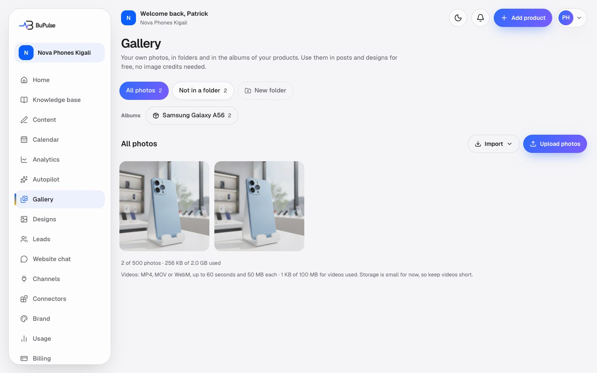

# Gallery and media import

The Gallery holds the business's own photos and short videos, in folders and in product and campaign albums. BuPulse
uses these first when it makes posts ("Gallery first"), so real photos of real products end up in the designs and
videos. Photos can also be brought in from Google Drive, Dropbox or Canva.

**Page:** `/dashboard/gallery`  **Plans:** the media gallery (feature key `gallery`) on Starter and Business. Import
from Google Drive and Dropbox (feature key `driveImport`) and from Canva (feature key `canva`) are in neither plan
today: they can be added (Billing → Add features, when priced) or put in a custom plan, and show "Coming soon" until
BuPulse's own keys for that service are set.

## What you see

- **Albums.** One per product and per campaign (see [Knowledge base](03-knowledge-base.md)). The first photo is the
  cover.
- **Folders.** The owner's own folders, plus the views "All photos" and "Not in a folder".
- **Upload** and **Import** (From Google Drive, From Dropbox, From Canva, with a "Save to" box).
- **Tiles.** Photos, and videos with a play mark and their length. Select several to move, delete or **Add to
  album**.
- **Viewer.** A large view of one photo or video, its name, **Used for** (its products and campaigns, with
  **Change**), "What's in this video?" for videos, and a button to make a design from the photo.
- **Footer.** How much of the space is used (items, gigabytes and video space).

## How to use it

Upload:

1. Open **Gallery**, or a product's album in the Knowledge base.
2. Click **Upload**. If you are in "All photos", first choose where the files go: a folder, or a product or campaign
   album (you can make a new folder there).
3. Pick photos (JPG, PNG, WebP) or videos (MP4, MOV, WebM, up to 60 seconds).
4. Rename photos so their names say what they show ("blue-phone-front.jpg"): the AI uses the names to write about
   them. For videos, fill in "What's in this video?".

Import:

1. Click **Import**, choose the folder in **Save to**.
2. Choose **From Google Drive**, **From Dropbox** or **From Canva** and pick up to 20 images.
3. They are downloaded, checked and added to the folder.

Organise:

1. Select photos, then **Move**, **Delete** or **Add to album**.
2. In an album, make a photo the cover or take it out (it stays in the gallery).

## Limits and settings

- **Per company:** 500 items and 2 GB in total; up to 100 folders; 30 photos per album. Videos also have their own
  cap (100 MB by default, `MEDIA_COMPANY_VIDEO_MAX_BYTES`).
- **Per file:** photos 10 MB (JPG, PNG, WebP); videos 50 MB and 60 seconds (MP4, MOV, WebM). Up to 20 files per
  upload or import.
- **Whole platform:** all companies share one storage space (`MEDIA_PLATFORM_MAX_BYTES`, 900 MB by default on the
  free Supabase plan). When it is full, uploads are refused with "BuPulse's photo storage is full right now…"; the
  admin is warned from 80% (Admin → Overview).
- **Imports:** images only (no videos or HEIC), 10 MB each. Drive sees only the files the client picks. Canva uses
  the same Canva connection as "Edit in Canva" (Settings → Canva).
- **Clean-up:** a daily job removes files nobody recorded, expired upload reservations, and BuPulse-made content
  videos 30 days after their posts went out. The owner's own Gallery videos are never removed by it.
- Uploading and moving photos is rate-limited per user.

## For developers

### Where it lives

| Part | Where |
|---|---|
| Page | `app/dashboard/gallery/page.tsx` |
| Server actions | `app/dashboard/gallery/actions.ts` (`createUploadTargets`, `finalizeUpload`, `discardUpload`, `listGalleryPage`, `getGalleryOverview`, `createFolder`, `renameFolder`, `deleteFolder`, `renameAsset`, `describeAsset`, `moveAssets`, `deleteAssets`), `app/dashboard/gallery/import-actions.ts` (`getImportOptions`, `importFromDrive`, `importFromDropbox`, `listFromCanva`, `importFromCanva`), `app/dashboard/knowledge/actions.ts` (`addToAlbum`, `removeFromAlbum`, `setAlbumCover`, `setPhotoProductsAction`) |
| Components | `components/media/gallery-view.tsx`, `components/media/use-gallery-upload.ts`, `components/media/upload-progress.tsx`, `components/media/destination-dialog.tsx`, `components/media/import-menu.tsx`, `components/media/use-importer.ts`, `components/media/import-sdk.ts`, `components/media/canva-import-dialog.tsx`, `components/media/media-picker.tsx`, `components/media/media-thumb.tsx`, `components/knowledge/album-card.tsx` |
| Logic | `lib/media/rules.ts` (limits, types, messages), `lib/media/service.ts` (`prepareUploads`, `finalizeUpload`, `importAsset`, `listMedia`, `galleryOverview`, `assertPlatformRoom`, `sweepOrphans`), `lib/media/destinations.ts`, `lib/media/albums.ts` (`linkPhotos`, `unlinkPhotos`, `makeCover`, `setPhotoProducts`), `lib/media/importers.ts` (`importOptions`, `importDriveFile`, `importDropboxFile`, `listCanvaDesigns`, `importCanvaDesign`), `lib/media/safe-fetch.ts`, `lib/media/videos.ts` (`subjectVideos`), `lib/media/storage-sweep.ts` (`sweepStorage`), `lib/visuals/duration.ts`, `lib/visuals/cleanup.ts` |
| Database | `MediaAsset` (`kind`, `source`, `bytes`, `durationMs`, `posterPath`, `description`), `MediaFolder`, `MediaUploadReservation`, `ProductPhoto`, `CampaignPhoto`, `CanvaConnection`; Storage buckets `media` and `gallery-videos` |
| API routes | none of its own (server actions only); Canva sign-in is `app/api/canva/connect/route.ts` and `callback/route.ts` |
| Cron jobs | `app/api/cron/media-cleanup/route.ts` (daily 03:19 UTC, `MEDIA_CLEANUP_CRON` in `worker-crons.ts`, `netlify/functions/cron-media-cleanup.mts`) |
| Tests | `tests/media/gallery-videos.test.ts`, `tests/media-service.test.ts`, `tests/media-import.test.ts`, `tests/media-import.db.test.ts`, `tests/knowledge/destinations.test.ts` |
| Docs | [docs/MEDIA.md](../../MEDIA.md), [docs/CONNECTORS.md](../../CONNECTORS.md) (importers), [docs/KNOWLEDGE_BASE.md](../../KNOWLEDGE_BASE.md) (albums), [docs/CANVA.md](../../CANVA.md) |

### Key functions

- `prepareUploads` (lib/media/service.ts) — checks type, size, quota and destination and returns signed upload URLs
  (video and poster for videos, with a `MediaUploadReservation`).
- `finalizeUpload` (lib/media/service.ts) — after the browser uploaded: checks the real bytes and video length,
  writes `MediaAsset` and links it to its folder or album.
- `resolveDestination` (lib/media/service.ts) and `lib/media/destinations.ts` — every upload needs `folder:<id>`,
  `product:<id>` or `campaign:<id>`.
- `assertPlatformRoom` / `platformBytes` (lib/media/service.ts) — the shared storage guard.
- `importAsset` (lib/media/service.ts) — the shared path for every import: download, check first bytes, quota, save.
- `importDriveFile` / `importDropboxFile` / `importCanvaDesign` (lib/media/importers.ts) — one importer each;
  `importOptions` says which are available ("Coming soon" without keys).
- `linkPhotos` / `makeCover` (lib/media/albums.ts) — album membership and cover.
- `subjectVideos` (lib/media/videos.ts) — a product's or campaign's album videos for the content pipeline.
- `sweepStorage` (lib/media/storage-sweep.ts) — deletes unrecorded files (daily cron).
- `purgePublishedVideos` (lib/visuals/cleanup.ts) — removes BuPulse-made videos 30 days after posting.

### How it works

1. **Upload:** browser → `createUploadTargets` → `prepareUploads` (signed URLs) → browser uploads straight to
   Supabase Storage → `finalizeUpload` action → `lib/media/service.ts` `finalizeUpload` → `MediaAsset` (+ album link).
2. **Import:** browser picker (Google Picker, Dropbox Chooser, or the Canva list) → `importFromDrive` /
   `importFromDropbox` / `importFromCanva` → `assertFeature(gallery)` and `assertFeature(driveImport | canva)` →
   `lib/media/importers.ts` downloads with `lib/media/safe-fetch.ts` → `importAsset`.
3. **Use:** content runs and Autopilot read albums first (`lib/content-flow/media.ts`), then the least-used gallery
   photos.
4. **Clean-up:** `/api/cron/media-cleanup` → `purgePublishedVideos`, `purgeAbandonedUploads`, `sweepStorage`.

## If something goes wrong

| Symptom | First place to look | Usual fix |
|---|---|---|
| "Choose where these photos go" | `resolveDestination` in `lib/media/service.ts` | Pick a folder or album in the dialog first. |
| "BuPulse's photo storage is full right now" | Admin → Overview (attention list); `assertPlatformRoom` in `lib/media/service.ts` | Free space (old videos, unused photos) or move to a larger Supabase plan and raise `MEDIA_PLATFORM_MAX_BYTES`. |
| Company gallery full | Gallery footer; `MEDIA_MAX_ASSETS` / `MEDIA_MAX_TOTAL_BYTES` in `lib/media/rules.ts` | Delete unused photos. |
| Video refused | `finalizeUpload` in `lib/media/service.ts`; `lib/visuals/duration.ts` | Trim to 60 seconds and under 50 MB; use MP4. |
| iPhone video has no preview | `components/media/use-gallery-upload.ts` | The browser could not play HEVC; the video still uploads. |
| Import shows "Coming soon" | `importOptions` in `lib/media/importers.ts`; Admin → Services | Set `GOOGLE_PICKER_API_KEY`, `GOOGLE_CLIENT_ID`, `GOOGLE_PICKER_APP_ID`, `DROPBOX_APP_KEY` or the Canva keys. |
| Import says "Add to your plan" | Admin → Plans (`driveImport`, `canva`) | Add the feature to the plan or offer. |
| Canva import asks to reconnect | `canvaImportState` in `lib/media/importers.ts` | Reconnect Canva in Settings (the design-list permission is new). |
