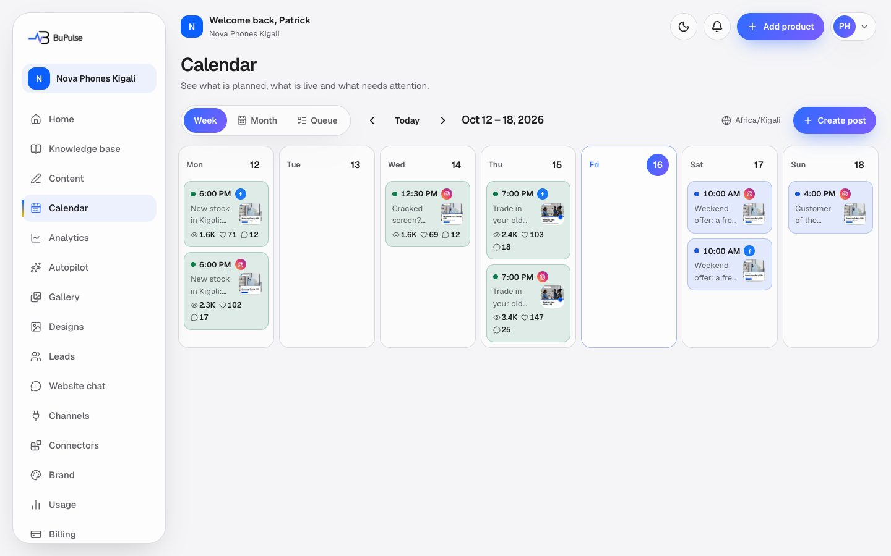
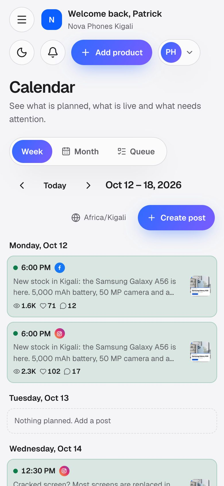

# Calendar and publishing

The calendar shows every post the business has: drafts, posts waiting for approval, scheduled posts, published posts
and posts that need attention. From here the owner writes a post once for several accounts, picks a time (or lets
BuPulse pick the next free posting time), and BuPulse publishes it at that time. For an app that BuPulse cannot post to
on its own (not connected, set to "remind me", or a video script), BuPulse emails a reminder with everything ready to
copy and an **I posted it** button.

**Page:** `/dashboard/calendar`  **Plans:** Starter and Business (feature key `calendar`, which also opens
`/dashboard/connections`). The admin can change what each plan includes in Admin → Plans.

## What you see

- **Week / Month / Queue** switch at the top. Week and Month show posts on their days; Queue lists "Needs your
  attention", "Upcoming" and "Drafts" as lists.
- **Arrows** move to the previous or next week or month.
- **Create post** opens the composer.
- **Time zone** (globe button): all times on the page are in the business's time zone. If it is still UTC a yellow note
  says "Set your time zone".
- **Approve all** appears when posts in view are waiting for approval (for example posts made by Autopilot or by
  "Create today's content").
- **Post cards** are coloured by status: Draft, Needs approval, Scheduled, Publishing, Published, Post it yourself,
  Failed, Cancelled. Drag a card to another day to move it.
- **Post detail** (click a card): the post as it will look on the network, its results once published (views, reach,
  likes, comments, shares, saves), and buttons **Edit**, **Duplicate**, **Back to review**, **Retry**, **Delete** and **Mark as posted** (the ones that fit the post's status).

On a phone the same page stacks into one column:

## How to use it

1. Connect your social accounts first in [Social connections](13-social-connections.md). Apps you have not connected can
   still get posts: you receive a reminder email instead.
2. Press **Create post**. Tick the accounts to post to (up to 12).
3. Write the text and hashtags once. Open a network's tab to change the text just for that network.
4. Add photos or a video from your gallery or designs (up to 10). For Instagram, BuPulse turns PNG and WebP pictures
   into JPEG and pads them to a shape Instagram accepts, by itself.
5. Choose when:
   - **Add to queue**: the next free posting time (your posting times, by default 09:00 and 18:00, set on the Autopilot page).
   - **Schedule**: a date and time you pick.
   - **Post now**: sent straight away; the result for each account shows at once.
   - Or save it as a draft.
6. To move a post, drag it to another day, or open it and change the time.
7. When a post says **Post it yourself**, check your email: it has the caption, hashtags, download links for the
   pictures or video (they work for 7 days) and an **I posted it** button. Press it after posting, or press **Mark as
   posted** in the calendar.
8. If a post **Failed**, open it to read why, fix it (for example reconnect the account) and press **Retry**.

## Video

<video src="../videos/calendar.webm" controls muted width="100%"></video>

[Watch the clip](../videos/calendar.webm)

## Limits and settings

- Posting and scheduling are free: they do not use AI credits. Writing posts with AI (on the Posts page or
  Autopilot) uses text credits; see [Projects and content](04-projects-and-content.md).
- Per person per hour: 120 create, edit, move or approve actions, and 40 "Post now" or "Retry" calls
  (`PUBLISHING_LIMITS`).
- A post that fails is tried again up to 5 times (after 1, 5, 15 and 60 minutes). After that it is **Failed** and the
  owner gets an email.
- Instagram only takes JPEG pictures between 4:5 and 1.91:1, under 8 MB. BuPulse converts and pads them; a picture
  that is still too big fails with a clear message.
- Posts of an account that is waiting for its demo, has an expired trial or an unpaid plan are kept, not lost: they
  stay scheduled and go out once the account is active again (late ones first).
- What the admin can change: the plans (Admin → Plans), the email service switch (Admin → Services, "Resend": while it
  is off, reminders wait instead of failing), social network switches (Admin → Services), and force-disconnecting a
  client's channel (Admin → Connections).

## For developers

### Where it lives

| Part | Path |
|---|---|
| Page | `app/dashboard/calendar/page.tsx` |
| Server actions | `app/dashboard/calendar/actions.ts` (`createPostsAction`, `updatePostAction`, `reschedulePostAction`, `duplicatePostAction`, `deletePostAction`, `approvePostsAction`, `connectByHandPostsAction`, `unschedulePostAction`, `retryPostAction`, `markPostedAction`, `setTimezoneAction`, `autoSetTimezoneAction`, `listDesignsAction`) |
| "I posted it" page | `app/posted/page.tsx`, `app/posted/actions.ts` (`confirmPosted`) |
| Components | `components/publishing/calendar.tsx` (`Calendar`), `composer.tsx` (`PostComposer`), `post-card.tsx`, `post-detail.tsx`, `post-preview.tsx`, `post-results.tsx`, `media-attach.tsx`, `timezone-form.tsx`, `auto-timezone.tsx` |
| Logic | `lib/publishing/` (`service.ts`, `engine.ts`, `queries.ts`, `media.ts`, `jpeg.ts`, `validate.ts`, `best-time.ts`, `slots.ts`, `token.ts`, `metrics.ts`, `results.ts`, `status.ts`, `time.ts`, `email.ts`), network providers in `lib/social/registry.ts` and `lib/social/providers/` |
| Database | `Post`, `PostMetrics`, `Connection`, `Business.timezone`, `AutopilotSettings.postingTimes`, `MediaAsset` |
| API routes | `POST /api/cron/publish` (`app/api/cron/publish/route.ts`), `POST /api/cron/metrics` (`app/api/cron/metrics/route.ts`), public REST `app/api/v1/posts/route.ts` and `app/api/v1/posts/[id]/route.ts` |
| Cron jobs | `PUBLISH_CRON` every minute and `METRICS_CRON` hourly at :23 (`worker-crons.ts`, `wrangler.jsonc`); Netlify `netlify/functions/cron-publish.mts`, `cron-metrics.mts`; GitHub fallback `.github/workflows/publish-posts.yml` every 5 minutes |
| Tests | `tests/publishing/` (`engine.test.ts`, `claim.db.test.ts`, `service.test.ts`, `actions.test.ts`, `jpeg.test.ts`, `jpeg-netlify.test.ts`, `token.test.ts`, `best-time.test.ts`, `metrics.test.ts`, `results.test.ts`, `validate.test.ts`, `time.test.ts`, `cron-routes.test.ts`), `tests/worker-crons.test.ts` |
| Docs | [docs/CONTENT.md](../../CONTENT.md) (reminder posts, approvals, daily summary), [docs/PLATFORM_APPS.md](../../PLATFORM_APPS.md) (network rules), [docs/CONTENT_VISUALS.md](../../CONTENT_VISUALS.md) (video posts) |

### Key functions

- `createPosts` (lib/publishing/service.ts) — validates the composer input and creates one `Post` per chosen account, sharing a `groupId`.
- `updatePost`, `reschedulePost`, `unschedulePost`, `retryPost`, `deletePost`, `duplicatePost` (lib/publishing/service.ts) — the calendar's edit actions, always scoped by `businessId`.
- `approvePosts` (lib/publishing/service.ts) — turns `PENDING_APPROVAL` posts into `SCHEDULED` at their best free time.
- `bestTime` (lib/publishing/best-time.ts) and `nextFreeSlots` (lib/publishing/slots.ts) — pick a time from the posting times, never within 2.5 hours of another post on the account.
- `publishDue` (lib/publishing/engine.ts) — the cron entry: sweeps stale locks, claims due posts and publishes them inside a time budget.
- `claimDuePosts` (lib/publishing/engine.ts) — atomic `UPDATE … RETURNING` with `SKIP LOCKED`, so two runs never take the same post.
- `publishPostsNow` (lib/publishing/engine.ts) — the "Post now" path for chosen post ids.
- `sweepStalePosts` (lib/publishing/engine.ts) — a post stuck in PUBLISHING becomes NEEDS_ACTION ("We could not confirm this post went out"), never re-sent.
- `backoffMinutes` (lib/publishing/engine.ts) — retry waits 1, 5, 15, 60 minutes; `MAX_ATTEMPTS` is 5.
- `signPathsForNetwork` and `requiresJpeg` (lib/publishing/media.ts) — sign media URLs; for Instagram run `prepareForInstagram` (lib/publishing/jpeg.ts) and store a `.jpg` copy next to the original.
- `createMarkPostedToken` / `readMarkPostedToken` (lib/publishing/token.ts) — the signed token in the reminder email (valid 30 days).
- `markPosted` / `markPostedFromEmail` (lib/publishing/service.ts) — set a reminder post to PUBLISHED.
- `collectMetrics` (lib/publishing/metrics.ts) — reads results of published posts for 30 days, at most once every 20 hours per post, into `PostMetrics`.
- `connectByHandPosts` (lib/content-board/connect.ts) — switches reminder posts to a just-connected account so they publish by themselves.

### How it works

1. The owner presses Schedule in `PostComposer` → `createPostsAction` checks the signed-in user, the `calendar`
   feature (`assertFeature`) and the rate limit, then calls `createPosts` → `Post` rows with status `SCHEDULED`
   (or `DRAFT`).
2. Every minute the Cloudflare cron (`worker.ts` → `routeForCron`) calls `POST /api/cron/publish` with
   `Bearer CRON_SECRET` → `recordCron("publish", publishDue)`.
3. `publishDue` → `claimDuePosts` → `processPost` for each post: checks the plan with `companyEntitlements` (a
   blocked or unresolved account is handed back, not failed), then:
   - connected account in automatic mode → `getProvider(network).publish(loadCredentials(...), request)` with media
     signed by `signPathsForNetwork` → `saveSuccess` (status `PUBLISHED`, permalink) and the `post.published` webhook;
   - no account but `remindOnly`, a `NOTIFY` account, or a `SCRIPT` post → `sendReminder` emails the owner (Resend,
     `lib/publishing/email.ts`) with media links valid 7 days and `/posted?token=…` → status `NEEDS_ACTION`
     ("Post it yourself").
4. A network error → `handleProviderError`: retry later with back-off, or `failFinally` (status `FAILED`, email to the
   owner, `post.failed` webhook); an expired token marks the connection with `markConnectionError`.
5. The owner presses "Yes, I posted it" on `/posted` → `confirmPosted` → `markPostedFromEmail` → `PUBLISHED`.
6. Hourly `POST /api/cron/metrics` → `collectMetrics` stores `PostMetrics`, shown on the post and on
   [Analytics](12-analytics.md).

## If something goes wrong

| Symptom | First place to look | Usual fix |
|---|---|---|
| Nothing is published at all | Admin → Health (cron list, last `publish` run); `worker-crons.ts`, `wrangler.jsonc` | Check `CRON_SECRET` is set on the host; on Netlify check `netlify/functions/cron-publish.mts` is deployed |
| One post is "Failed" | Post detail (its `lastError`); `handleProviderError` in `lib/publishing/engine.ts` | Reconnect the account in Channels, then Retry |
| Post shows "Post it yourself" but no email came | Admin → Services ("Resend" switch); `sendReminder` in `lib/publishing/engine.ts` | Switch Resend on / check the Resend key; the owner can use Mark as posted |
| "We could not confirm this post went out" | `sweepStalePosts` in `lib/publishing/engine.ts` | Check the network; if it is there, Mark as posted; never re-send blindly |
| Instagram post fails because of the picture | `prepareForInstagram` in `lib/publishing/jpeg.ts`, `signPathsForNetwork` in `lib/publishing/media.ts` | Use a smaller picture (under 8 MB after conversion) |
| Posts go out at the wrong hour | Business time zone (globe button); `setBusinessTimezone` in `lib/publishing/service.ts` | Set the right time zone |
| "I posted it" link says it expired | `readMarkPostedToken` in `lib/publishing/token.ts` (30 days) | Press Mark as posted in the calendar |
| Posts stay scheduled and do not go out | Admin → Companies (subscription status); `processPost` holds posts of blocked accounts | The account must be active (paid, trial running) |
