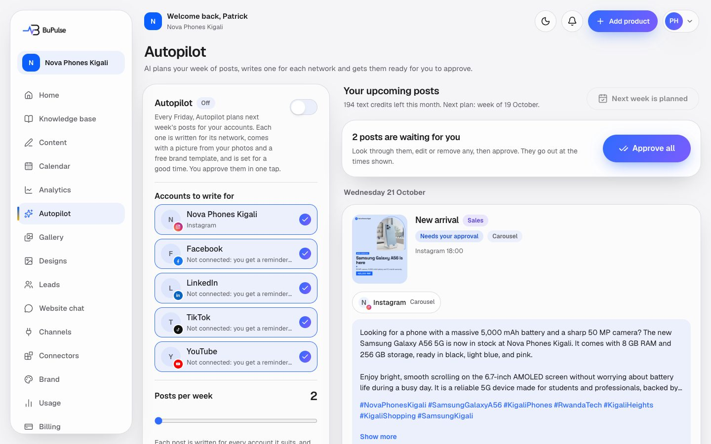

# Autopilot

Autopilot plans next week's posts for the business by itself. Every Friday it picks ideas that suit the business (tips,
products, offers, customer stories, holidays in its country), writes one version for each connected network, makes the
picture (or the video plan), and leaves the posts ready for the owner to approve in one tap. With "Post without asking"
on, they are scheduled straight away. It learns from the results of earlier posts which ideas, days and hours work best.

**Page:** `/dashboard/autopilot`  **Plans:** feature key `autopilot` (it needs `content`, `designs`, `calendar` and
`gallery`). It is not in Starter or Business as set up at launch: it is sold as an add-on in Billing → Add features
(Rwanda seed price 20,000 RWF a month, Admin → Add-on prices) or in a custom plan, and it is in Pro. The admin can change
plans in Admin → Plans.

## What you see

- **Settings card** (left): **Turn Autopilot on**, **Accounts to write for** (connected accounts, and apps not
  connected yet, which get reminder posts), **Posts per week** (2 to 14 ideas), **Posting times** (up to 4 local
  times; 09:00 and 18:00 at first), **Post without asking**, **AI images with people** (on by default, uses image
  credits) and **Skip religious holidays**. Staff without the right role see only "Autopilot is on/off".
- **The plan** (right): next week's posts by day. Each card shows the idea's goal (Awareness, Engagement, Sales,
  Trust), a preview for each account, badges such as "Needs your approval", "Scheduled", "Carousel", "Video ready",
  and buttons **Picture and video** (or **Make the video**), **Regenerate (1 credit)** and **Remove**.
- **Approve all** schedules every waiting post of the week at once.
- **Plan next week now** makes the plan without waiting for Friday ("Next week is planned" once it is done).
- With no account connected the page shows "Connect an account to start" with links to Channels and the Gallery.

## How to use it

1. Connect your accounts in [Social connections](13-social-connections.md) and upload a few real photos to the
   [Gallery](06-gallery-and-media-import.md). Fill in the [Knowledge base](03-knowledge-base.md): Autopilot only writes
   from facts it has (products, offers, FAQs, opening hours) and never invents prices or reviews.
2. Switch **Turn Autopilot on**, tick the accounts, choose how many posts a week and your posting times.
3. Leave **Post without asking** off at first, so you check everything before it goes out.
4. On Friday (or after **Plan next week now**) you get an email: "Your posts for next week are ready".
5. Open Autopilot, read the cards, change or **Regenerate** a post you do not like, **Remove** one you do not want,
   then press **Approve all**.
6. Approved posts appear in the [Calendar](07-calendar-and-publishing.md) and go out at their times.

## Video

<video src="../videos/autopilot.webm" controls muted width="100%"></video>

[Watch the clip](../videos/autopilot.webm)

## Limits and settings

- Each idea Autopilot writes uses **1 AI text credit**; it is given back if the posts were not saved. "Regenerate" uses
  1 credit. When credits run out the run stops, keeps what is done and shows a note.
- With "AI images with people" on, each idea's AI photo uses **1 image credit**; when image credits run out, free
  templates are used instead. Videos count as videos (see [Videos and voiceover](09-videos-and-voiceover.md)).
- Per person per hour: "Plan next week now" 6 times, Regenerate 30 times, settings and other edits 120 times.
- Remembrance days (for example Kwibuka on 7 April in Rwanda) are kept quiet: nothing is posted that day.
- Posts are never closer than 2.5 hours to another post on the same account.
- What the admin can change: plans and add-on prices (Admin → Plans, Admin → Add-on prices), the AI service switches
  (Admin → Services: Gemini, Claude), the monthly AI budget (Admin → AI).

## For developers

### Where it lives

| Part | Path |
|---|---|
| Page | `app/dashboard/autopilot/page.tsx` |
| Server actions | `app/dashboard/autopilot/actions.ts` (`saveAutopilotSettings`, `planNextWeek`, `approveAllPosts`, `removePlannedPost`, `regeneratePlannedPost`) |
| Components | `components/autopilot/settings-card.tsx` (`SettingsCard`), `components/autopilot/plan-board.tsx` (`PlanBoard`), `components/autopilot/switch.tsx`, the visual panel `components/visuals/content-visual.tsx` |
| Logic | `lib/autopilot/` (`run.ts`, `plan.ts`, `data.ts`, `planner.ts`, `playbook.ts`, `calendar.ts`, `learning.ts`, `results.ts`, `writer.ts`, `visuals.ts`, `images.ts`, `manage.ts`, `settings.ts`, `view.ts`, `notify.ts`, `timezone.ts`) |
| Database | `AutopilotSettings`, `AutopilotRun`, `Post` (`source` AUTOPILOT, `autopilotRunId`, `playbookId`, `groupId`), `PostMetrics`, `Design`, `ContentVisual`, `UsageRecord`, `AiCall` |
| API routes | `POST /api/cron/autopilot` (`app/api/cron/autopilot/route.ts`, `?cursor=` paging) |
| Cron jobs | `AUTOPILOT_CRON` `11 */3 * * 5,6` (every 3 hours on Fridays and Saturdays, UTC; `worker-crons.ts`, `wrangler.jsonc`), Netlify `netlify/functions/cron-autopilot.mts`, GitHub `.github/workflows/autopilot.yml` |
| Tests | `tests/autopilot/` (`run.test.ts`, `planner.test.ts`, `playbook.test.ts`, `calendar.test.ts`, `learning.test.ts`, `writer.test.ts`, `images.test.ts`, `manage.test.ts`, `settings.test.ts`, `timezone.test.ts`, `by-hand.test.ts`), `tests/ai-eval/autopilot.test.ts` (real model, costs cents) |
| Docs | [docs/AUTOPILOT.md](../../AUTOPILOT.md), [docs/CONTENT.md](../../CONTENT.md) (auto-approval), [docs/CONTENT_VISUALS.md](../../CONTENT_VISUALS.md) (pictures and videos) |

### Key functions

- `runDueBusinesses` (lib/autopilot/run.ts) — the cron: visits enabled businesses after a cursor, only where it is Friday locally, at most 2 per call.
- `runAutopilot` (lib/autopilot/run.ts) — one business and week: claims an `AutopilotRun` (unique per week, so it is safe to repeat), plans, writes, draws, saves.
- `runAutopilotForUser` (lib/autopilot/run.ts) — the "Plan next week now" button, resolving the business from the user.
- `planWeek` (lib/autopilot/plan.ts) with `loadPlanInput` (lib/autopilot/data.ts) — loads the facts, accounts, photos, holidays and results.
- `buildWeekPlan` (lib/autopilot/planner.ts) — pure and seeded: which ideas, which days and times, which accounts.
- `IDEAS`, `getIdea`, `industryTags` (lib/autopilot/playbook.ts) — the playbook of post types and the industry tags.
- `holidaysBetween` (lib/autopilot/calendar.ts) — national, cultural and religious days per country, offline.
- `buildProfile`, `engagementRate` (lib/autopilot/learning.ts) — scores ideas, networks, weekdays and hours from `PostMetrics` (needs 6 measured posts).
- `buildPrompt`, `inventedNumbers` (lib/autopilot/writer.ts) — the writer prompt and the check that no numbers are invented.
- `makeGroupVisuals` (lib/autopilot/visuals.ts) and `makeGroupImages` (lib/autopilot/images.ts) — picture, carousel or video plan for one idea.
- `saveSettings`, `approveAll`, `removeGroup`, `regenerateGroup` (lib/autopilot/manage.ts) — the owner's actions, scoped to their business.
- `readConfig`, `toRow` (lib/autopilot/settings.ts) — settings form ⇄ `AutopilotSettings` row.
- `loadAutopilotView` (lib/autopilot/view.ts) — what the page shows.
- `sendReadyEmail` (lib/autopilot/notify.ts) — "Your posts for next week are ready".

### How it works

1. Cloudflare calls `POST /api/cron/autopilot` (bearer `CRON_SECRET`) → `runDueBusinesses`; callers loop while the
   answer has `nextCursor`.
2. For each business `runAutopilot` claims the week's `AutopilotRun` → `planWeek` → `buildWeekPlan`.
3. For each idea (group): `consumeUsage(..., "text")` → the writer (Gemini, through `withLedger` with feature
   `autopilot`) → `makeGroupVisuals` (template design, AI photo with `createAiPhotoDesign`, carousel, or a video plan).
4. One `Post` per account: `PENDING_APPROVAL`, or `SCHEDULED` with "Post without asking". Apps that need no approval
   (Posts → Settings) are scheduled at once unless a safety rule keeps them in review.
5. If posts wait, `sendReadyEmail` goes out (Resend).
6. The owner presses Approve all → `approveAllPosts` → `approveAll` → `approvePosts` (lib/publishing/service.ts) →
   the [publish cron](07-calendar-and-publishing.md) sends them at their times.

## If something goes wrong

| Symptom | First place to look | Usual fix |
|---|---|---|
| No plan appeared on Friday | Admin → Health (last `autopilot` cron run); `runDueBusinesses` in `lib/autopilot/run.ts` | Check `CRON_SECRET`; Autopilot must be on and an account chosen; press Plan next week now |
| "Autopilot could not plan next week this time" with a note | The run's note on the page (`AutopilotRun`); `runAutopilot` | Usually out of text credits or the AI budget: Usage page, Admin → AI |
| Page says Autopilot is not in the plan | Billing → Add features; `featureGate("autopilot")` | Add the Autopilot add-on or change plan |
| Posts have plain template pictures, not AI photos | Usage page (image credits); `makeGroupImages` | Image credits ran out, or "AI images with people" is off |
| An idea is missing (no FAQ post, no offer post) | Knowledge base; `planner.ts` skips ideas whose facts are missing | Add FAQs, products or campaigns |
| Posts not scheduled after Approve all | Calendar (status, `lastError`); `approvePosts` | Reconnect the account; check the plan includes `calendar` |
| No "posts are ready" email | Admin → Services ("Resend"); `sendReadyEmail` | Switch Resend on / check the key |
