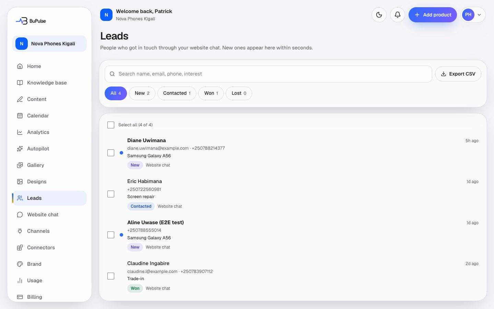
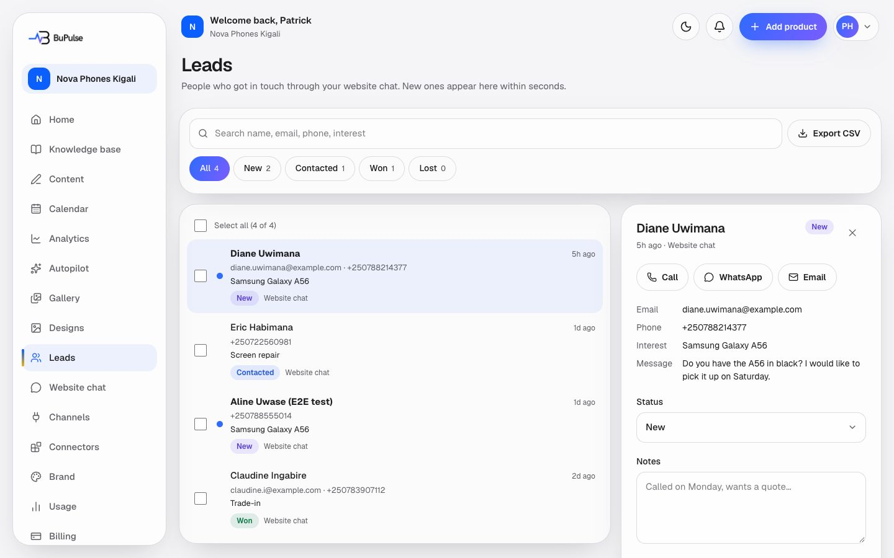
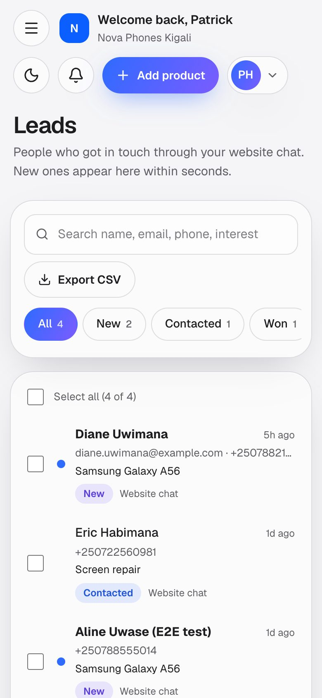

# Leads

The Leads page is the inbox of people who got in touch through the website chat. Each lead has the visitor's name,
phone or email, what they are interested in, the page they came from and the chat itself. The owner marks leads New,
Contacted, Won or Lost, writes notes, calls or messages them in one tap, and exports the list. BuPulse tells the owner
about every new lead straight away: by email, and by a free alert on the phone or computer. WhatsApp alerts are built
but **off** until BuPulse switches them on.

**Page:** `/dashboard/leads` (one lead: `/dashboard/leads/<id>` opens the inbox with that lead)  **Plans:** Business
(feature key `websiteChat`, 500 chat replies a month). Not in Starter: it can be added in Billing → Add features
(Rwanda seed price 10,000 RWF a month with 500 replies, Admin → Add-on prices) or a custom plan. Without the feature,
leads the company already has stay readable, exportable and deletable. The admin can change plans in Admin → Plans.

## What you see

- **Search** (name, email, phone, interest), a **Source** filter and **Export CSV** at the top.
- **Status tabs** with counts: All, New, Contacted, Won, Lost.
- **The list**: newest first, 50 at a time. Tick several leads to change their status or delete them together.
- **Notifications card**: **Email me for every new lead**, **Daily summary** (about 08:00 your time; not sent on quiet
  days), **Alerts on this device** (phone or browser alerts), and **WhatsApp alerts** with a number, only when BuPulse
  has switched WhatsApp on.

- **The lead panel**: **Call**, **WhatsApp** and **Email** buttons, the details (email, phone, interest, message), the
  page the visitor was on, the chat transcript, the status and **Notes** (saved as you type).

On a phone:

## How to use it

1. Put the chat on your website first ([Website chat](11-website-chat.md)). New leads appear here within seconds.
2. On your phone, open BuPulse, go to Leads and switch on **Alerts on this device**. Allow notifications when the phone
   asks. Do the same on your computer if you want.
3. When a lead arrives, tap the alert or the email (it has a **Reply on WhatsApp** button when the visitor left a
   number). The lead opens.
4. Call or message the person, then set the status to **Contacted**. Write a short note ("Called Monday, wants a quote").
5. When you close the sale, set **Won** (or **Lost**).
6. Use **Export CSV** to take the list to Excel or Google Sheets (it keeps the filters you chose).

## Video

<video src="../videos/leads.webm" controls muted width="100%"></video>

[Watch the clip](../videos/leads.webm)

## Limits and settings

- Leads themselves are free and unlimited. The website chat's AI replies count (see [Website chat](11-website-chat.md)).
- Export: up to 10,000 leads per file.
- Alerts go to the company owner and to admins who chose to get them (team settings).
- Phone and browser alerts are free. They need BuPulse's push keys (`VAPID_PUBLIC_KEY`, `VAPID_PRIVATE_KEY`,
  `VAPID_SUBJECT`); without them the switch is hidden. Up to 10 devices per person.
- WhatsApp alerts are paid per message by BuPulse. They stay hidden until the admin switches **WhatsApp** on in
  Admin → Services (off by default) and the keys `WHATSAPP_CLOUD_TOKEN` and `WHATSAPP_PHONE_NUMBER_ID` are set.
- What the admin can change: plans and add-on prices, the Resend (email) and WhatsApp switches (Admin → Services), and
  switching a company's chat off (Admin → Connections).

## For developers

### Where it lives

| Part | Path |
|---|---|
| Pages | `app/dashboard/leads/page.tsx`, `app/dashboard/leads/[id]/page.tsx` (redirects to `?lead=<id>`) |
| Server actions | `app/dashboard/leads/actions.ts` (`loadLead`, `changeStatus`, `saveNotes`, `removeLeads`, `saveToggles`, `savePushDevice`, `removePushDevice`, `saveWhatsappToggle`) |
| Components | `components/leads/leads-inbox.tsx` (`LeadsInbox`), `components/leads/lead-panel.tsx`, `components/leads/notifications-card.tsx` (`NotificationsCard`), `components/leads/push-toggle.tsx` (`PushToggle`), `public/sw.js` (shows push alerts, opens the lead) |
| Logic | `lib/leads/` (`service.ts`, `notify.ts`, `email.ts`, `digest.ts`, `filters.ts`, `csv.ts`, `settings.ts`, `whatsapp.ts`, `normalize.ts`, `webhook.ts`, `background.ts`), `lib/push/` (`service.ts`, `web-push.ts`), `lib/team/recipients.ts` |
| Database | `Lead`, `LeadStatus` (enum), `ChatSession`, `ChatMessage`, `ChatWidget` (`notifyInstant`, `notifyDaily`, `notifyWhatsapp`, `whatsappNumber`, `lastDigestAt`), `PushSubscription` |
| API routes | `GET /api/leads/export` (`app/api/leads/export/route.ts`, CSV, not gated by the plan), `POST /api/cron/leads-digest`, public REST `app/api/v1/leads/route.ts` and `app/api/v1/leads/[id]/route.ts` (scope `leads:read`) |
| Cron jobs | `LEADS_DIGEST_CRON` hourly at :37 (sends where it is 08:00 local; `worker-crons.ts`, `wrangler.jsonc`), Netlify `netlify/functions/cron-leads-digest.mts`, GitHub `.github/workflows/leads-digest.yml` |
| Tests | `tests/leads/` (`service.test.ts`, `alerts.test.ts`, `alert-actions.test.ts`, `digest.test.ts`, `export-route.test.ts`, `webhook.test.ts`, `pure.test.ts`), `tests/push/` (`service.test.ts`, `web-push.test.ts`) |
| Docs | [docs/WIDGET.md](../../WIDGET.md), [docs/WEBHOOKS.md](../../WEBHOOKS.md) (`lead.created`), [docs/RELEASE_2.0.md](../../RELEASE_2.0.md) (lead alerts) |

### Key functions

- `createLeadFromChat` (lib/leads/service.ts) — one lead per chat session (merges repeats), claims `notifiedAt` atomically, then notifies in the background.
- `notifyNewLead` (lib/leads/notify.ts) — the instant email, the `lead.created` webhook, web push and WhatsApp, side by side; a failing channel never blocks the email.
- `renderInstantLeadEmail`, `renderDigestEmail` (lib/leads/email.ts) — the two emails (with "Reply on WhatsApp" when there is a number).
- `runLeadsDigest`, `isDigestDue` (lib/leads/digest.ts) — the daily summary at 08:00 in the business's time zone.
- `listLeads`, `statusCounts`, `leadSources`, `getLeadDetail`, `setLeadStatus`, `setLeadNotes`, `deleteLeads` (lib/leads/service.ts) — the inbox, always scoped by `businessId`.
- `parseFilters`, `leadWhere` (lib/leads/filters.ts) — the same filters for the page, the CSV and the API.
- `leadsToCsv` (lib/leads/csv.ts) — the export file.
- `pushToLeadWatchers`, `saveDevice`, `vapidKeys` (lib/push/service.ts) and `sendWebPush` (lib/push/web-push.ts) — free Web Push with VAPID.
- `whatsappAlertsAvailable`, `sendWhatsappLeadAlert` (lib/leads/whatsapp.ts) — the WhatsApp template alert; off unless keys and the admin switch are on.
- `alertRecipients` (lib/team/recipients.ts) — the owner plus admins who opted in.

### How it works

1. A visitor leaves details in the chat → `POST /api/widget/lead` (or details found in a message) → `handleLead` /
   `handleChat` (lib/widget/chat.ts) → `createLeadFromChat` → `Lead` row (source `website_chat`).
2. The one call that claims `notifiedAt` runs `notifyNewLead` in the background (`runInBackground`).
3. Email via Resend (`sendEmail`, lib/publishing/email.ts) to `alertRecipients`; webhook via `emitWebhookEvent`;
   push via `pushToLeadWatchers` → the browser's push service → `public/sw.js` shows it and opens
   `/dashboard/leads/<id>`; WhatsApp via the Meta Graph API when available.
4. Hourly `POST /api/cron/leads-digest` → `runLeadsDigest` emails businesses where it is 08:00 and there were new or
   still-new leads.
5. The owner works the lead in `LeadsInbox` → `changeStatus` / `saveNotes` (need `websiteChat`) or `removeLeads`
   and the CSV (never gated).

## If something goes wrong

| Symptom | First place to look | Usual fix |
|---|---|---|
| No email for new leads | Notifications card ("Email me for every new lead"); Admin → Services ("Resend"); `notifyNewLead` | Switch the toggle or Resend on; check the Resend key and DNS |
| No daily summary | Admin → Health (last `leads-digest` run); `runLeadsDigest` | Check the business time zone and the "Daily summary" toggle; it is skipped on days without leads |
| "Alerts on this device" is missing | `pushPublicKey` in `lib/push/service.ts` | Set the VAPID keys on the host |
| Push switched on but nothing arrives | Phone notification settings; `PushSubscription` rows | Allow notifications for the site; on iPhone add BuPulse to the Home Screen first |
| No WhatsApp option | Admin → Services ("WhatsApp"); `whatsappAlertsAvailable` | Built but off by design; switch on only after the template is approved |
| Status or notes cannot be changed | Plan (`websiteChat`); `owner` in `app/dashboard/leads/actions.ts` | Add website chat back; leads stay readable meanwhile |
| Lead appears twice | `createLeadFromChat` merges per chat session | Two different chats: delete one |
