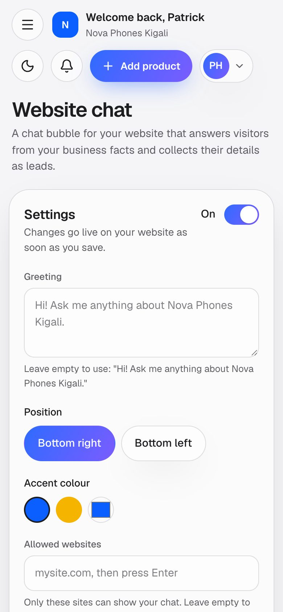

# Website chat

A chat bubble for the business's own website. Visitors ask questions and an AI answers from the business's facts only
(products, prices it knows, opening hours, locations, FAQs), in the visitor's language. When a visitor is interested
(price, booking, a quote) the chat asks for their name and phone or email and saves them as a lead in
[Leads](10-leads.md). The owner adds it to the website with one line of code.

**Page:** `/dashboard/widget` ("Website chat" in the menu)  **Plans:** Business (feature key `websiteChat`): **500 AI chat replies a month**. Not in Starter: it can be added in
Billing → Add features (Rwanda seed price 10,000 RWF a month with 500 replies; more replies as "+1,000 chat replies"
blocks, seed 3,000 RWF, Admin → Add-on prices) or a custom plan. The admin can change plans in Admin → Plans. Only the
owner and admins can change the chat settings.

## What you see


- **Settings**: the on/off switch, the **Greeting** (empty uses a greeting in your content language), **Position**
  (bottom right or bottom left), **Accent colour** (your brand colours or a custom one, **Use brand colour**), and
  **Allowed websites** (at first your own website; with none listed, anyone who copies the code could use your replies).
- **Install**: a grid of platforms (HTML, WordPress, Next.js, React, Shopify, Wix, Squarespace, Webflow, Google Tag
  Manager). Each opens the exact code with a **Copy code** button and a short animated walkthrough.
- **Check installation**: type your page address; BuPulse says whether it has seen the chat on that site and when.
- **Chat replies this month**: a meter of AI replies used against the plan's limit.
- **Live preview**: the real chat, as visitors see it.
- If BuPulse support switched the chat off: "Website chat is switched off. Our team turned it off for your account."

On a phone:



## How to use it

1. Fill in your [Knowledge base](03-knowledge-base.md): profile, products, FAQs, opening hours and locations. The chat
   only answers from these.
2. Open **Website chat**. Check **Allowed websites** shows your site (add it if not), pick a colour and greeting, and
   press save.
3. Choose your website builder in the install grid and follow the steps. For a plain site, paste this line before
   `</body>`:

   ```html
   <script src="https://bupulse.com/widget.js" data-key="YOUR_WIDGET_KEY" async></script>
   ```

   (the page shows it with your real key).
4. Open your website, then press **Check installation** in BuPulse.
5. Try it in the **Live preview**: ask a question, then say you want a price. The contact card appears; the lead shows
   in Leads.

## Video

<video src="../videos/website-chat.webm" controls muted width="100%"></video>

[Watch the clip](../videos/website-chat.webm)

## Limits and settings

- Each AI reply uses **1 chat reply** of the month. If the AI fails, the reply is given back.
- With no replies left (or a trial that ended, or an unpaid plan) the chat does not answer with AI: it shows "Leave
  your details and the team will get back to you." with the contact card. **Leads still work.**
- Protection against abuse: a message is at most 1,000 characters, a chat at most 40 visitor messages; per visitor 20
  messages in 10 minutes; per business 40 messages a minute; per visitor address 30 AI replies a day.
- **Cloudflare Turnstile** (an invisible "are you human" check) runs on the first message, every 10th message and when
  messages come too fast, once BuPulse's Turnstile keys are set. Without them it is skipped and only the limits apply.
- The chat shows **WhatsApp** and **Call** buttons when the business has those numbers in its contacts.
- What the admin can change: the plan's chat replies (Admin → Plans, `limits.chat`), add-on prices, the Gemini and
  Turnstile keys and switches (Admin → Services), and switching one company's chat off or on (Admin → Connections).

## For developers

### Where it lives

| Part | Path |
|---|---|
| Page | `app/dashboard/widget/page.tsx` (creates the `ChatWidget` row on first visit; `pageGate("widget")` + `featureGate("websiteChat")`) |
| Server actions | `app/dashboard/widget/actions.ts` (`saveWidgetSettings`), `app/dashboard/widget/check-action.ts` (`checkInstallation`) |
| Components | `components/widget/widget-settings.tsx` (`WidgetSettings`), `install-guide.tsx` (`InstallGuide`), `install-check.tsx` (`InstallCheck`), `walkthrough.tsx`, `install-scenes.tsx`, `install-guide.css` |
| Website side | `public/widget.js` (loader: launcher in a closed Shadow DOM, iframe on open), `public/widget-chat.js` (chat UI inside the iframe), `app/widget/[key]/route.ts` (chat page with a per-business CSP) |
| Logic | `lib/widget/` (`chat.ts`, `ai.ts`, `prompt.ts`, `config.ts`, `origin.ts`, `turnstile.ts`, `limits.ts`, `detect.ts`, `page.ts`, `settings.ts`, `install.ts`, `seen.ts`, `strings.ts`, `request.ts`), `lib/business-info/facts.ts`, `lib/business-info/contacts.ts`, `lib/usage.ts` |
| Database | `ChatWidget`, `ChatSession`, `ChatMessage`, `Lead`, `UsageRecord` (`chat`), `RateLimit`, `Business.widgetKey` |
| API routes | `GET /api/widget/config`, `POST /api/widget/chat`, `POST /api/widget/lead` (`app/api/widget/config/route.ts`, `app/api/widget/chat/route.ts`, `app/api/widget/lead/route.ts`) |
| Cron jobs | none (lead emails: see [Leads](10-leads.md)) |
| Tests | `tests/widget/` (`chat.test.ts`, `units.test.ts`, `install.test.ts`, `suspended.test.ts`), `npm run ai:eval:widget` (real model) |
| Docs | [docs/WIDGET.md](../../WIDGET.md), [docs/BUSINESS_INFO.md](../../BUSINESS_INFO.md) |

### Key functions

- `handleChat` (lib/widget/chat.ts) — one visitor message: validation, origin check, rate limits, Turnstile, `consumeUsage(…, "chat")`, AI reply, refund on failure, contact detection.
- `handleLead` (lib/widget/chat.ts) — the contact card → `createLeadFromChat` (lib/leads/service.ts).
- `generateChatReply` (lib/widget/ai.ts) — Gemini Flash-Lite (`WIDGET_MODEL`, default `gemini-3.1-flash-lite`), main text model as fallback, ledger feature `widget`.
- `buildSystemPrompt`, `parseChatReply` (lib/widget/prompt.ts) — only this business's facts; visitor text passed as data, never instructions.
- `shouldAskContact`, `mergeDetected`, `findEmail`, `findPhone` (lib/widget/detect.ts) — when to show the contact card; emails and phones typed in messages.
- `loadPublicWidget` (lib/widget/config.ts) — the public config for `widget.js` (never reveals the plan: a missing feature answers `unavailable`).
- `checkOrigin`, `frameAncestors`, `defaultAllowedDomains` (lib/widget/origin.ts) — allowed websites and the `frame-ancestors` CSP.
- `turnstileEnabled`, `needsChallenge`, `verifyTurnstile` (lib/widget/turnstile.ts) — the human check, skipped without keys.
- `renderChatPage`, `chatPageCsp` (lib/widget/page.ts) — the HTML of `/widget/<key>`.
- `validateWidgetSettings`, `installSnippet` (lib/widget/settings.ts) and `buildPlatforms` (lib/widget/install.ts) — settings form and install guides.
- `describeSeen`, `shouldRecordSeen` (lib/widget/seen.ts) — "Check installation" (`ChatWidget.lastSeenAt`, `lastSeenHost`).
- `businessFactsContext` (lib/business-info/facts.ts) and `quickActions` (lib/business-info/contacts.ts) — facts in the prompt; WhatsApp and Call buttons.

### How it works

1. The website loads `widget.js` → `GET /api/widget/config` → if on and the site is allowed, a launcher; on first open
   an iframe to `/widget/<key>` (`app/widget/[key]/route.ts`).
2. The visitor writes → `POST /api/widget/chat` → `handleChat`: limits, Turnstile when needed, a chat credit
   reserved with `consumeUsage`, `generateChatReply` with the business facts → reply saved as `ChatMessage`.
3. If the reply or the message shows interest (or from the 3rd message) the iframe shows the contact card →
   `POST /api/widget/lead` → `handleLead` → `createLeadFromChat` → alerts ([Leads](10-leads.md)).
4. Out of credits or blocked account → no AI call; the fallback text and the contact card.

## If something goes wrong

| Symptom | First place to look | Usual fix |
|---|---|---|
| Bubble does not show on the website | Browser console on the site (the loader explains `unknown_key`, `disabled`, `not_allowed`, `unavailable`); Check installation | Paste the exact line; add the site to Allowed websites; switch the chat on |
| `unavailable` in the console | The owner's Website chat page (shows the real reason); plan has `websiteChat`? | Add website chat to the plan, or support switched it off (Admin → Connections) |
| Chat only says "Leave your details…" | Usage meter on the page; Admin → Services ("Gemini") | Replies used up: add a "+1,000 chat replies" block or wait for next month |
| Wrong or made-up answers | Knowledge base facts; `buildSystemPrompt` | Fill in FAQs, hours, products; the AI only uses what is there |
| Visitors see "challenge" errors | `verifyTurnstile`; Turnstile hostnames in the Cloudflare dashboard | Add the site and `challenges.cloudflare.com` to the Turnstile widget's allowed hostnames |
| "Check installation" never sees the site | `shouldRecordSeen` (not recorded from BuPulse's own host, at most every 10 minutes) | Open the real website (not localhost) and wait a minute |
| "Website chat is switched off" banner | Admin → Connections (`switchOffWidget`, `disabledByAdminAt`) | Support switches it back on (`switchOnWidget`) |
