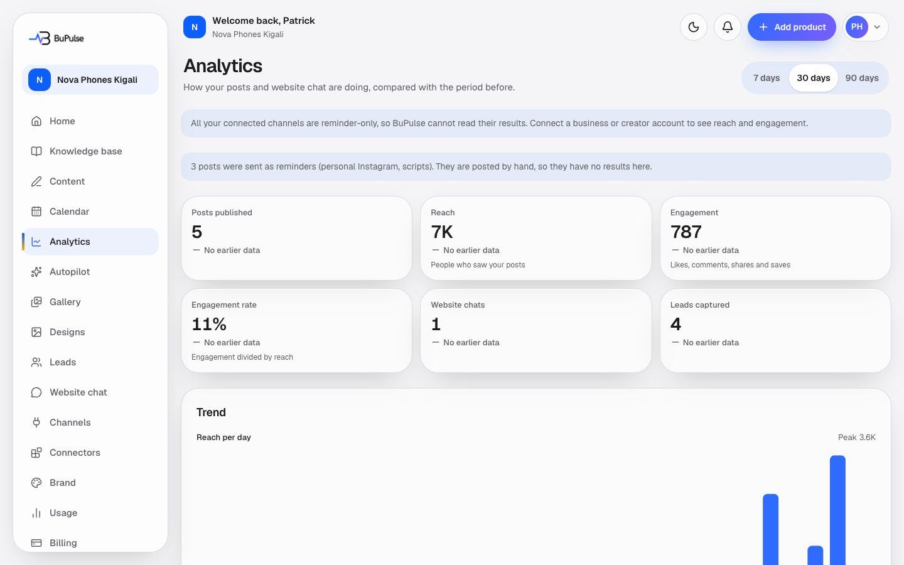

# Analytics

Analytics shows how the business's posts and website chat are doing over the last 7, 30 or 90 days, each number
compared with the period just before. It counts posts published, reach, engagement and the engagement rate, shows a
trend chart, a split by network, the best posts, short "What worked" tips, and the website chat's conversations and
leads with the pages leads came from. Results come from the connected social accounts, read once a day.

**Page:** `/dashboard/analytics`  **Plans:** feature key `analytics` (it needs `calendar`). It is not in Starter or
Business as set up at launch: it is sold as an add-on in Billing → Add features (Rwanda seed price 5,000 RWF a month,
Admin → Add-on prices) or in a custom plan, and it is in Pro. The admin can change plans in Admin → Plans.

## What you see

- **Range picker** (top right): 7, 30 or 90 days.
- **Summary cards**: Posts published, Reach (people who saw your posts), Engagement (likes, comments, shares and
  saves), Engagement rate (engagement divided by reach), Website chats, Leads captured. Each shows the change against
  the period before.
- **What worked**: up to three short tips taken from your own results.
- **Trend**: a chart of reach and engagement across the period.
- **By network**: the same numbers for each connected network.
- **Best posts**: the five best posts of the period, with a thumbnail and a link to the post.
- **Website chat**: Conversations, Leads, "Became a lead" (the share of chats that gave a lead), and "Pages leads came
  from".
- Notes when needed: no channel connected yet, results still on their way (they arrive within a day), or posts sent as
  reminders (personal Instagram accounts saved before that option was removed, scripts), which have no results because
  they were posted by hand.

## How to use it

1. Connect your accounts in [Social connections](13-social-connections.md). Instagram connects Business and Creator
   accounts only; an older personal Instagram account on reminder posting has no results.
2. Publish posts through the [Calendar](07-calendar-and-publishing.md) or [Autopilot](08-autopilot.md).
3. Come back a day later: results arrive within a day of publishing.
4. Switch between 7, 30 and 90 days to compare. Look at **Best posts** and **What worked**, and make more posts like
   those. Autopilot uses the same results to choose its ideas and times.

## Video

<video src="../videos/analytics.webm" controls muted width="100%"></video>

[Watch the clip](../videos/analytics.webm)

## Limits and settings

- Viewing analytics costs nothing; it uses no AI credits.
- Each published post is measured for 30 days, at most once every 20 hours (an hourly job), up to 25 posts per
  account per run.
- Days are counted in the business's time zone. A post counts on the day it was published, with its latest numbers.
- Only posts BuPulse published are counted; posts made directly on the network are not.
- Accounts connected through BuPulse-Socials (Composio) send fewer numbers: Facebook gives likes, comments and shares,
  Instagram likes and comments, and LinkedIn and YouTube none. With no reach or views, their posts add to Engagement but
  not to Reach, the engagement rate or Best posts (which are ranked by engagement rate).
- What the admin can change: plans and add-on prices (Admin → Plans, Admin → Add-on prices) and the social network
  switches (Admin → Services). BuPulse's own platform analytics (visitors of the BuPulse website, sign-ups, revenue) are
  a different thing, in the admin console, not on this page.

## For developers

### Where it lives

| Part | Path |
|---|---|
| Page | `app/dashboard/analytics/page.tsx` (`featureGate("analytics")`, `?range=7|30|90`) |
| Server actions | none (read-only page) |
| Components | `components/analytics/stat-card.tsx` (`StatCard`), `components/analytics/trend-chart.tsx` (`TrendChart`), `components/analytics/format.ts`, `components/publishing/network-icon.tsx` |
| Logic | `lib/analytics/service.ts` (`loadClientAnalytics`), `lib/analytics/compute.ts` (pure maths), `lib/publishing/metrics.ts` (collecting results), `lib/publishing/results.ts`, provider metrics in `lib/social/providers/` and, for BuPulse-Socials accounts, `metrics` in `lib/social/composio/networks.ts` (Facebook and Instagram) |
| Database | `Post` (`status` PUBLISHED, `publishedAt`), `PostMetrics` (views, reach, likes, comments, saves, shares, `capturedAt`), `Connection` (`postingMode` NOTIFY = reminder only, `method` COMPOSIO = BuPulse-Socials), `ChatSession`, `Lead` (`pageUrl`), `Business.timezone` |
| API routes | `POST /api/cron/metrics` (`app/api/cron/metrics/route.ts`) |
| Cron jobs | `METRICS_CRON` hourly at :23 (`worker-crons.ts`, `wrangler.jsonc`), Netlify `netlify/functions/cron-metrics.mts`. (`/api/cron/analytics-rollup` and `/api/collect` are the platform analytics for the admin console, not this page.) |
| Tests | `tests/client-analytics.test.ts`, `tests/publishing/metrics.test.ts`, `tests/publishing/results.test.ts`, `tests/publishing/results-query.test.ts` |
| Docs | [docs/AUTOPILOT.md](../../AUTOPILOT.md) (learning from the same metrics), [docs/PLATFORM_APPS.md](../../PLATFORM_APPS.md) (what each network allows) |

### Key functions

- `loadClientAnalytics` (lib/analytics/service.ts) — everything the page shows for one business, every query filtered by `businessId`.
- `parseRange`, `RANGES` (lib/analytics/compute.ts) — 7, 30 or 90 days (default 30).
- `splitPeriods`, `periodKeys`, `startOfLocalDay` (lib/analytics/compute.ts) — the chosen period and the one before, in local days.
- `totalsOf`, `reachOf`, `engagementOf`, `rate`, `changePct` (lib/analytics/compute.ts) — the summary cards.
- `trend`, `byNetwork`, `bestPosts` (lib/analytics/compute.ts) — the chart, the network split and the top five.
- `computeTips` (lib/analytics/compute.ts) — the "What worked" tips.
- `topPages` (lib/analytics/compute.ts) — "Pages leads came from".
- `collectMetrics` (lib/publishing/metrics.ts) — the hourly job that reads each network's results into `PostMetrics`.
- `sharesResults`, `postResults` (lib/publishing/results.ts) — which accounts share results, and the numbers shown on a post.
- `buildProfile` (lib/autopilot/learning.ts) — Autopilot's use of the same `PostMetrics`.

### How it works

1. A post is published by the [publish cron](07-calendar-and-publishing.md) → `Post` is `PUBLISHED` with `publishedAt`.
2. Hourly, `POST /api/cron/metrics` (bearer `CRON_SECRET`) → `recordCron("metrics", collectMetrics)` → each
   network provider's metrics call (`getProvider` follows the account's `method`: BuPulse's own app, or Composio for
   BuPulse-Socials accounts) → a new `PostMetrics` snapshot (at most once every 20 hours per post, for 30 days). An
   account whose way cannot read numbers (a BuPulse-Socials LinkedIn or YouTube account) gives an empty answer, which is
   skipped, not saved.
3. The owner opens Analytics → `loadClientAnalytics(businessId, days)` reads posts with their newest snapshot,
   chat sessions and leads for this period and the one before → `lib/analytics/compute.ts` builds cards, trend,
   network split, best posts and tips.
4. Thumbnails of the best posts are signed for 2 hours (`signPaths`, lib/publishing/media.ts).

## If something goes wrong

| Symptom | First place to look | Usual fix |
|---|---|---|
| "Connect a channel to see your results" | Channels page; `data.hasChannels` in `loadClientAnalytics` | Connect a social account |
| "All your connected channels are reminder-only" | Channels (account type); `Connection.postingMode` | Disconnect the personal Instagram and connect a Business or Creator account |
| Reach and engagement rate stay empty, but likes come in | `Connection.method` COMPOSIO; `metrics` in `lib/social/composio/networks.ts` | Expected for BuPulse-Socials accounts: they give no reach or views |
| Posts published but all numbers 0 | Admin → Health (last `metrics` run); `collectMetrics` | Wait a day; check `CRON_SECRET` and that the account token is still valid (reconnect) |
| One network never has results | `sharesResults` / `RESULTS_ACCOUNT_TYPES` in `lib/publishing/results.ts` | Some account types do not share results through the API |
| Page shows "Add to your plan" | Billing → Add features; `featureGate("analytics")` | Add the Analytics add-on |
| Numbers on the wrong day | Business time zone (Calendar, globe button) | Set the right time zone |
