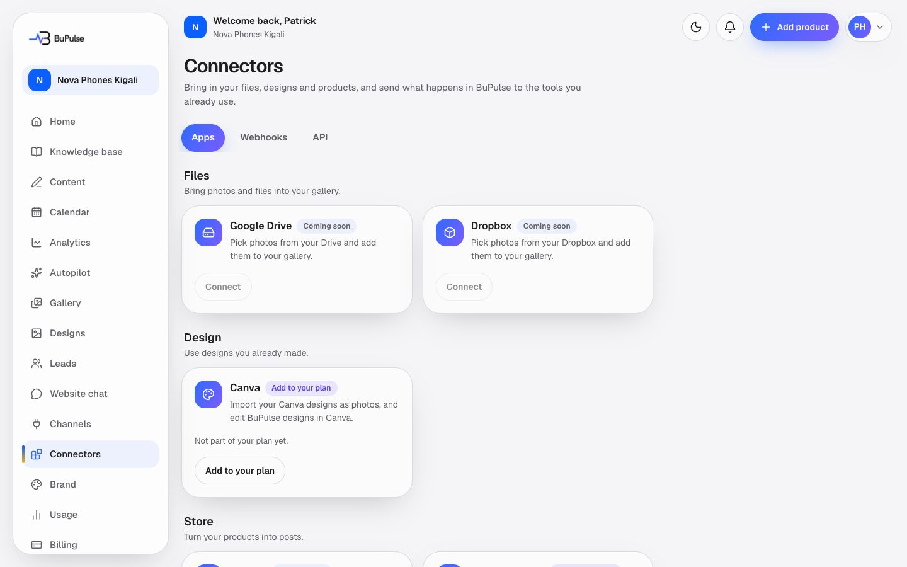
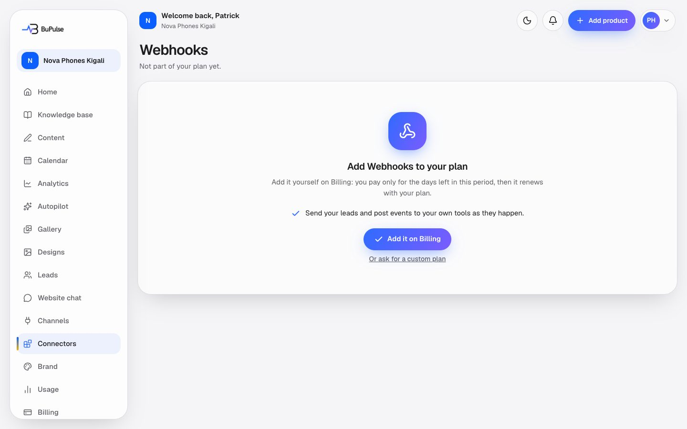
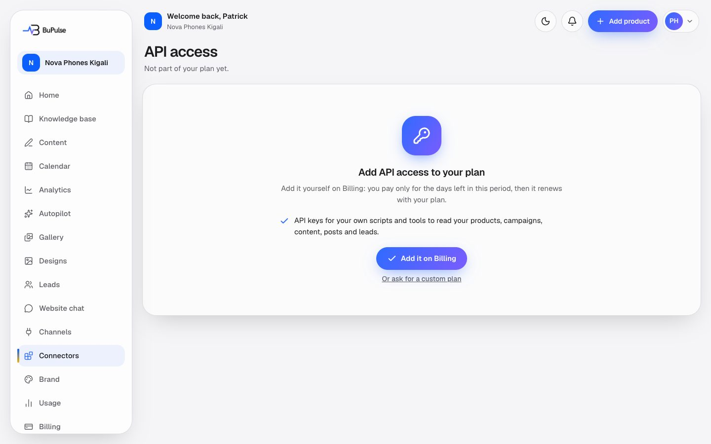

# Connectors, API keys and webhooks

Connectors is the hub for everything BuPulse links to outside social media. **Apps** brings files, designs and products
in (Google Drive, Dropbox, Canva, Shopify, WooCommerce, Cloudflare). **Webhooks** sends what happens in BuPulse (a new
lead, new content, a post published or failed) to Zapier, Make or the business's own system. **API** gives the
business keys so its own scripts can read its products, campaigns, content, posts and leads.

**Page:** `/dashboard/connectors`, `/dashboard/connectors/webhooks`, `/dashboard/connectors/api`  **Plans:** the Apps
tab is open to Owners and Admins on every plan; each app needs its own feature (`driveImport`, `canva`, `storeImport`,
`websiteChat`). Webhooks need feature key `webhooks` and the API needs `apiAccess`. Neither is in Starter or Business
as seeded (they are in Pro); in Rwanda they are add-ons in Billing → Add features or a custom plan (seeded at 5,000 RWF
and 15,000 RWF a month, Admin → Money → Add-on prices). The admin can change plans in Admin → Plans. Team permissions:
`connectors` for Apps, `webhooks` for Webhooks and API (Owner and Admin).

## What you see

- **Tabs**: Apps, Webhooks, API.
- **Apps**, in groups: **Files** (Google Drive, Dropbox), **Design** (Canva), **Store** (Shopify, WooCommerce),
  **Website** (Cloudflare). Each card says Connected, Needs attention, Not connected, Coming soon (BuPulse's own keys
  are not set) or "Add to your plan".
- **More ways to connect**: links to Social networks (the Channels page), Webhooks and API keys, with an "Add to your
  plan" badge when the plan lacks them.

- **Webhooks**: your endpoints (up to 5), the events each one receives, on/off, **Send test event**, **New secret**,
  and the last 50 deliveries with status, HTTP code, tries and **Retry**.

- **API keys**: your keys (up to 10) with name, the first characters, scopes, when last used, and **Revoke**.

## How to use it

**Connect an app**
1. Open **Connectors**, find the app, press **Connect** (or **Open**). Drive, Dropbox and Canva imports happen from the
   gallery ([Gallery and media import](06-gallery-and-media-import.md)); stores in [Online stores](15-online-stores.md);
   Cloudflare in [Domains](16-domains.md).

**Send events to Zapier or Make**
1. In Zapier make a Zap with *Webhooks by Zapier → Catch Hook* (in Make: *Webhooks → Custom webhook*) and copy its address.
2. In BuPulse open **Connectors → Webhooks**, press add, paste the address, tick the events
   (New lead, Content generated, Post published, Post failed) and save.
3. Copy the secret (`whsec_…`). It is shown once.
4. Press **Send test event**, then finish the Zap in Zapier.

**Create an API key**
1. Open **Connectors → API**, give the key a name and tick what it may do (read products and campaigns, read content,
   read posts, create draft posts, read leads, change lead status and notes).
2. Copy the key (`bp_live_…`). It is shown once.
3. Give it to your developer with [docs/API.md](../../API.md). Revoke it any time; it stops at once.

## Limits and settings

- 5 webhook endpoints per business (`MAX_ENDPOINTS`), 10 API keys (`MAX_API_KEYS`), 60 API requests a minute per key.
- Webhooks: answer within 5 seconds. Failed sends are retried for 24 hours, then marked Failed. Deliveries are kept 30 days.
- Nothing here counts against AI usage.
- Note: the Webhooks page subtitle and docs/WEBHOOKS.md still say webhooks are "on every plan". The code gates them by
  the `webhooks` feature (`emitWebhookEvent` sends nothing without it), so a Starter or Business company needs it added.
- **Keeping your data**: without the feature, existing endpoints and keys stay visible read-only (you can delete an
  endpoint, switch it off, or revoke a key); a page with nothing on it shows "Add to your plan". Keys of a plan that
  is not active (past due, ended) are paused, not deleted.
- **Admin → Connections** lists every client's webhook endpoints and API keys; support can pause or resume an endpoint
  and revoke a key.

## For developers

### Where it lives

| Part | Files |
|---|---|
| Pages | `app/dashboard/connectors/page.tsx`, `app/dashboard/connectors/webhooks/page.tsx`, `app/dashboard/connectors/api/page.tsx` |
| Server actions | `app/dashboard/connectors/actions.ts` (`disconnectConnector`); `app/dashboard/connectors/webhooks/actions.ts` (`createWebhook`, `updateWebhook`, `toggleWebhook`, `deleteWebhook`, `rotateWebhookSecret`, `sendWebhookTest`, `retryWebhookDelivery`); `app/dashboard/connectors/api/actions.ts` (`createKey`, `revokeKey`) |
| Components | `components/connectors/connector-card.tsx`, `sub-nav.tsx`, `webhooks-manager.tsx`, `api-keys-manager.tsx`, `secret-box.tsx`, `when.tsx`; `components/app/kept-data-note.tsx` |
| Logic | `lib/connectors/catalog.ts`, `lib/connectors/types.ts`, `lib/connectors/entries/{google-drive,dropbox,canva,shopify,woocommerce,cloudflare}.ts`; `lib/webhooks/{core,endpoints,events,emit,delivery,retry}.ts`; `lib/api/{auth,keys,paging,serialize}.ts` |
| Database | `WebhookEndpoint`, `WebhookDelivery`, `ApiKey`; the apps use `Connection`, `StoreConnection`, `CloudflareConnection`, `CanvaConnection` |
| API routes | `app/api/v1/route.ts`, `app/api/v1/products/…`, `campaigns/…`, `content/…`, `posts/…`, `leads/…`, `projects/…` (deprecated), each with `[id]/route.ts` |
| Cron jobs | Webhook retries run inside `app/api/cron/leads-digest/route.ts` (hourly at :37, `LEADS_DIGEST_CRON` in `worker-crons.ts`) via `retryDueWebhooks` |
| Admin | `app/admin/(console)/(clients)/connections/` (`pauseWebhookAction`, `resumeWebhookAction`, `revokeApiKeyAction`); `lib/admin/connections.ts` (`listWebhookEndpoints`, `listApiKeys`) |
| Tests | `tests/connectors/catalog.test.ts`, `tests/webhooks/core.test.ts`, `tests/webhooks/delivery.test.ts`, `tests/webhooks/migration.test.ts`, `tests/api/api.test.ts`, `tests/features/keep-your-data.test.ts` |
| Docs | [docs/CONNECTORS.md](../../CONNECTORS.md), [docs/WEBHOOKS.md](../../WEBHOOKS.md), [docs/API.md](../../API.md) |

Environment variables (names only): `API_KEY_PEPPER` (falls back to a key derived from `ENCRYPTION_KEY`),
`ENCRYPTION_KEY` (webhook secrets are stored encrypted), plus each app's own keys (see the app's page).

### Key functions

- `getCatalog` (`lib/connectors/catalog.ts`) — every app card with its real state (`ConnectorState`) for this business and plan.
- `CONNECTOR_FEATURE` (`lib/connectors/catalog.ts`) — the plan feature each app belongs to.
- `findEntry` + `ConnectorEntry.disconnect` (`lib/connectors/catalog.ts`, `lib/connectors/entries/*`) — what the Disconnect button runs.
- `createEndpoint`, `updateEndpoint`, `setEndpointEnabled`, `deleteEndpoint`, `rotateEndpointSecret` (`lib/webhooks/endpoints.ts`) — endpoint CRUD, 5 per business.
- `checkWebhookUrl`, `isBlockedHost` (`lib/webhooks/core.ts`) — https only, no private or local hosts.
- `signWebhook` / `verifyWebhookSignature` (`lib/webhooks/core.ts`) — `X-BuPulse-Signature: t=…,v1=<HMAC-SHA256 of "t.body">`.
- `queueWebhookEvent` / `emitWebhookEvent` (`lib/webhooks/emit.ts`) — called from `lib/leads/notify.ts`, `lib/studio/service.ts`, `lib/studio/pack.ts` and `lib/publishing/engine.ts`; first send in the background (3 quick tries).
- `retryDueWebhooks` (`lib/webhooks/retry.ts`) — hourly retries with growing waits, gives up after 24 hours, deletes deliveries after 30 days.
- `sendTestEvent`, `listDeliveries`, `retryDelivery` (`lib/webhooks/endpoints.ts`) — the page's test, log and Retry.
- `createApiKey`, `revokeApiKey`, `listApiKeys`, `hashApiKey` (`lib/api/keys.ts`) — keys are shown once and stored as a peppered HMAC.
- `authenticate` / `apiRoute` (`lib/api/auth.ts`) — bearer key, scope, `apiAccess` and account checks, 60 a minute per key.
- `apiFeatureDenied` (`lib/api/auth.ts`) — extra feature checks (`PATCH /leads/:id` needs `websiteChat`, `POST /posts` needs `calendar`).
- `parsePaging` / `toPage` (`lib/api/paging.ts`) and `productJson`, `campaignJson`, `postJson`, `leadJson` (`lib/api/serialize.ts`) — list paging and response shapes.

### How it works

1. **Webhook event**: something happens (a lead, generated content, a publish) → `queueWebhookEvent(businessId, event, build)`
   → `emitWebhookEvent` sends nothing when the plan lacks `webhooks`; otherwise a `WebhookDelivery` per enabled, not
   admin-paused endpoint that wants the event → `attemptDelivery` (`lib/webhooks/delivery.ts`)
   signs and POSTs it. Timeouts, 429 and 5xx stay due; the hourly `retryDueWebhooks` tries again.
2. **API call**: `Authorization: Bearer bp_live_…` → `apiRoute(scope, handler)` → `authenticate` finds the key by hash,
   checks the scope, the plan's `apiAccess` and the account state, rate-limits → the handler reads only that business's
   rows → JSON (`{ data, nextCursor }` for lists).
3. **Apps**: the page builds cards with `getCatalog`; Connect links to the app's own page; Disconnect calls
   `disconnectConnector(id)`.

## If something goes wrong

| Symptom | Look first | Usual fix |
|---|---|---|
| Webhook deliveries show Failed | Connectors → Webhooks log (HTTP code); Admin → Connections | Fix the receiver so it answers 2xx within 5 s, then press Retry. A 4xx other than 429 is not retried. |
| "That address points to a private or local network…" or "The address must start with https://" when adding an endpoint | `checkWebhookUrl` / `isBlockedHost` (`lib/webhooks/core.ts`) | Use a public https address. |
| Receiver says the signature is wrong | `signWebhook`; the secret (`rotateEndpointSecret`) | Verify against the raw body bytes and the current `whsec_` secret; see docs/WEBHOOKS.md. |
| An endpoint says "paused by BuPulse support" | `PAUSED_BY_SUPPORT` (`lib/webhooks/endpoints.ts`); Admin → Connections | Support resumes it there. |
| API answers 401 | `authenticate` (`lib/api/auth.ts`) | Key revoked or mistyped; create a new one. Changing `API_KEY_PEPPER` invalidates every key. |
| API answers 403 `plan_required` | The plan's `apiAccess`; Admin → Plans or the client's offers | Add API access to the plan; keys work again without being recreated. |
| API answers 503 `feature_unavailable` | `featureStatus` = `plan_unknown` (`lib/entitlements.ts`) | Temporary (plan could not be read); retry. Check Admin → Health if it lasts. |
| App card stuck on "Coming soon" | The entry in `lib/connectors/entries/*` and its env keys | Set BuPulse's keys for that app ([docs/CONNECTORS.md](../../CONNECTORS.md)). |
