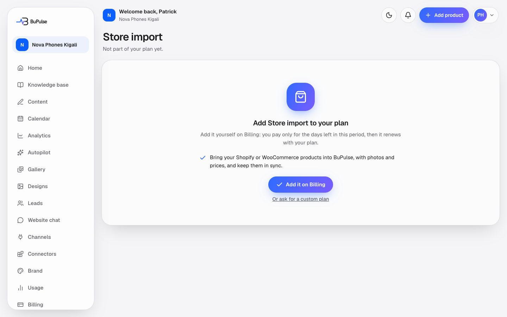

# Online stores (Shopify and WooCommerce import)

A business with an online shop can bring its products into BuPulse instead of typing them again. BuPulse reads the
products (name, price, description, features and up to 10 photos), adds them to the Knowledge base as products with a
photo album, and keeps them in step with the shop every day. It only reads: nothing in the shop is ever changed.

**Page:** `/dashboard/stores`, `/dashboard/stores/shopify`, `/dashboard/stores/woocommerce`  **Plans:** feature key
`storeImport`. Not in Starter or Business as seeded; it is an add-on in Billing → Add features or a custom plan
(seeded at 10,000 RWF a month in Rwanda, Admin → Money → Add-on prices). Pro has it. The admin can change plans in
Admin → Plans. Owner and Admins only (team permission `connectors`).

## What you see

- **Import from your store**: one card for Shopify and one for WooCommerce, with the connected shop address and a badge
  (Connected, Not connected, or Coming soon when Shopify is not set up by BuPulse yet). The button says **Connect** or
  **Import products**.

- **Not connected**: for Shopify, a box for your `your-shop.myshopify.com` address; for WooCommerce, your store's web
  address for the one-click connection, and **Or paste your keys by hand** (consumer key and secret).
- **Connected**: the shop address, a **Connected** or **Needs attention** badge, **Disconnect**, the product list from
  your shop (search, tick, **Import selected**, **Import all (up to 200)**), and the **Sync now** panel with when it last ran.
- **Knowledge → Products** also has an **Import from Shopify / WooCommerce** (or "Import from your store") button.

## How to use it

**Shopify**
1. Open **Import from your store**. It is not in the sidebar: use the Shopify or WooCommerce card on **Connectors**, or
   **Import from your store** on Knowledge → Products. Press **Connect** on Shopify.
2. Type your shop's address (it ends in `.myshopify.com`, found in Shopify under Settings, Domains) and continue.
3. Approve BuPulse in Shopify. It asks for read-only access to products.
4. Back in BuPulse, tick the products you want and press **Import selected** (or **Import all**).

**WooCommerce**
1. Press **Connect** on WooCommerce and type your store's address (starting with `https://`).
2. Approve read-only access in your WordPress store.
3. Back in BuPulse, press **Connect <your store>** to confirm (within 30 minutes).
4. If your host blocks the one-click way: in WordPress open WooCommerce → Settings → Advanced → REST API → **Add key**
   (Description: BuPulse, Permissions: Read), then paste the key and secret under **Or paste your keys by hand**.

**Keeping products up to date**
- BuPulse re-checks imported products every night. Press **Sync now** to do it straight away.
- If you changed a product in BuPulse (name, price, features, description or photos), your edit is kept and the sync
  reports "kept your edits". A product removed from the shop stays in BuPulse and is flagged.

## Limits and settings

- Import all takes up to 200 products; the screen imports 5 at a time and shows progress.
- At most 500 products per business (`MAX_PRODUCTS_PER_BUSINESS`) and 10 photos per product.
- Photos go to the gallery and count against its quota (500 photos, 2 GB; [Gallery](06-gallery-and-media-import.md)).
  JPEG, PNG and WebP only, 10 MB each.
- Importing does not use AI credits. Writing posts about the products later does ([Projects and content](04-projects-and-content.md)).
- The admin can switch Shopify or WooCommerce off in **Admin → Services**; the nightly sync then skips those stores
  without touching their data. **Admin → Connections** lists every client's store connections.
- Disconnecting removes the store link; the imported products stay.

## For developers

### Where it lives

| Part | Files |
|---|---|
| Pages | `app/dashboard/stores/page.tsx`, `app/dashboard/stores/[provider]/page.tsx` (both `pageGate("connectors")` then `featureGate("storeImport")`) |
| Server actions | `app/dashboard/stores/actions.ts`: `listProductsAction`, `importChunkAction`, `resyncAction`, `disconnectStoreAction`, `connectWooManualAction`, `startWooConnectAction`, `confirmPendingAction`, `cancelPendingAction` |
| Components | `components/stores/product-import.tsx`, `sync-panel.tsx`, `woo-manual-form.tsx`, `store-actions.tsx` |
| Logic | `lib/stores/shopify.ts`, `lib/stores/woocommerce.ts`, `lib/stores/sync.ts`, `lib/stores/connection.ts`, `lib/stores/safe-fetch.ts`, `lib/stores/shopify-webhooks.ts`, `lib/stores/state.ts`, `lib/stores/hmac.ts`, `lib/stores/text.ts`, `lib/stores/types.ts`; card entries `lib/connectors/entries/shopify.ts`, `woocommerce.ts` |
| Database | `StoreConnection` (encrypted credentials, status, last attempt), `StoreConnectionPending` (WooCommerce one-click, 30 min), `ProductSync` (store product → `Product`, with `baseline` and `sourceMissing`), `Product`, `ProductPhoto`, `MediaAsset` (source `store`) |
| API routes | `app/api/stores/shopify/connect/route.ts` (GET install / POST form), `app/api/stores/shopify/callback/route.ts`, `app/api/stores/shopify/webhooks/route.ts`, `app/api/stores/woocommerce/callback/route.ts` |
| Cron jobs | `app/api/cron/store-sync/route.ts`, daily at 03:47 UTC (`STORE_SYNC_CRON`, cursor calls from `worker.ts`, 5 stores per call (2 on hosts with a short request limit); `netlify/functions/cron-store-sync.mts`) |
| Tests | `tests/stores/shopify.test.ts`, `woocommerce.test.ts`, `sync.test.ts`, `pending.test.ts`, `safe-fetch.test.ts`, `install-login.test.ts` |
| Docs | [docs/CONNECTORS.md](../../CONNECTORS.md) ("Stores and Cloudflare": Shopify Partner setup, WooCommerce, overwrite rule) |

Environment variables (names only): `SHOPIFY_API_KEY`, `SHOPIFY_API_SECRET`, `SHOPIFY_API_VERSION` (optional,
default `2026-07`), `ENCRYPTION_KEY` (credentials are encrypted), `CRON_SECRET`.

### Key functions

- `isShopifyEnabled`, `shopifyConfig` (`lib/stores/shopify.ts`) — Shopify shows "Coming soon" without its keys.
- `normalizeShopDomain`, `buildAuthorizeUrl`, `verifyOAuthHmac`, `exchangeCode` (`lib/stores/shopify.ts`) — the Shopify OAuth steps (scope `read_products`).
- `installRedirect` (`lib/stores/shopify.ts`) — an install opened from Shopify with a valid HMAC (15 minutes) starts OAuth at once.
- `verifyWebhookHmac` + `handleShopifyWebhook` (`lib/stores/shopify.ts`, `lib/stores/shopify-webhooks.ts`) — GDPR and `app/uninstalled` webhooks.
- `buildWooAuthorizeUrl`, `sealWooState` / `openWooState`, `verifyWooKeys` (`lib/stores/woocommerce.ts`) — WooCommerce one-click and key check.
- `savePending`, `getPending`, `confirmPending`, `cancelPending` (`lib/stores/connection.ts`) — WooCommerce keys wait for the owner's confirm.
- `saveConnection`, `removeConnection`, `markNeedsAttention` (`lib/stores/connection.ts`) — store link CRUD; a 401/403 from the store marks it.
- `importProducts` (`lib/stores/sync.ts`) — imports a chunk (5) of products as `Product` rows with album photos.
- `planUpdate`, `baselineOf` (`lib/stores/sync.ts`) — the overwrite rule: a field is replaced only while it still equals the last synced value.
- `resyncConnection` (`lib/stores/sync.ts`) — Sync now: up to 40 products per call and about 800 subrequests (`SUBREQUEST_BUDGET`); the button calls again until the pass is done.
- `runDailyStoreSync` (`lib/stores/sync.ts`) — the nightly pass, stalest store first, with a cursor.
- `fetchImage`, `checkImageUrl`, `isShopifyImageHost` (`lib/stores/safe-fetch.ts`) — SSRF-safe image download (https, public hosts, 10 MB, sniffed type).
- `galleryRoom` (`lib/stores/sync.ts`) — how many photos still fit in the gallery quota.

### How it works

1. **Shopify**: the form posts to `/api/stores/shopify/connect` → sealed state cookie (`sealShopifyState`) → Shopify
   consent → `/api/stores/shopify/callback` checks HMAC, state and shop → `exchangeCode` → `saveConnection` →
   `subscribeUninstall` → back to `/dashboard/stores/shopify`.
2. **WooCommerce**: `startWooConnectAction` → `<store>/wc-auth/v1/authorize` → the store POSTs keys to
   `/api/stores/woocommerce/callback` → `verifyWooKeys` → `savePending` → the owner presses confirm →
   `confirmPendingAction` → `confirmPending`.
3. **Import**: `listProductsAction` (paged, searchable) → the owner ticks → `importChunkAction` 5 at a time →
   `importProducts` writes `Product`, `ProductPhoto`, `MediaAsset` and a `ProductSync` row with the baseline.
4. **Re-sync**: `resyncAction` (button, repeated while it has more) or the daily cron → `resyncConnection` →
   `planUpdate` per product → updated / unchanged / kept your edits / missing / failed.

## If something goes wrong

| Symptom | Look first | Usual fix |
|---|---|---|
| Shopify card says "Coming soon" | `isShopifyEnabled` (`lib/stores/shopify.ts`) | Set `SHOPIFY_API_KEY` and `SHOPIFY_API_SECRET` and redeploy. |
| "That does not look like a Shopify address" | `normalizeShopDomain` | Use the `.myshopify.com` address, not the custom domain. |
| WooCommerce: "The one-click way needs BuPulse on https" | `buildWooAuthorizeUrl`, the site URL | Use the manual keys, or run BuPulse on https. |
| WooCommerce: "That connection request expired" | `getPending` (30-minute limit) | Start the connection again and confirm sooner. |
| Store shows **Needs attention** | `markNeedsAttention`; Admin → Connections | The shop refused the key (401/403): reconnect or paste new keys. |
| A product's price or name did not update | `planUpdate` (kept your edits) | Expected when it was edited in BuPulse. Delete the product and import it again to follow the shop. |
| Photos missing after import | `fetchImage` result; gallery quota (`galleryRoom`) | Free space in the gallery; images over 10 MB or not JPEG/PNG/WebP are skipped. |
| Nightly sync did nothing | Admin → Health (cron runs `store-sync`); Admin → Services | Check `CRON_SECRET` and the schedule; the provider may be switched off. |
