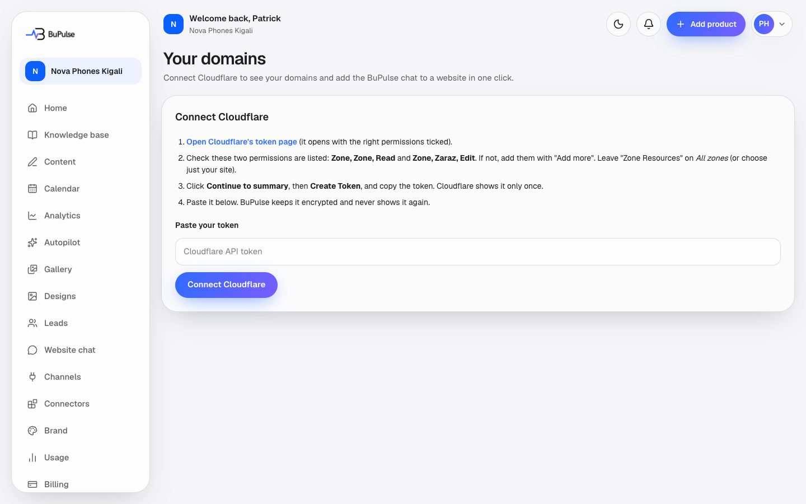

# Domains (Cloudflare)

If a business's website runs through Cloudflare, it can connect Cloudflare here and put the BuPulse website chat on the
site in one click, without touching the website's code. BuPulse lists the business's domains, adds the chat to the one
chosen, and shows when the chat has loaded on that site. Sites not on Cloudflare install the chat by pasting a code line
instead ([Website chat](11-website-chat.md)).

**Page:** `/dashboard/domains`  **Plans:** part of the website chat, feature key `websiteChat`: Business (with its 500
chat replies a month); not in Starter, where it can be added in Billing → Add features (seeded at 10,000 RWF a month in
Rwanda) or a custom plan. The admin can change plans in Admin → Plans. Owner and Admins only (team permission `connectors`).

## What you see

- **Not connected**: **Connect Cloudflare** with four steps (open Cloudflare's token page, check the two permissions,
  create the token, paste it) and a box to paste the token.
- **Connected**: a **Cloudflare · Connected** bar with **Disconnect**, then one row per domain with its chat state:
  - **Live**: "Chat is live on this site" (the chat has loaded there).
  - **Added**: "Chat added, waiting for the first visit".
  - Not added: **Install chat**.
  - **Remove** takes the chat off that domain.
- When Cloudflare refuses the change, the row shows the code line to paste into the site by hand and a link to
  step-by-step guides (WordPress, Wix, Shopify and more).
- If the saved token stops working, a red note asks for a new token.

## How to use it

1. Open **Your domains**: it is not in the sidebar; use the Cloudflare card on **Connectors** (or Channels → Apps).
2. Press **Open Cloudflare's token page**. It opens with the right permissions ticked: **Zone, Zone, Read** and
   **Zone, Zaraz, Edit**. Leave "Zone Resources" on All zones, or pick just your site.
3. Press **Continue to summary**, then **Create Token**, and copy it (Cloudflare shows it once).
4. Paste it in BuPulse and save. Your domains appear.
5. Press **Install chat** on your website's domain.
6. Open your website once. The row changes from **Added** to **Live**.
7. To take it off, press **Remove**. **Disconnect** forgets the token but leaves chats that are already installed (remove
   them first if you want them gone).

## Limits and settings

- The domain must be proxied through Cloudflare (orange cloud). Pages that are not proxied will not show the chat.
- Installing also adds the domain to the chat's allowed websites (Website chat settings). There is a maximum number of
  allowed websites; when it is full, remove one in Website chat first.
- Chat replies count against the plan's chat allowance, wherever the chat is installed ([Website chat](11-website-chat.md)).
- If the admin switches Cloudflare off in **Admin → Services**, Install chat answers with the code to paste by hand.
- **Admin → Connections** lists every client's Cloudflare connection.

## For developers

### Where it lives

| Part | Files |
|---|---|
| Page | `app/dashboard/domains/page.tsx` (`pageGate("connectors")` then `featureGate("websiteChat")`) |
| Server actions | `app/dashboard/domains/actions.ts`: `connectCloudflareAction`, `installChatAction`, `removeChatAction`, `disconnectCloudflareAction` |
| Components | `components/domains/token-form.tsx`, `zone-list.tsx`, `disconnect-button.tsx` |
| Logic | `lib/cloudflare/client.ts` (API calls), `lib/cloudflare/zaraz.ts` (the Zaraz tool), `lib/cloudflare/service.ts` (connect, list, install, remove); `lib/widget/install.ts` (`scriptTag`); card entry `lib/connectors/entries/cloudflare.ts` |
| Database | `CloudflareConnection` (encrypted token, status ACTIVE / NEEDS_ATTENTION), `CloudflareInstall` (zone, tool id), `ChatWidget.allowedDomains`, `ChatWidget.lastSeenHost` |
| API routes | none of its own; the installed chat calls the website chat routes (`app/api/widget/*`) |
| Cron jobs | none |
| Admin | `lib/admin/connections.ts` (`listCloudflareConnections`) on `app/admin/(console)/(clients)/connections/page.tsx` |
| Tests | `tests/stores/cloudflare.test.ts` |
| Docs | [docs/CONNECTORS.md](../../CONNECTORS.md) ("Cloudflare: owner and user setup") |

No BuPulse-side Cloudflare keys: each business pastes its own user API token. `ENCRYPTION_KEY` encrypts it.

### Key functions

- `tokenPageUrl` (`lib/cloudflare/client.ts`) — the pre-filled Cloudflare token page link.
- `verifyToken`, `listZones`, `cf` (`lib/cloudflare/client.ts`) — `GET /user/tokens/verify`, the zones, and the API wrapper (`CloudflareError`, `authFailed`).
- `connectCloudflare` (`lib/cloudflare/service.ts`) — checks the token before saving it encrypted.
- `listZoneRows` (`lib/cloudflare/service.ts`) — each zone with its chat state (`none`, `added`, `installed`).
- `installChat` (`lib/cloudflare/service.ts`) — allows the domain, installs the Zaraz tool, records `CloudflareInstall`; returns `manual` with a reason when it cannot.
- `allowDomain` (`lib/cloudflare/service.ts`) — adds the zone to `ChatWidget.allowedDomains`.
- `uninstallChat` (`lib/cloudflare/service.ts`) — removes only this business's tool.
- `disconnectCloudflare` (`lib/cloudflare/service.ts`) — forgets the token.
- `installWidget`, `removeWidget`, `findTool`, `buildTool`, `toolNameFor` (`lib/cloudflare/zaraz.ts`) — reads, changes, publishes and re-reads the zone's Zaraz config; the tool is named "BuPulse chat widget (<widget key>)".

### How it works

1. Paste token → `connectCloudflareAction` → `connectCloudflare` → `verifyToken` → `CloudflareConnection` saved encrypted.
2. The page → `listZoneRows` → `listZones` with the decrypted token; a rejected token sets `NEEDS_ATTENTION`.
3. **Install chat** → `installChatAction(zoneId)` → `installChat` → `allowDomain` first (so the manual code works even if
   the next step fails) → `installWidget` adds a Zaraz "Custom HTML" tool with the `scriptTag` line, publishes, and reads
   it back → `CloudflareInstall` upsert.
4. The chat loads on the site → the widget routes record `ChatWidget.lastSeenHost` → the row shows **Live**.

## If something goes wrong

| Symptom | Look first | Usual fix |
|---|---|---|
| Token is refused when pasted | `verifyToken` (`lib/cloudflare/client.ts`) | Use a *User* API token (not an account token) with Zone Read and Zaraz Edit. |
| "This token cannot change Zaraz on this domain" | `installChat` manual reason | Add the Zaraz Edit permission to the token, or paste the code by hand. |
| Row stays on **Added** | `ChatWidget.lastSeenHost`; Cloudflare proxy status | Open the site once; make sure the domain is proxied (orange cloud). |
| "Your chat widget already lists the most websites allowed" | `allowDomain`; Website chat → allowed websites | Remove an unused website in Website chat, then install again. |
| Red note "Cloudflare no longer accepts the saved token" | `CloudflareConnection.status` = NEEDS_ATTENTION | Create a new token and paste it. |
| Cloudflare rejects the tool shape | `buildTool` (`lib/cloudflare/zaraz.ts`) | The shape has not been tested on a real zone yet (docs/CONNECTORS.md); adjust that one function. |
