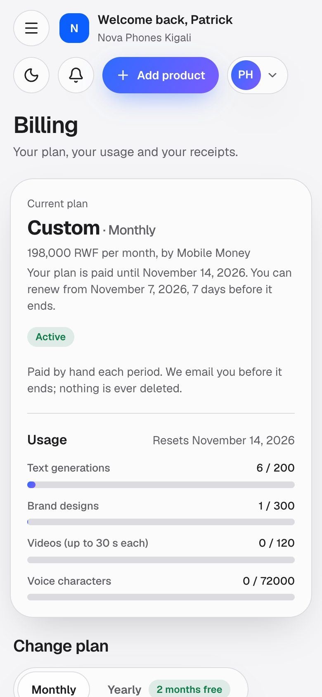
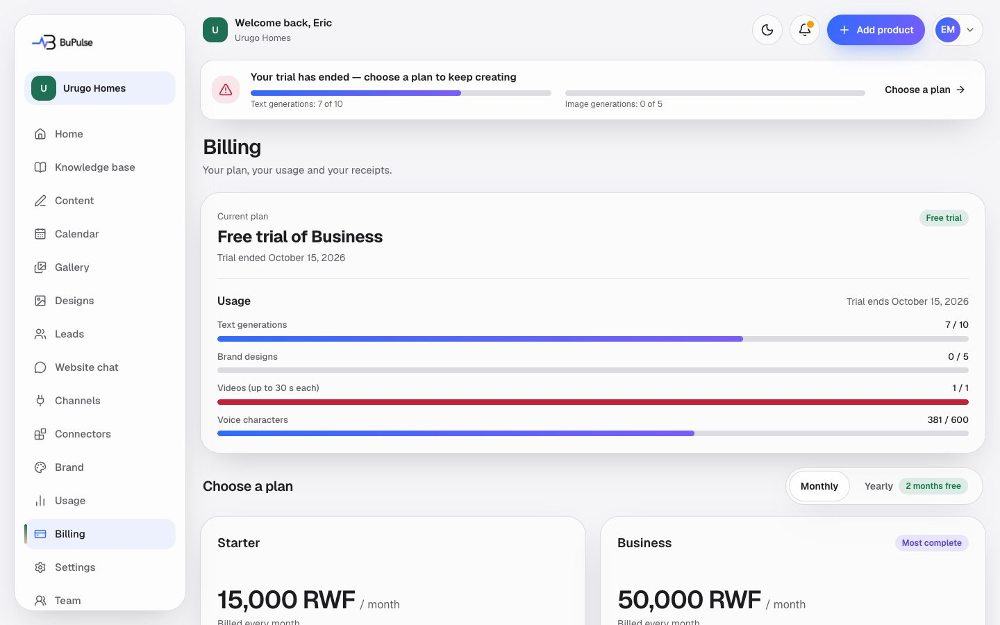
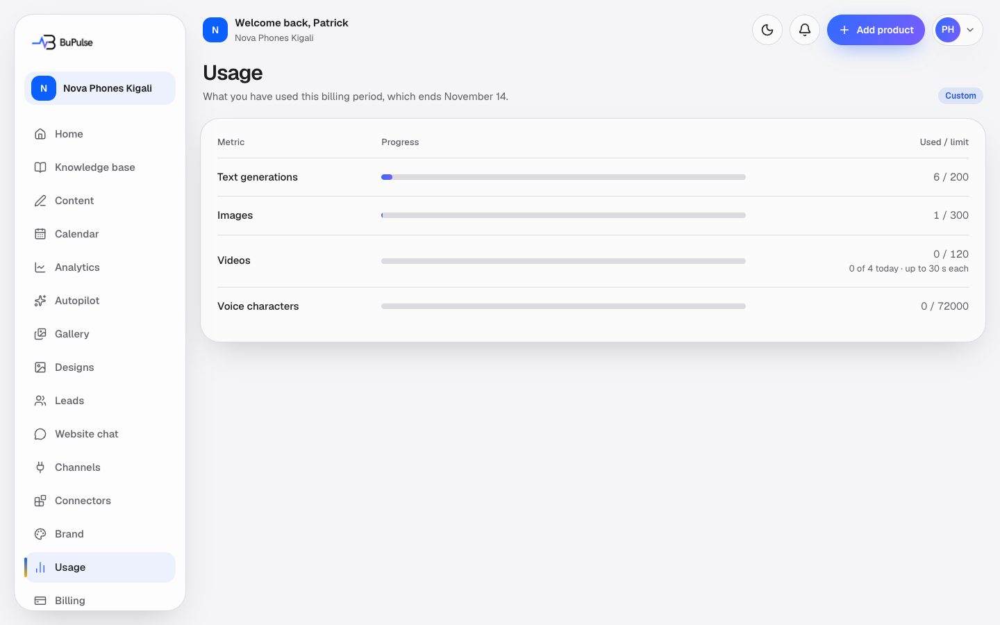
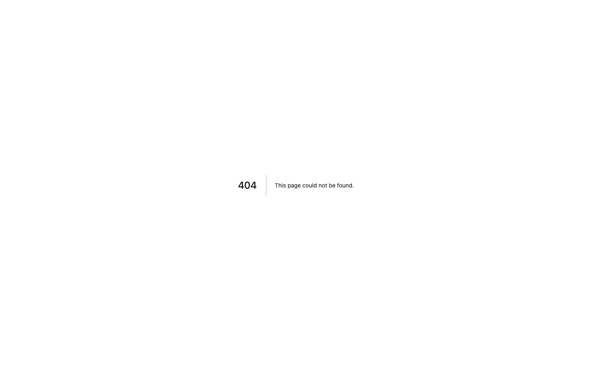
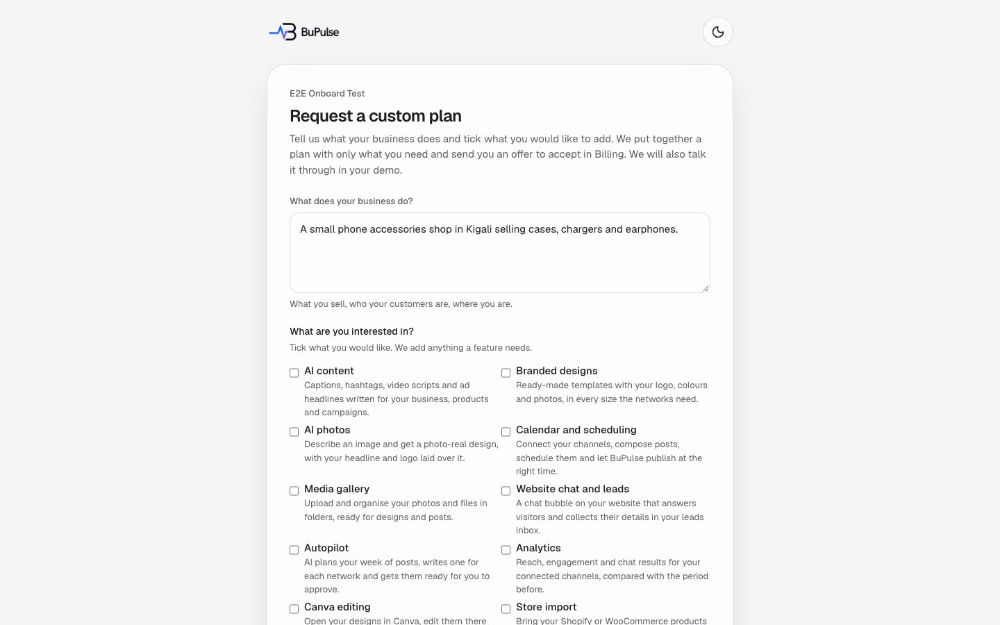

# Billing, plans and usage

Billing is where the company Owner sees the plan, how much of it is used, and pays. In Rwanda a client pays with
**Mobile Money** (MTN or Airtel, checked by hand by the BuPulse owner) or by **card** (through Paddle, charged in US
dollars). The same page renews the plan, adds single features to it, pays BuPulse invoices and custom plan offers, and
links to a request form for a custom plan. **Usage** shows what has been used this month, and **Add to your plan**
explains a locked feature and how to get it.

**Page:** `/dashboard/billing`, `/dashboard/usage`, `/dashboard/upgrade?feature=<key>`, `/custom-plan`,
`/custom-plan/call`  **Plans:** every plan. Rwanda prices (seeded; the admin changes them in Admin → Settings → Regions
and prices, and features and limits in Admin → Plans):

| | Starter | Business |
|---|---|---|
| Monthly | 15,000 RWF | 50,000 RWF |
| Yearly (10 months) | 150,000 RWF | 500,000 RWF |
| Features | AI content (`content`), designs (`designs`), calendar and publishing (`calendar`), gallery (`gallery`) | Starter + AI photos (`aiPhotos`), website chat and leads (`websiteChat`), videos (`video`), voiceover (`voice`) |
| AI texts a month | 60 | 200 |
| Designs / AI images a month | 30 | 100 |
| Videos | none | 120 a month, at most 4 a day, up to 30 s each |
| Chat replies a month | none | 500 |
| Users | 1 | 3 |

Other features (autopilot, analytics, Canva, store import, Drive and Dropbox, webhooks, API) are **add-ons** the
Owner can buy in Billing → Add features; extra users and more texts, images or chat replies come in a **custom plan**. Free trial: the chosen plan's features
with the TRIAL plan's limits. Only the Owner sees Billing (team permission `billing`); Admins see "Add to your plan" to
ask the owner; Members see neither.

## What you see

- **Alerts at the top** when they apply: "Your plan has ended" / "Your last payment didn't go through", a custom plan
  offer from the BuPulse team (with Accept and pay), an invoice to pay, or a Mobile Money payment in progress.
- **Current plan**: name, Monthly/Yearly, price, and when it renews or is paid until ("Renews automatically on …" for a
  card plan; "Your plan is paid until … You can renew from …" for Mobile Money). A badge says Active, Cancels soon, Free trial,
  Waiting for demo, Payment failed, Cancelled or Ended. Buttons: **Renew with Mobile Money** / **Renew with card** (last 7 days only), **Cancel plan** or
  **Resume** for card plans.
- **Usage**: bars for text generations, brand designs, videos and voice characters (only the ones the plan has), and
  the date they reset.
- **Plans**: the region's plans with Monthly/Yearly, "Prices for Rwanda", and **How would you like to pay?** (Mobile
  Money or Card; a method not ready yet stays visible and greyed out, for example "Card payments coming soon").
- **Add features**: the plan's own features ticked and locked; tick extra ones to see the price now (for the days left)
  and from the next renewal. On a card plan, features already added show **Remove**.
- **Invoices**: BuPulse invoices (number, amount, due date, status, PDF) and, for card plans, the card receipts.
- **Need something different?** → Request a custom plan (or "Request a custom change"), and **Need done-for-you
  marketing?** → the done-for-you page.

**Usage** (`/dashboard/usage`, every role): one row each for text generations, images, videos (with "N of 4 today · up to
30 s each") and voice characters, "Not in plan" when the limit is 0. Chat replies are shown on the Website chat page.

**Add to your plan** (`/dashboard/upgrade?feature=…`): what the feature does and why it is locked (not in your plan,
paused for a short while, or the plan could not be checked). The Owner gets **Add it on Billing** when Billing can sell
it, else **Ask for a custom plan**.

**Request a custom plan** (`/custom-plan`): what the business does, the features wanted (those in the plan are ticked and
locked), an optional budget and phone. After sending, an existing client can book a short call (`/custom-plan/call`).

## Video

<video src="../videos/billing.webm" controls muted width="100%"></video>

[Watch the clip](../videos/billing.webm)

## How to use it

**Pay or change plan by Mobile Money**
1. Open **Billing**, pick the plan and Monthly or Yearly, then **Mobile Money (MTN / Airtel)**.
2. The screen shows the amount, your reference (like `BP-7K3Q`) and how to pay: dial `*182*8*1*<code>#` on MTN (on a
   phone, **Tap to dial**), or send to the Airtel number with the reference.
3. Pay on your phone. Then press **I have paid**: choose the network, type the phone you paid from and the transaction
   id, and add a **screenshot** of the confirmation. No transaction id? Tick "I can't find the transaction id"; the
   screenshot is then required.
4. Wait on the page ("Thanks. We are checking your payment now", usually a few minutes). When the BuPulse owner confirms, the page refreshes:
   "You are all set. Your plan is active." You also get an email.
5. If it is rejected, the reason shows on Billing for a week with **Try again**.

**Pay by card**
1. Pick the plan and **Card**. The Paddle checkout opens; pay with your card (charged in US dollars).
2. Back on Billing the page refreshes by itself for up to about 2 minutes until Paddle has confirmed; then the plan is
   active and renews by itself.

**Renew**
- Card plans renew by themselves. Mobile Money plans do not: from 7 days before the end, Billing shows **Renew with
  Mobile Money** and **Renew with card**. Renewing early loses no days (the new period starts when the old one ends).
- You get reminder emails 5 days and 1 day before the end. After the end you have 3 more days; then the account becomes
  read-only (nothing is deleted) until you pay.

**Add one feature**
1. On Billing, under **Add features**, tick what you want. You see the price for the days left now, and the new total
   from your next renewal.
2. Pay with Mobile Money, get an invoice, or pay by card. The feature switches on when the payment is confirmed. Your
   renewal date does not move.

**Custom plan**
1. Press **Request a custom plan** (Billing, the pricing page, the demo screen or Add to your plan), fill in the form, send.
2. Optional: book a short call about it.
3. The BuPulse team sends an offer. It appears at the top of Billing (and by email), open for 7 days. Accept and pay it
   by Mobile Money, invoice or card. Paying switches the custom plan on.

**Invoices**
- An invoice from BuPulse arrives by email with a PDF and a **Pay online** link to Billing. Pay it by Mobile Money (the
  invoice number is the reference) or by card when its plan has a card price.

## Limits and settings

- **What counts:** each AI caption/script/headline set (text), each design or AI photo (image), each video, each
  voiceover character, each website chat reply. Usage resets every month from the period start, also on yearly plans.
  A failed AI call is given back.
- **When a limit is reached** the action says so. Self-serve Add features sells features only; more of a limit (blocks of
  +100 texts, +50 designs, +1,000 chat replies) or extra users come in a custom plan the BuPulse team prices
  (Request a custom plan). Adding AI photos also adds 30 designs, and adding the website chat 500 replies.
- **Add-on prices in Rwanda** (seeded, a month; Admin → Money → Add-on prices): AI photos 8,000, website chat 10,000,
  autopilot 20,000, analytics 5,000, Canva 5,000, store import 10,000, Drive and Dropbox 3,000, webhooks 5,000,
  API 15,000, videos 20,000, voiceover 15,000, extra user 3,000, +100 texts 3,000, +50 designs 5,000, +1,000 chat replies
  3,000 RWF; Managed by BuPulse 100,000 (light) or 180,000 (full) RWF.
- **Who can pay:** only the Owner. Members get no purchase prompts.
- **Admin side** (the BuPulse owner): **Admin → Payments** (confirm or reject Mobile Money payments, see the
  screenshot), **Admin → Offers** and **Customise plan** (`/admin/offers/new`), **Admin → Plan requests**
  (`/admin/requests`), **Admin → Invoices** (create, send, mark paid, void; settings at `/admin/invoices/settings`),
  **Admin → Plans**, **Admin → Add-on prices**, **Admin → Settings** (Mobile Money pay details, Card payments (Paddle),
  USD→RWF rate, trial days) and **Admin → Settings → Regions and prices** (`/admin/settings/regions`).

## For developers

### Where it lives

| Part | Files |
|---|---|
| Pages | `app/dashboard/billing/page.tsx` (`pageGate("billing")`), `app/dashboard/usage/page.tsx`, `app/dashboard/upgrade/page.tsx`, `app/custom-plan/page.tsx`, `app/custom-plan/call/page.tsx` |
| Server actions | `app/dashboard/billing/actions.ts`: `startCheckout`, `changePlan`, `cancelSubscription`, `resumeSubscription`, `openPortal`, `getInvoices`, `getInvoiceUrl`, `checkoutActivated`, `startMomoPayment`, `startMomoProofUpload`, `submitMomoProof`, `cancelMomoPayment`, `momoPaymentStatus`, `acceptOfferAction`, `addFeaturesAction`, `removeCardFeatureAction`, `payOfferByCardAction`; `app/custom-plan/actions.ts` (`requestCustomPlanAction`); `app/custom-plan/call/actions.ts` (`bookPlanCallAction`, `cancelPlanCallAction`) |
| Components | `components/billing/plan-picker.tsx`, `pay-choice.tsx`, `plan-actions.tsx`, `momo-payment.tsx`, `add-features.tsx`, `offer-card.tsx`, `offer-actions.tsx`, `invoice-pay.tsx`, `client-invoices.tsx`, `invoice-list.tsx`, `checkout/index.tsx`, `checkout-return.tsx`, `upgrade-dialog.tsx`; `components/app/add-to-plan.tsx`, `trial-banner.tsx`, `offer-banner.tsx`, `demo-lock.tsx`, `demo-pay.tsx`, `invoice-lock.tsx`; `components/offers/custom-plan-form.tsx` |
| Logic | Plans: `lib/plans.ts`, `lib/plan-catalog.ts`, `lib/features.ts`, `lib/entitlements.ts`, `lib/region-prices.ts`, `lib/region.ts`, `lib/region-format.ts`. Usage: `lib/usage.ts`, `lib/billing/period.ts`. Card: `lib/billing/paddle.ts`, `paddle-events.ts`, `paddle-config.ts`, `apply.ts`, `card-ready.ts`, `carry-over.ts`, `signing.ts`, `index.ts`, `types.ts`. Mobile Money: `lib/billing/momo.ts`, `momo-shared.ts`, `momo-settings.ts`, `momo-proofs.ts`, `momo-emails.ts`, `momo-renewals.ts`, `methods/`. Shared: `lib/billing/renewal.ts`, `pay-methods.ts`. Offers: `lib/offers/{shared,service,addon-prices,activate,card,card-plan,card-plan-items,requests,reminders,emails}.ts`. Invoices: `lib/invoices/{service,pdf,shared,settings,storage,emails}.ts`. Calls: `lib/demo/plan-calls.ts` |
| Database | `PlanDefinition`, `PricingRegion`, `PlanRegionPrice`, `Subscription`, `BillingEvent`, `ManualPayment`, `RenewalNotice`, `CardCarryOver`, `UsageRecord`, `VideoDayUsage`, `AddonPrice`, `PlanOffer`, `CustomPlanRequest`, `Invoice`, `DemoBooking` (plan calls) |
| API routes | `app/api/billing/webhooks/paddle/route.ts` (Paddle), `app/api/billing/webhooks/[provider]/route.ts` (future automatic Mobile Money providers; 404 today), `app/api/invoices/[id]/pdf/route.ts` (client's own invoice PDF) |
| Cron jobs | `app/api/cron/momo-renewals/route.ts` daily 05:41 UTC (`MOMO_RENEWALS_CRON`: reminders, grace → PAST_DUE, offer and invoice reminders, card carry-over retries, unsubmitted proofs); `app/api/cron/trial-reminders/route.ts` hourly at :53 (`TRIAL_CRON`); `app/api/cron/plan-price-changes/route.ts` daily 04:29 UTC (`PLAN_PRICE_CRON`). Schedules in `worker-crons.ts`, `wrangler.jsonc` and `netlify/functions/cron-*.mts` |
| Admin | `app/admin/(console)/(money)/{payments,offers,addon-prices,invoices,plans}/`, `app/admin/(console)/(clients)/requests/`, `app/admin/(console)/(system)/settings/` and `settings/regions/` |
| Tests | `tests/billing/*.test.ts` (momo-*, renewal, period-end, pay-methods, pay-states, paddle-*, card-flow-ui), `tests/offers/*.test.ts`, `tests/invoices/*.test.ts`, `tests/plans/*.test.ts`, `tests/plans.test.ts`, `tests/billing-apply.test.ts`, `tests/paddle-webhook.test.ts`, `tests/usage-videos.test.ts`, `tests/features/*.test.ts`, `tests/journeys/2-trial-to-momo-active.test.ts`, `3-invoice-to-active.test.ts`, `4-card-paddle-active.test.ts`, `5-downgrade-keep-your-data.test.ts`, `6-region-lock.test.ts` |
| Docs | [docs/BILLING.md](../../BILLING.md), [docs/MOMO.md](../../MOMO.md), [docs/OFFERS.md](../../OFFERS.md), [docs/INVOICES.md](../../INVOICES.md), [docs/PLANS.md](../../PLANS.md), [docs/REGIONS.md](../../REGIONS.md) |

Environment variables (names only; Paddle values are optional once saved in Admin → Settings → Card payments):
`BILLING_PROVIDER`, `PADDLE_ENVIRONMENT`, `PADDLE_API_KEY`, `PADDLE_CLIENT_TOKEN`, `PADDLE_WEBHOOK_SECRET`,
`PADDLE_PRICE_<PLAN>_<MONTH|YEAR>`, `BILLING_SIGNING_SECRET` (falls back to `ENCRYPTION_KEY`), `ADMIN_EMAILS`
(who gets "New MoMo payment to check"), `CRON_SECRET`.

### Key functions

- `getPlans`, `getPlan`, `getPlanLimits`, `planHasFeature` (`lib/plan-catalog.ts`) — plans from the database, cached 30 s, seed plans as fallback.
- `companyPlans`, `regionPriceIdFor` (`lib/region-prices.ts`) — the company region's plans and prices; the Paddle price id for a region.
- `companyEntitlements`, `featureStatus`, `featureGate`, `upgradeHref` (`lib/entitlements.ts`, `components/app/no-access.tsx`) — what the company may use and where a locked feature sends people.
- `consumeUsage` / `refundUsage`, `consumeDailyVideo`, `getUsageSummary` (`lib/usage.ts`) — reserve, give back and read usage; refuses when the account is blocked or the limit is reached.
- `periodState`, `periodGraceMs`, `manualGrace`, `usageWindowStart` (`lib/billing/period.ts`) — active / grace / ended from the dates: trial ends at `trialEndsAt` with no grace; Mobile Money 3 days (`MANUAL_GRACE_DAYS`); card 1 day (`CARD_RENEWAL_GRACE_DAYS`), none when cancelled at period end.
- `renewalState`, `tooEarlyToRenew` (`lib/billing/renewal.ts`) — the 7-day renewal window (`RENEWAL_WINDOW_DAYS`).
- `payMethods`, `methodState`, `methodReason` (`lib/billing/pay-methods.ts`) and `cardCheckoutConfigured`, `cardPricedPlans` (`lib/billing/card-ready.ts`) — which pay buttons are ready, coming soon, or off.
- `startManualPayment`, `startInvoicePayment`, `startOfferPayment`, `startProofUpload`, `submitManualProof` (`lib/billing/momo.ts`) — the client side of Mobile Money.
- `confirmManualPayment`, `rejectManualPayment` (`lib/billing/momo.ts`) — the admin's decision; confirm activates the plan in one transaction (`planManualPeriod` extends or replaces the period).
- `processMomoRenewals` (`lib/billing/momo-renewals.ts`) — the daily job.
- `processPaddleEvent` (`lib/billing/paddle-events.ts`) → `applyProviderSubscription` (`lib/billing/apply.ts`) — Paddle webhooks update `Subscription`.
- `carryOverMomoDays` (`lib/billing/carry-over.ts`) — card taking over a Mobile Money plan without losing paid days.
- `quoteOffer`, `quoteAddition`, `prorateMinor` (`lib/offers/shared.ts`) — prices of offers and added features (prorated for the days left).
- `startFeatureAddition`, `acceptOffer`, `clientOffer` (`lib/offers/service.ts`); `addFeaturesByCard`, `removeFeatureFromCardPlan`, `addableOnBilling` (`lib/offers/card-plan.ts`); `startOfferCardCheckout`, `applyOfferCardPayment` (`lib/offers/card.ts`) — Add features and offers.
- `createPlanRequest` (`lib/offers/requests.ts`), `bookPlanCall` (`lib/demo/plan-calls.ts`) — custom plan request (3 a day per company) and its call.
- `clientInvoices`, `payableView`, `markInvoicePaid`, `settleInvoiceFromCardPayment` (`lib/invoices/service.ts`) — invoices on Billing and how they get paid.

### How it works

1. **Mobile Money**: plan picker → `startMomoPayment` → `startManualPayment` writes a pending `ManualPayment` with the
   region price and a `BP-XXXX` reference → screenshot upload (`startMomoProofUpload`, private `payment-proofs` bucket)
   → `submitMomoProof` → admins emailed, Admin → Payments badge → the owner presses Confirm → `confirmManualPayment`:
   `Subscription` becomes `MANUAL_MOMO`, `ACTIVE`, new period, `BillingEvent` for revenue, email → the client's page
   (polling `momoPaymentStatus` every 5 s) refreshes.
2. **Card**: `startCheckout` returns the Paddle.js config (signed user id) → Paddle checkout → Paddle POSTs to
   `/api/billing/webhooks/paddle` → signature check, `BillingEvent` stored once → `processPaddleEvent` →
   `applyProviderSubscription`. The browser waits with `checkoutActivated`.
3. **Every AI action** calls `consumeUsage(userId, metric)`: it checks suspension, demo, `periodState`, status, then
   increments `UsageRecord` only while under the plan limit.
4. **Daily**: `processMomoRenewals` sends 5-day and 1-day reminders (claimed in `RenewalNotice`), turns plans 3 days past
   their end into `PAST_DUE`, and handles offer/invoice reminders and carry-over retries.
5. **Add features**: `addFeaturesAction` → `startFeatureAddition` (Mobile Money / invoice) or `addFeaturesByCard` (card
   plan: new recurring items on the Paddle subscription) or a one-off card charge → on confirmation the company moves to
   a custom plan (`CUSTOM-…`) with the same period end.

## If something goes wrong

| Symptom | Look first | Usual fix |
|---|---|---|
| Client paid by MoMo but the plan is not active | Admin → Payments (pending queue) | Check the MoMo message, then Confirm (type the transaction id if the client had none) or Reject with a reason. |
| "Transaction id seen before" in the queue | Replay guard in `confirmManualPayment` | Check it is not a reused id; reject if it is. |
| "Mobile Money coming soon" on Billing | Admin → Settings → Payments: Mobile Money (`momoConfigured`) | Fill in the MoMo Pay merchant code or a number. |
| "Card payments coming soon" | `cardCheckoutConfigured`, `cardPricedPlans`; Admin → Settings → Card payments; Admin → Settings → Regions and prices ("Not in Paddle") | Save the Paddle keys, switch Paddle on in Admin → Services, run **Set up prices**. |
| Card paid but plan not active | Admin → Errors (`billing.*`), the Paddle event in `BillingEvent`; `processPaddleEvent` | Check the webhook secret and URL; reprocess the event (`reprocessBillingEvent`). A second subscription is cancelled and logged as `billing.duplicate`: refund it in Paddle. |
| "Your plan is paid until … You can renew from …" | `tooEarlyToRenew` (`lib/billing/renewal.ts`) | Expected: renewal opens 7 days before the end. |
| Client says "Your plan has ended" though they renewed | `periodState` and `Subscription.currentPeriodEnd`; `CardCarryOver` rows | Confirm the pending payment, or fix a failed carry-over (move the next billing date in Paddle by hand). |
| "Limit reached" on an AI action | `/dashboard/usage`; `consumeUsage`; Admin → Usage | Add a block or a custom plan; usage resets monthly from the period start. |
| Added feature not switched on | Billing ("waiting for the card payment to be confirmed"); `pendingCardAddition`; Admin → Offers | Wait for the webhook, or reload Billing after a minute (the next try settles it). For Mobile Money, confirm the payment. |
| Offer not shown to the client | Admin → Offers (status sent / expired after 7 days) | Send it again or a new one. |
| Custom plan request "too many today" | `RATE_LIMITS.planRequest` (3 a day) | Try again tomorrow, or write to support. |
