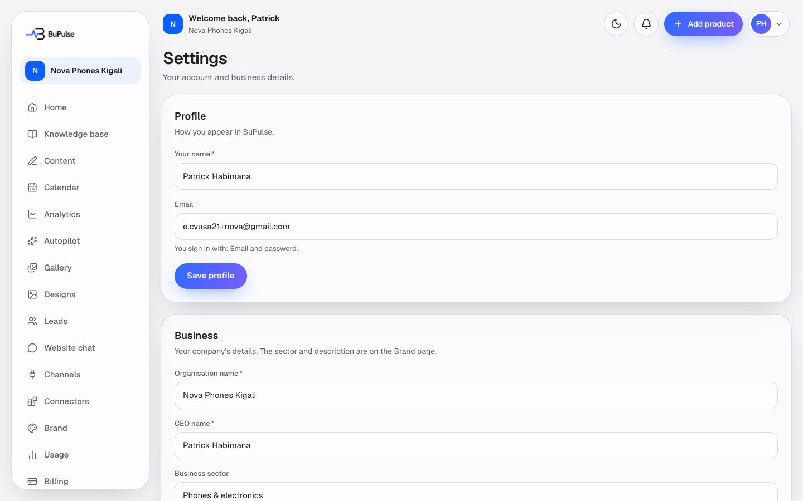
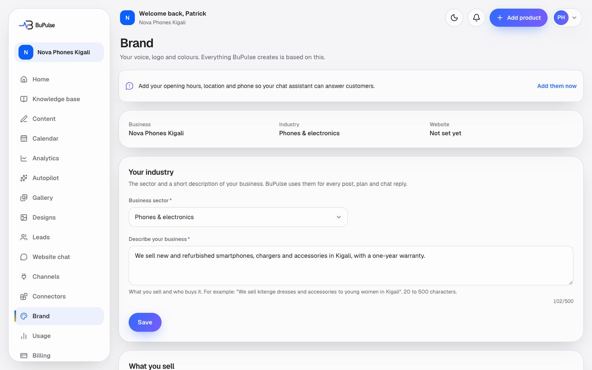

# Team, settings and brand

Three pages hold who the business is and who works in it. **Settings** has the person's own profile, the company
details, the Canva link, a team summary and account deletion. **Team** is where the Owner and Admins invite colleagues
and set their roles. **Brand** holds what every post is based on: what the business sells, its voice, the language of
its posts, its logo and colours, its sector, and the facts the website chat answers from.

**Page:** `/dashboard/settings`, `/dashboard/settings/team`, `/dashboard/brand`, plus `/invite/[token]` and
`/account/deletion`  **Plans:** every plan; no feature key. The number of users is the plan's `seats` limit: Starter 1,
Business 3 (seeded; Admin → Plans), more in a custom plan. Roles decide what each person sees (below).

## What you see

**Settings** (everyone):
- **Profile**: your name, and your email with how you sign in (Google, or email and password).
- **Business** (Owner and Admin): organisation name, CEO name, phone, website. The sector is changed on Brand; the
  country decides prices and currency and is changed only by BuPulse support.
- **Canva**: link or unlink your own Canva account ([Designs](05-designs.md)).
- **Team**: how many people are in the company, with a link to Team.
- **Danger zone**: delete your account (a teammate) or the whole company (the Owner), after 30 days.

**Team** (Owner and Admin): the members with their role, open invitations (Resend, Cancel), an invite form (email and
role), Change role, Remove, **Transfer ownership** (Owner), "Your email alerts" (Admins: also get the owner's new-lead,
daily digest, post reminder and failure emails), and a short history of team changes.

**Brand** (Owner and Admin): business, industry and website at the top; a reminder when the chat essentials are
missing; then cards for **Industry**, **What you sell**, **Brand voice** (Friendly, Professional, Bold, Playful, Luxury,
Caring), **content language** (English, French, Kinyarwanda, Swahili and 11 more), **Logo and colours** (up to 3
colours, taken from the logo if you like), and **Help your chat assistant** (opening hours, head office address,
WhatsApp or phone, FAQs). If an approved digital marketing profile exists ([Knowledge base](03-knowledge-base.md),
interview), it sets the voice and the preset is only a fallback.

## How to use it

**Invite a colleague**
1. Open **Team** (sidebar, or Settings → Team).
2. Type their email, choose **Admin** or **Member**, press **Send invitation**.
3. They get an email "<you> invited you to <business> on BuPulse". The link opens `/invite/<token>`, where they choose a
   name and password and press **Join the team** ([Sign-up and account states](02-sign-up-onboarding-and-account-states.md)).
   The link works for 7 days.
4. Roles: **Owner** = everything incl. billing and deleting the company; **Admin** = everything except billing and
   deleting the company (team, channels, connectors, widget, settings); **Member** = create, edit and schedule content
   and designs, and see leads.

**Change the brand**
1. Open **Brand**, change a card, press its save button. New content uses it straight away.
2. Change the content language to have posts written in, for example, Kinyarwanda.

**Delete an account**
1. Settings → Danger zone → type your email exactly → **Delete in 30 days**.
2. A teammate deletes only their own login; the company carries on.
3. The Owner deletes the whole company. With teammates, either transfer ownership first or tick the box to delete it for
   everyone. A card plan is cancelled at the end of its period first, so nobody is charged after asking to leave.
4. You are signed out. Signing in again in the next 30 days shows "Your account will be deleted on …" with **Keep my
   account**. Teammates see "Your company is being deleted". After 30 days everything is erased for good.

## Limits and settings

- Users: members plus open invitations count against the plan's seats. When full: "Your plan includes N users and all
  are taken."
- Nobody can be invited as Owner; ownership moves with **Transfer ownership**.
- Logo: PNG, JPEG or WebP, up to 5 MB. Up to 3 brand colours.
- Nothing on these pages counts against AI usage.
- The admin sees and manages companies and their users in **Admin → Companies** and **Admin → Users**.

## For developers

### Where it lives

| Part | Files |
|---|---|
| Pages | `app/dashboard/settings/page.tsx`, `app/dashboard/settings/team/page.tsx` (`pageGate("team")`), `app/dashboard/brand/page.tsx` (`pageGate("settings")`), `app/invite/[token]/page.tsx`, `app/account/deletion/page.tsx` |
| Server actions | `app/dashboard/settings/actions.ts` (`saveProfile`, `saveBusiness`, `scheduleAccountDeletion`), `app/dashboard/settings/canva-actions.ts` (`disconnectCanvaAction`), `app/dashboard/settings/team/actions.ts` (`inviteAction`, `resendInviteAction`, `cancelInviteAction`, `changeRoleAction`, `removeMemberAction`, `transferOwnershipAction`, `setAlertsAction`), `app/dashboard/brand/actions.ts` (`saveIndustry`), `app/dashboard/brand/language-action.ts` (`saveContentLanguage`), `app/onboarding/actions.ts` (`saveOffer`, `saveVoice`, `saveLook`, `saveKnowledge`, `createLogoUpload`, shared with onboarding), `app/invite/[token]/actions.ts`, `app/account/deletion/actions.ts` (`keepAccount`) |
| Components | `components/settings/settings-form.tsx` (`ProfileSection`, `BusinessSection`), `delete-account.tsx`, `team-card.tsx`, `canva-card.tsx`; `components/team/team-manager.tsx`, `invite-form.tsx`; `components/brand-profile/brand-section.tsx`, `industry-section.tsx`, `steps.ts`, `look-fields.tsx`, `voice-picker.tsx`, `knowledge-fields.tsx`; `components/studio/language-section.tsx`; `components/business-info/essentials-banner.tsx` |
| Logic | `lib/team/roles.ts` (roles and permissions), `lib/team/service.ts` (seats, invites, roles, transfer), `lib/team/recipients.ts` (who gets alerts), `lib/team/company.ts`; `lib/brand/schemas.ts`, `lib/brand/voices.ts`, `lib/brand/languages.ts`, `lib/brand/colors.ts`, `lib/brand/image-colors.ts`; `lib/account-deletion.ts`; `lib/storage.ts` (`BUCKETS`) |
| Database | `User` (`deletionScheduledFor`), `Business` (name, logo, colours, voice, `contentLanguage`, `knowledge`, `marketingProfile`), `Membership` (role, `notifyEmail`), `Invite` (`tokenHash`, `expiresAt`, `acceptedAt`) |
| API routes | none of their own |
| Cron jobs | `app/api/cron/purge-accounts/route.ts`, daily at 03:17 UTC by `.github/workflows/purge-accounts.yml` |
| Tests | `tests/team/*.test.ts` (roles, team.db, gated-actions, recipients, require-user), `tests/account-deletion.test.ts`, `tests/cron-purge-route.test.ts`, `tests/account/*.test.ts` |
| Docs | [docs/BUSINESS_INFO.md](../../BUSINESS_INFO.md) (hours, locations, contacts), [docs/INDUSTRIES.md](../../INDUSTRIES.md) |

### Key functions

- `PERMISSIONS`, `can`, `assignableRoles`, `askMessage` (`lib/team/roles.ts`) — the one table of who may do what; every action checks it.
- `requireActiveUser(permission)` (`lib/auth/require-user.ts`) and `pageGate(permission)` (`components/app/no-access.tsx`) — enforce it in actions and pages.
- `seatLimit`, `seatsUsed` (`lib/team/service.ts`) — the plan's `seats` and members plus open invites.
- `createInvite`, `resendInvite`, `cancelInvite` (`lib/team/service.ts`) — invitations; the token is stored hashed (`hashToken`) and lasts 7 days (`INVITE_TTL_MS`).
- `previewInvite`, `acceptInvite` (`lib/team/service.ts`) — the `/invite/[token]` page and joining.
- `changeRole`, `removeMember`, `transferOwnership`, `setMyAlerts` (`lib/team/service.ts`) — team management.
- `alertRecipients` (`lib/team/recipients.ts`) — the owner plus teammates who switched alerts on.
- `saveStep` (`components/brand-profile/steps.ts`) → `saveOffer` / `saveVoice` / `saveLook` / `saveKnowledge` (`app/onboarding/actions.ts`) — the brand cards.
- `validateKnowledge`, `readKnowledge`, `isOwnLogoPath` (`lib/brand/schemas.ts`) — chat facts and logo checks.
- `scheduleAccountDeletion` (`app/dashboard/settings/actions.ts`) — locks the login (or the company) for 30 days and cancels card billing at period end.
- `purgeDueAccounts` (`lib/account-deletion.ts`) — erases accounts past their date: files in `brand`, `media`, `designs`, `gallery-videos`, invoice PDFs and payment screenshots, then the rows; also `sweepOrphanLogins`.

### How it works

1. **Invite**: `inviteAction` → `createInvite` (role check, seat check under a lock, hashed token) → `sendInviteEmail`
   → the invitee opens `/invite/<token>` → `previewInvite` → form → `acceptInvite` creates the login and `Membership`.
2. **Brand card save**: `BrandSection` → `saveStep(step, values)` → the onboarding action validates with
   `lib/brand/schemas.ts` and updates `Business`. The AI writers read these fields for every post.
3. **Delete**: `scheduleAccountDeletion` → email check → (Owner) cancel the card plan at period end via
   `billingAdapter(...).cancelAtPeriodEnd` and `applyProviderSubscription` → set `User.deletionScheduledFor` (+30 days)
   → sign out. Signed-in pages redirect a locked user to `/account/deletion` (`keepAccount` clears the date).
4. **Daily purge**: the GitHub workflow POSTs `/api/cron/purge-accounts` with `CRON_SECRET` → `purgeDueAccounts`.

## If something goes wrong

| Symptom | Look first | Usual fix |
|---|---|---|
| "Your plan includes N users and all are taken" | `seatLimit` / `seatsUsed` (`lib/team/service.ts`); Admin → Plans (`seats`) | Cancel an open invitation or remove someone, or add users in a custom plan. |
| Invitation email never arrives | `sendInviteEmail`; email setup ([docs/EMAIL_SETUP.md](../../EMAIL_SETUP.md)); Admin → Errors | Press Resend; check the email provider settings. |
| "This invitation was already used" / "This link is not valid" | `previewInvite` | Sign in if it was you; otherwise send a new invitation. |
| A teammate cannot see Billing or Channels | `PERMISSIONS` in `lib/team/roles.ts` | Expected for Members (and Billing for Admins). Change their role in Team. |
| "This sign-in holds the company account" when deleting | `scheduleAccountDeletion` | Ownership was transferred away from the company login: transfer it back, or ask support. |
| "We could not cancel your plan's billing just now" | Paddle; Admin → Errors (`settings.delete.cancel-billing`) | Try again in a few minutes; nothing was changed. |
| Deleted account still there after 30 days | Admin → Health (cron runs `purge-accounts`); `.github/workflows/purge-accounts.yml` | Check the workflow runs and `CRON_SECRET`; a storage error stops that account's purge until the next run. |
| Logo does not show on Brand | `isOwnLogoPath`, the `brand` bucket | Upload the logo again (PNG, JPEG or WebP, 5 MB). |
