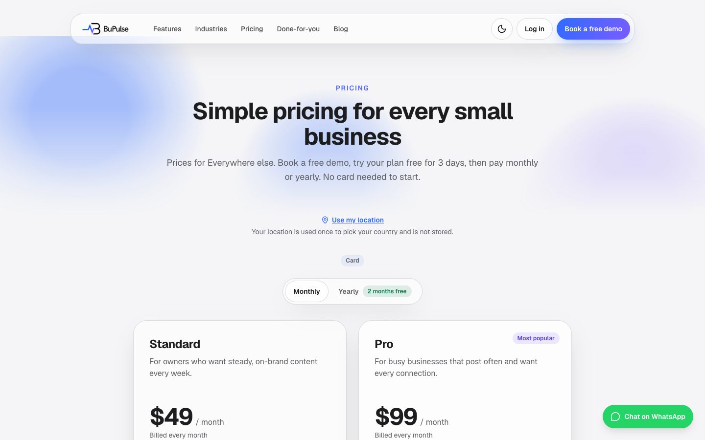
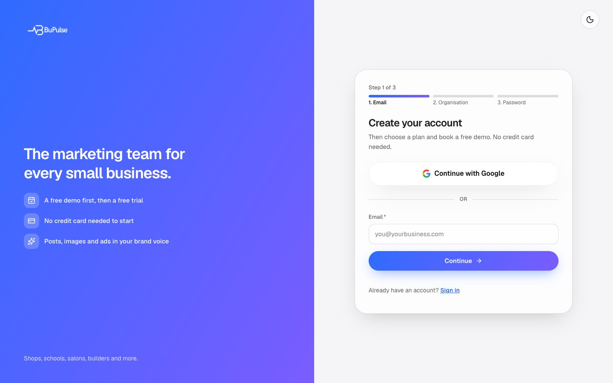
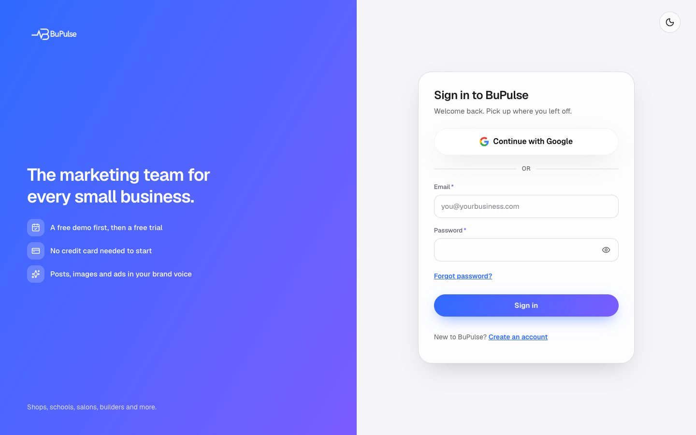
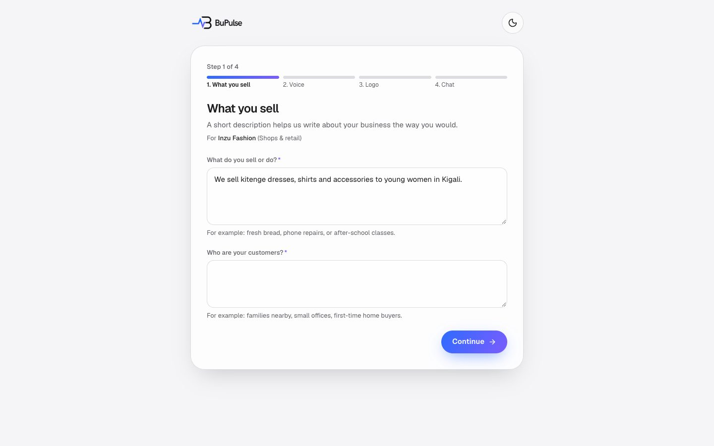
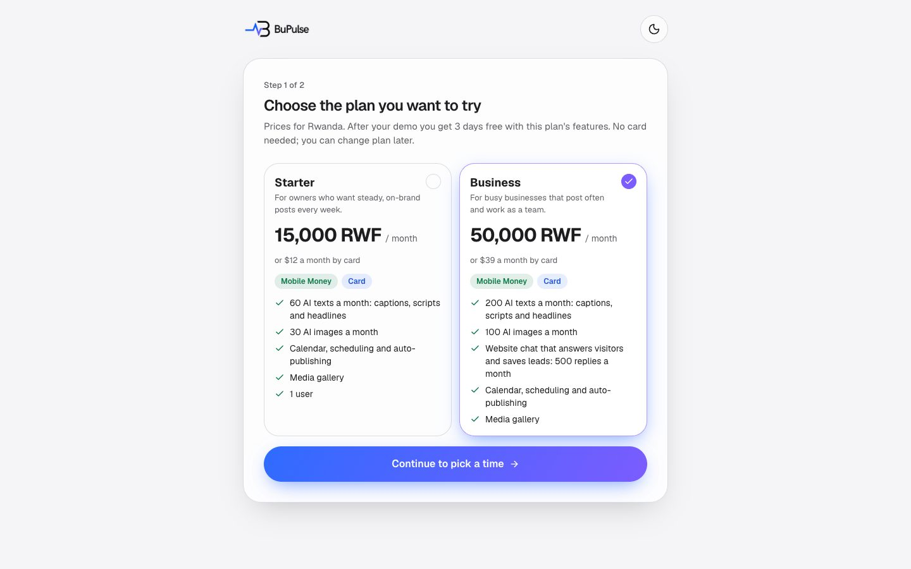
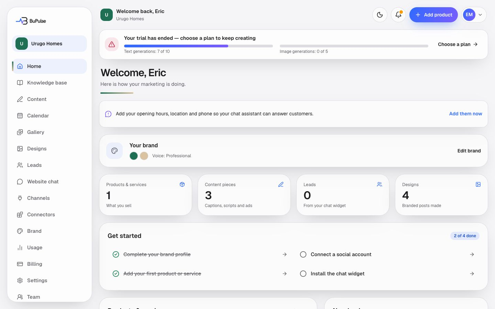
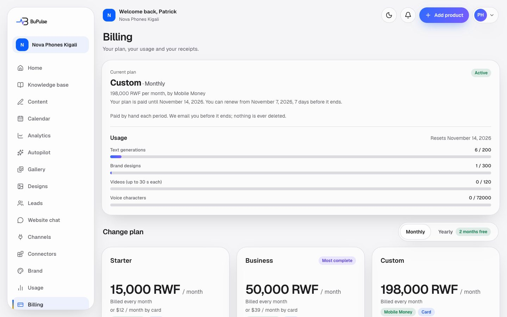
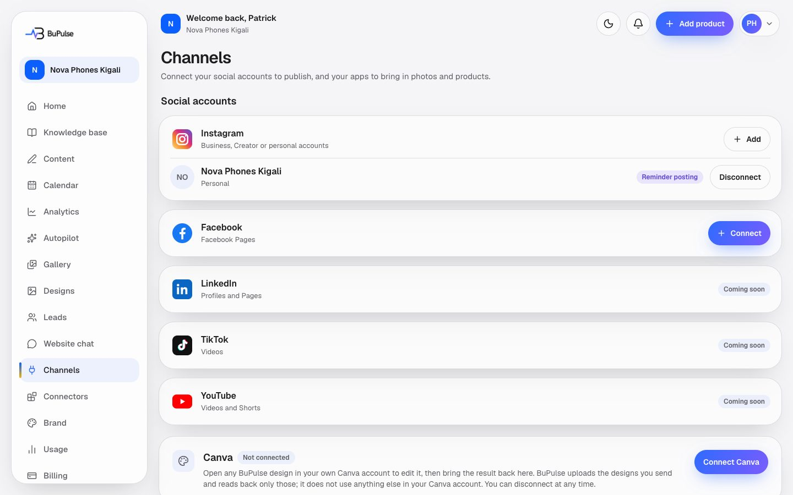
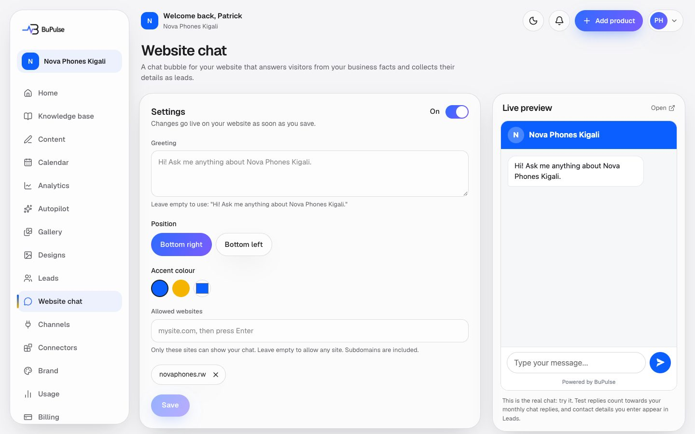
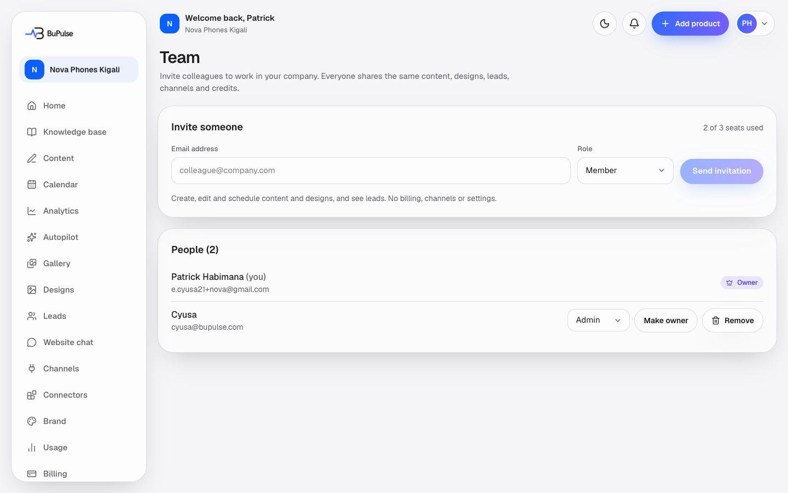

# Client setup: from sign-up to the first post

This page follows a new client (a business owner) through their first days with BuPulse: creating the account,
setting up the brand, booking the demo, the free trial, paying by Mobile Money or card, connecting Instagram,
Facebook, LinkedIn, TikTok and YouTube, adding the website chat to their site, making the first post and inviting
their team. Use it to help a client on the phone or in person. Each section says what the client does, and what the
BuPulse team does in the admin console when it is needed.

**On this page**
- [Before you start](#before-you-start)
- [1. Sign up](#1-sign-up)
- [2. Set up the brand (onboarding)](#2-set-up-the-brand-onboarding)
- [3. Book the demo and wait for it](#3-book-the-demo-and-wait-for-it)
- [4. The free trial](#4-the-free-trial)
- [5. Pay: Mobile Money or card](#5-pay-mobile-money-or-card)
- [6. Connect the social accounts](#6-connect-the-social-accounts)
- [7. Add the website chat to the client's site](#7-add-the-website-chat-to-the-clients-site)
- [8. The first post](#8-the-first-post)
- [9. Invite the team](#9-invite-the-team)
- [For developers](#for-developers)

## Before you start

The client needs: an email address they can open, a phone (for Mobile Money), and ideally their logo, opening hours,
head office address and a WhatsApp or phone number. To connect Instagram automatically they need an Instagram
**Business or Creator** account linked to a Facebook Page.

Prices are on `/pricing`. They follow where the visitor is (Rwanda shows RWF; East Africa and the rest of the world
have their own prices). "Use my location" on that page corrects a wrong guess.



## 1. Sign up

<video src="../videos/public-signup.webm" controls muted width="100%"></video>

[Watch the sign-up clip](../videos/public-signup.webm) (silent).

1. On bupulse.com press **Sign up** (or go to `/signup`).
2. Three short steps: **Email**, then **Organisation** (organisation name, CEO name, business sector, country, phone,
   website optional), then **Password** (twice) and the terms.
3. BuPulse sends a confirmation email from `register@bupulse.com`. The client opens it and presses the button. (It works
   on any device, also when the email is opened on a phone.)
4. Or **Continue with Google** instead: no confirmation email, and the organisation details are asked on `/welcome`.



Each account uses one sign-in method: a Google account signs in with Google, a password account with its password.
Next time the client signs in at `/login`.



If the email does not arrive: check spam, then use "resend" on the confirmation screen. See
[Troubleshooting](../troubleshooting.md#sign-in-and-accounts).

## 2. Set up the brand (onboarding)

Four steps at `/onboarding`. Each **Continue** saves, so a refresh carries on where the client was.

| Step | What the client fills in | Can skip? |
|---|---|---|
| 1. What you sell | A short description of the business and who it is for | No |
| 2. Voice | How the posts should sound | No |
| 3. Logo | Logo and brand colours, used on the designs | Yes, "I'll add these later" |
| 4. Chat | Opening hours, head office address, a WhatsApp or phone number (FAQs optional). The website chat answers visitors from this. | No |



Everything can be changed later in **Brand** and **Knowledge base**.

## 3. Book the demo and wait for it

No trial starts at sign-up. The client first books a demo call with the BuPulse team.

1. `/book-demo`, step 1: choose the plan to try (the plans sold in the client's region).
2. Step 2: pick a free time. Times are Kigali time and at least 2 hours ahead.
3. The client gets an email with the meeting link, **Add to Google Calendar** and an `.ics` file for Apple or
   Outlook calendars. The BuPulse team gets a copy.



Until the trial starts, every dashboard page shows only the demo screen: the time, **Join**, **Add to calendar**,
**Reschedule** and **Cancel** (both up to 2 hours before), and for the owner **Pay for <plan>** if they want to skip the
trial and pay now.

(No screenshot yet: none of the test accounts is waiting for a demo right now.)

**BuPulse team:** Admin → **Demos** lists the bookings. After the call, mark it done and press **Start trial**. Or skip
the trial and send an invoice: the client then sees the invoice and how to pay it instead of the demo screen.

## 4. The free trial

When the team starts the trial, the dashboard opens. The trial gives the chosen plan's features with the trial's
limits. A banner shows the days left.



The client gets a reminder a day before and on the last day. When the trial ends without payment, the account becomes
read-only: nothing is deleted, and paying reopens it.

## 5. Pay: Mobile Money or card

Only the company **Owner** can pay. Go to **Billing**, choose the plan and **monthly** or **yearly**, then answer
"How would you like to pay?": **Mobile Money (MTN / Airtel)** or **Card**. A method that is not ready yet shows as
"coming soon"; one the region does not offer shows "not available in your region".



### Mobile Money (checked by hand)

1. The pay screen shows the amount and a **reference** such as `BP-7K3Q` (copy buttons).
2. MTN: dial the **MoMo Pay code** shown (`*182*8*1*<code>#`; on a phone, tap to dial). Airtel: dial `*182#`, Send
   money, to the Airtel number shown. Use the reference.
3. Press **I have paid**: choose the network, type the phone number paid from and the **transaction id** from the
   confirmation SMS, and add a **screenshot** of the confirmation. No transaction id? Tick "I can't find it" (the
   screenshot is then required).
4. **Send for approval**. The screen says "Thanks. We are checking your payment now." and updates by itself.
5. **BuPulse team:** Admin → **Payments** (or the Overview's "Waiting for approval"): compare with the MoMo message on
   the business phone, then **Confirm** (or **Reject** with a reason). The client sees "You are all set. Your plan is
   active." and gets an email.

Mobile Money does not renew by itself: the client gets reminders 5 days and 1 day before the end, with a "Pay now"
link. They can renew in the last 7 days of a period without losing a day. After the end there are 3 days of grace, then
the account becomes read-only until they pay.

### Card (Paddle, renews by itself)

1. Choose **Card**. Paddle's secure checkout opens over the page.
2. Pay. Paddle tells BuPulse by itself and the plan becomes active within seconds (the page waits for it).
3. Card plans renew automatically every month or year. The client can cancel in Billing (the plan stays active until
   the end of the period) and download invoices there.

Card only works once the BuPulse team has set up Paddle (Admin → Settings → Card payments). Until then clients see
"Card payments coming soon" and pay by Mobile Money.

## 6. Connect the social accounts

Owner or Admin only. **Channels** in the sidebar (`/dashboard/connections`).



| Network | How it connects | What BuPulse does today |
|---|---|---|
| Instagram, **Professional** (Business or Creator) | Sign in with Instagram (or "through Facebook") | Posts by itself at the scheduled time. Pictures are turned into JPEG automatically. |
| Instagram, **Personal** | Type the username, no login | Sends a reminder with the caption and photos ready; the client posts by hand and presses "I posted it" |
| Facebook Pages | Sign in with Facebook, tick the Pages | Posts by itself |
| LinkedIn | Sign in with LinkedIn | Posts to the person's profile; company Pages only once LinkedIn approves BuPulse (Community Management) |
| TikTok | Sign in with TikTok | Photo posts once TikTok approves BuPulse; until TikTok's audit passes, posts are private |
| YouTube | Sign in with Google | Video scripts and reminders; BuPulse does not upload videos yet |

1. Press **Connect** on the network and approve BuPulse on the network's own page.
2. If the login has several accounts (for example several Pages), tick the ones to add and save.
3. The account shows **Active**. **Expires soon** or **Needs reconnect** means: press **Reconnect**.

**Coming soon** instead of Connect means BuPulse's own app keys for that network are not set yet. **Facebook and
Instagram for real clients** wait for Meta's Business Verification and App Review: until then only people with a role on
BuPulse's Meta app can connect, and clients use reminders plus copy-and-post (`docs/META_APP_REVIEW.md`).

More: [Social connections](../features/13-social-connections.md).

## 7. Add the website chat to the client's site

Owner or Admin only. **Website chat** in the sidebar (`/dashboard/widget`).



1. Open the page once: this creates the chat for the business. Turn it on and check the greeting and colours in the
   live preview.
2. Optional: list the client's website domains under **Allowed websites** (empty = any site). A domain covers its
   subdomains.
3. Choose the client's website platform (HTML, WordPress, Next.js, React, Shopify, Wix, Squarespace, Webflow, Google
   Tag Manager). A guide shows where to paste, with the exact code and a **Copy** button. The code is one line:

   ```html
   <script src="https://bupulse.com/widget.js" data-key="WIDGET_KEY" async></script>
   ```

   (The page fills in the client's real key.) It goes just before `</body>`.
4. Open the client's website once, then press **Check installation** and type **Your page address**.
5. Site on Cloudflare? **Your domains** (`/dashboard/domains`) can add the chat in one click after connecting
   Cloudflare.

The chat answers visitors only from what the business wrote (opening hours, addresses, contacts, FAQs, products), and
asks interested visitors for their contact details. Each contact becomes a **lead** in **Leads**, with an email to the
team. Every AI answer uses one chat credit from the plan; when they run out, visitors can still leave their details.

## 8. The first post

1. Connect at least one account first (step 6).
2. **Content** → **Create today's content** (or "AI makes it"): BuPulse writes a post for each chosen network from the
   business's products, campaigns and photos, with a picture or video. The client checks it and approves.
3. Or **Calendar** → **Create post**: tick the accounts, write the text once (change it per network in its tab), add
   photos or a video from the Gallery or Designs, choose **when**, and schedule.
4. The post goes out at its time (within 5 minutes on the current host). It shows **Published** on the calendar.
   **Post it yourself** means a reminder email was sent (personal Instagram, YouTube scripts); **Failed** shows the
   reason and a **Retry** button.

More: [Calendar and publishing](../features/07-calendar-and-publishing.md).

## 9. Invite the team

Owner or Admin. **Team** in the sidebar (`/dashboard/settings/team`).



1. **Invite someone**: their email and a role.

   | Role | Can do |
   |---|---|
   | Owner | Billing, the plan and deleting the company, plus everything an Admin can do |
   | Admin | Everything except billing and deleting the company: team, channels, connectors, website chat, settings |
   | Member | Create, edit and schedule content and designs, and see leads. No billing, channels or settings |

2. They get an email. The link works once and expires in **7 days** (resend it from the Team page if needed).
3. They open it, choose a name and a password, and land in the same company's dashboard.

Each plan has a number of seats; open invitations count as seats. The Owner can hand over ownership to another member
from the same page.

## For developers

| Step | Pages and actions | Logic |
|---|---|---|
| Sign up | `app/signup/page.tsx`, `app/signup/actions.ts` (`checkEmail`, `signUp`, `resendConfirmation`), `components/auth/signup-form.tsx`; `app/auth/confirm/route.ts`, `app/auth/callback/route.ts` (Google) | Supabase Auth; Turnstile via `turnstileSiteKey()` (`lib/widget/turnstile.ts`) |
| Organisation (Google) | `app/welcome/page.tsx`, `app/welcome/actions.ts` (`saveOrganisation`) | |
| Onboarding | `app/onboarding/page.tsx`, `app/onboarding/actions.ts` (`saveOffer`, `saveVoice`, `saveLook`, `saveKnowledge`, `createLogoUpload`, `finishOnboarding`), `components/onboarding/onboarding-wizard.tsx`, step titles `STEP_TITLES` in `components/brand-profile/steps.ts` | |
| Demo | `app/book-demo/page.tsx`, `app/book-demo/actions.ts` (`choosePlanAction`, `bookDemoAction`), `components/app/demo-lock.tsx`, `components/app/demo-pay.tsx` | `lib/demo/bookings.ts`, `lib/demo/slots.ts`, `lib/demo/ics.ts`; admin `startTrial` in `lib/admin/demos.ts` |
| Gating | `app/dashboard/layout.tsx` (`getAppContext` from `components/app/context.ts`, `DemoLock`, `InvoiceLock`) | `accountBlock` (`lib/entitlements.ts`), `consumeUsage` (`lib/usage.ts`), `periodState` (`lib/billing/period.ts`) |
| Trial end | | `processTrialReminders` (`lib/demo/trial-reminders.ts`), cron `/api/cron/trial-reminders` |
| Mobile Money | `app/dashboard/billing/actions.ts` (`startMomoPayment`, `startMomoProofUpload`, `submitMomoProof`, `cancelMomoPayment`, `momoPaymentStatus`), `components/billing/momo-payment.tsx`, `components/billing/pay-choice.tsx` | `lib/billing/momo.ts` (`startManualPayment`, `submitManualProof`, `confirmManualPayment`, `rejectManualPayment`), `lib/billing/momo-proofs.ts`, `lib/billing/pay-methods.ts`; admin `app/admin/(console)/(money)/payments/` |
| Card | `startCheckout`, `changePlan`, `cancelSubscription`, `resumeSubscription`, `checkoutActivated` in `app/dashboard/billing/actions.ts` | `lib/billing/paddle.ts`, webhook `app/api/billing/webhooks/paddle/route.ts` → `processPaddleEvent` (`lib/billing/paddle-events.ts`) → `applyProviderSubscription` (`lib/billing/apply.ts`); readiness `lib/billing/card-ready.ts` |
| Channels | `app/dashboard/connections/page.tsx`, `actions.ts` (`disconnectAction`, `connectReminderAction`, `savePickedAccountsAction`, `cancelPickAction`), `app/api/social/[network]/connect/route.ts`, `app/api/social/[network]/callback/route.ts` | `lib/social/registry.ts`, `lib/social/oauth.ts` (`redirectUri`), `lib/social/providers/*.ts` |
| Website chat | `app/dashboard/widget/page.tsx`, `actions.ts` (`saveWidgetSettings`), `check-action.ts`, `components/widget/install-check.tsx`; `app/dashboard/domains/` | `lib/widget/install.ts` (platform guides), `lib/widget/chat.ts` (`handleChat`, `handleLead`), `public/widget.js`, `app/widget/[key]/route.ts`; Cloudflare install `lib/cloudflare/zaraz.ts` |
| First post | `app/dashboard/content/`, `app/dashboard/calendar/` | `lib/content-flow/service.ts`, `lib/publishing/service.ts`, `lib/publishing/engine.ts` (`publishDue`) |
| Team | `app/dashboard/settings/team/actions.ts` (`inviteAction`, `resendInviteAction`, `cancelInviteAction`, `changeRoleAction`, `removeMemberAction`, `transferOwnershipAction`), `app/invite/[token]/` | `lib/team/service.ts` (`seatLimit`), roles `lib/team/roles.ts` (`ROLES`, `ROLE_LABEL`) |

Deeper notes: `docs/REGIONS.md` (demo-first trial), `docs/MOMO.md`, `docs/BILLING.md`, `docs/WIDGET.md`,
`docs/PLATFORM_APPS.md`, and [Sign-up, onboarding and account states](../features/02-sign-up-onboarding-and-account-states.md).
